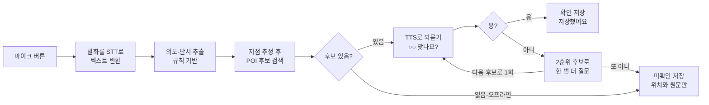

# 다음에 가게 — 개발 기획서

작성일 2026-11-08 · 작성자 재원 (easycd)

## 1. 문서 개요

이 문서는 Pleos Connect 앱 '다음에 가게'를 실제로 개발하기 위한 기획서다. 공모전 제출용 기획서(docs/contest-application-consent.docx)가 '왜 만드는가'를 설명했다면, 이 문서는 '무엇을, 어떤 순서로, 어떤 SDK로 만들 것인가'를 정한다.

- 범위: 앱의 기능 정의, 사용자 흐름, 음성 대화 규칙, 데이터, 비기능 요구사항, SDK 사용 계획, 개발 범위와 일정
- 범위 밖: 화면 레이아웃과 UI 상세(화면 설계서에서 다룸), 클래스·모듈 구조와 API 명세(기술서에서 다룸)
- 기준 문서: [Pleos 개발자 문서](https://document.pleos.ai/docs/pleos-only/connect-sdk-pleos/SpeechToText/intro)의 Connect SDK 5종(SpeechToText, TextToSpeech, FusedLocation, NaviHelper, Vehicle)
- 후속 문서: 화면 설계서 → 기술서 순서로 작성하며, 이 문서의 기능 ID(F-xx)를 두 문서에서 그대로 참조한다.

이 문서에서 결정이 필요한 항목은 마지막 장 '확인이 필요한 사항'에 모아 두었다.

## 2. 서비스 개요

'다음에 가게'는 운전 중 스쳐 지나간 가게를 말 한마디로 저장하면, 다시 지나갈 때 Pleos가 대신 기억해 알려 주는 차량용 맛집 메모·추천 앱이다.

| 항목 | 내용 |
| --- | --- |
| 앱 이름 | 다음에 가게 (영문 패키지명은 확인 필요) |
| 플랫폼 | Pleos Connect (Android Automotive OS) 차량 앱, Kotlin |
| 해결하는 문제 | 운전 중 본 가게는 이름도 모르고 메모도 못 해 금방 잊히고, 다시 그 길을 지나도 떠올리지 못한다 |
| 핵심 가치 | 손과 눈을 떼지 않고 말 한마디로 저장, 차량 위치·진행 방향으로 가게 자동 특정, 근처를 지날 때 차량이 먼저 알려 줌 |
| 사용자에게 남는 경험 | "Pleos가 기억해 준 덕분에 그 집에서 맛있게 먹었다"는 작은 성공이 반복된다 |
| 개발 체제 | 1인 개발, 약 12주 |

핵심 기능은 네 가지다. 말 한마디로 저장, 지나칠 때 리마인드, 동승자와 함께 고르는 추천, 나만의 맛집 지도와 공유다. 네 기능 모두 음성이 기본 입력이고 화면은 보조다.

## 3. 사용자와 사용 환경

주 사용자는 운전자이고, 추천과 지도 화면은 동승자도 함께 본다. 모든 기능은 주행 중 상황을 기본으로 설계하고, 정차 중에만 세부 화면을 연다.

| 사용자 | 상황 | 앱에 바라는 것 |
| --- | --- | --- |
| 운전자 (주행 중) | 가게를 스쳐 지나감, 저장한 가게 근처를 지남 | 버튼 한 번과 말 한마디로 끝나고, 응답은 음성으로 돌아온다 |
| 운전자 + 동승자 | "뭐 먹을까" 고민 중 | 후보 2\~3곳을 음성과 화면으로 보고 바로 길안내를 시작한다 |
| 운전자 (정차 중) | 저장 목록 정리, 잘못 매칭된 가게 수정, 지도 공유 | 터치로 편집하는 일반 앱 수준의 화면 |
| 공유받는 사람 | 링크로 받은 맛집 지도를 열어 보고 내 앱에 가져옴 | 가게 목록을 한 번에 저장한다 |

**차량 환경의 전제**

- 단말: Pleos Connect가 탑재된 차량의 중앙 디스플레이. 개발과 검증은 Pleos Connect Emulator에서 한다.
- 입력: 차량 마이크(SpeechToText SDK)와 터치. 웨이크워드가 없으므로 음성 입력은 화면의 큰 버튼으로 시작한다.
- 출력: 차량 스피커(TextToSpeech SDK)와 화면. 주행 중 화면은 한 번에 한 가지만 크게 보여 준다.
- 위치: FusedLocation SDK가 주는 위도·경도·진행 방향(heading). 스마트폰 GPS보다 안정적이고 진행 방향을 바로 얻는다.
- 네비게이션: NaviHelper SDK로 목적지를 넘기고 주행 상태 이벤트를 받는다.
- 네트워크: 차량 통신을 쓰지만 터널·산간에서 끈길 수 있다. 저장 요청은 오프라인에서도 유실되지 않아야 한다.

**주행 중 제약 (설계 원칙)**

1. 한 번의 상호작용은 버튼 1회 + 발화 1회 + 대답 1회를 넘지 않는다.
2. 주행 중에는 목록 스크롤, 키보드 입력, 지도 탐색을 열지 않는다. 이 화면들은 정차 상태(주차 브레이크 또는 속도 0)에서만 연다.
3. 음성 안내는 짧고(10초 이내) 한 번에 한 가지만 말한다. 같은 가게 리마인드는 하루 1회를 넘지 않는다.
4. 가게를 특정하지 못해도 위치와 발화 원문을 먼저 저장하고, 정차 후 확인하게 한다. 기록은 어떤 경우에도 잃지 않는다.

## 4. 핵심 사용자 흐름

네 흐름 모두 '발화 → 앱 판단 → 음성 확인 → 실행' 한 바퀴로 끝난다. 저장 흐름이 핵심이며 나머지는 저장된 데이터를 꺼내 쓰는 흐름이다.

**흐름 A. 말 한마디로 저장 (핵심)**

1. 운전자가 화면의 마이크 버튼을 누른다. 앱은 이 순간의 위치·진행 방향을 '말한 곳'으로 고정하고, 직전 30초의 위치 버퍼도 함께 고정한다. 말하는 동안 차가 계속 움직여도(최대 15초, 시속 60km면 약 250m) 이후 가게 찾기는 모두 이 고정 위치를 기준으로 하고 실시간 위치는 다시 읽지 않는다.
2. "방금 지난 빨간 간판 고깃집 저장해줘"라고 말한다. STT가 문장을 텍스트로 바꾼다.
3. 앱이 의도(저장)와 단서(업종 '고깃집', 간판 색 '빨간', 시점 '방금', 방향 '오른쪽' 등)를 뽑는다.
4. '방금'에 해당하는 지점(기본 10\~20초 전 구간) 주변 반경 150m의 POI를 검색하고(시점 단서가 없으면 말한 곳 주변), 업종·이름·좌우 방향으로 점수를 매겨 1순위를 고른다.
5. TTS가 "서울갈비 맞나요?"라고 되묻는다. "응"이면 저장하고 "저장했어요"로 끝난다. "아니"면 2순위를 한 번 더 묻고, 그래도 아니면 위치와 원문만 '미확인 가게'로 저장한다.
6. 후보가 없거나 네트워크가 없으면 되묻지 않고 "위치를 기억해 둘게요, 멈추면 확인해 주세요"로 바로 저장한다.

후보가 없거나 두 번 아니라고 하면 미확인 저장으로 끝나고, 미확인 가게는 정차 후 정리 화면(F-07)에서 확정한다.

**흐름 B. 지나칠 때 리마인드**

1. 저장된 가게마다 반경 500m 근접 알림을 등록한다.
2. 근접 알림이 오면 필터를 거친다. 식사 시간대(11\~14시, 17\~20시)인가, 오늘 이미 안내했는가, 네비 목적지가 따로 있는가, 직전 안내 후 10분이 지났는가.
3. 통과하면 TTS가 "지난주에 저장한 서울갈비가 300m 앞이에요. 갈까요?"라고 묻는다.
4. "응"이면 NaviHelper로 목적지를 설정한다. 대답이 없거나 "아니"면 조용히 끝내고 화면에 작은 카드만 남긴다.

**흐름 C. 동승자와 함께 고르는 추천**

1. 마이크 버튼 후 "뭐 먹을까" 또는 "근처 저장한 데 있어?"라고 말한다.
2. 앱이 저장 가게 중 말한 곳(마이크 버튼이나 '뭐 먹을까' 카드를 누른 순간 고정한 위치) 기준 거리, 영업 여부, 메모·방문 기록, 마지막 방문 경과를 점수화해 상위 3곳을 고른다.
3. TTS가 세 곳을 번호와 함께 읽고, 화면에 카드 3장을 크게 보여 준다. 결과가 나온 뒤 차가 움직여도 순서와 거리는 바뀌지 않아, 읽어 준 번호와 화면의 번호가 어긋나지 않는다. 동승자가 터치로 고를 수도 있다.
4. "2번" 또는 가게 이름을 말하면 NaviHelper로 목적지를 설정하고 안내를 시작한다.

**흐름 D. 나만의 맛집 지도와 공유 (정차 중)**

1. 지도 화면에 저장 가게(회색)와 방문 가게(채색)가 핀으로 쌍인다. 미확인 가게는 물음표 핀으로 보여 주고, 누르면 후보 목록에서 고를 수 있다.
2. 방문은 네비 목적지 도착 이벤트와 해당 위치 체류(10분 이상)로 자동 기록한다. 방문 후 "여기 괜찮았어" 같은 짧은 음성 메모를 남길 수 있다.
3. 공유할 가게를 골라 '공유 링크 만들기'를 누르면 링크와 QR이 만들어진다. 받는 사람은 링크를 열어 목록을 보고, 앱이 있으면 '내 지도에 추가'로 가져온다.

## 5. 기능 요구사항

MVP는 저장·리마인드·추천·지도·공유까지 공모전 기획서에 약속한 네 기능을 모두 포함하고, 방문 인증 리뷰와 LLM 문장 분석은 확장으로 둔다. 기능 ID는 화면 설계서와 기술서에서 그대로 쓴다.

| ID | 기능 | 설명 | 우선순위 | 사용 SDK/API |
| --- | --- | --- | --- | --- |
| F-01 | 음성 입력 시작 | 화면 마이크 버튼으로 녹음 시작, 부분·최종 인식 텍스트 수신, 발화 종료 자동 감지 | MVP | SpeechToText |
| F-02 | 위치 버퍼 | 주행 중 1초 간격 위치·진행 방향을 최근 60초분 메모리에 보관. 마이크 버튼을 누른 순간 현재 위치와 버퍼를 '말한 곳'으로 고정해 저장·추천 검색의 기준으로 씀 | MVP | FusedLocation |
| F-03 | 발화 분석 (규칙 기반) | 의도(저장/추천/메모/취소)와 슬롯(업종, 색, 이름, 시점, 방향) 추출. 네트워크 없이 동작 | MVP | 앱 내부 |
| F-04 | 가게 후보 검색 | 추정 지점 주변 POI를 검색하고 업종·이름·좌우로 점수화해 상위 2곳 선정 | MVP | 카카오 로컬 API (확인 필요) |
| F-05 | 음성 확인 대화 | 후보를 TTS로 되묻고 예/아니오 대답을 STT로 받아 확정. 무응답 5초면 미확인 저장 | MVP | TextToSpeech, SpeechToText |
| F-06 | 가게 저장 | 가게 정보, 저장 시각·위치, 발화 원문, 상태(확인/미확인)를 로컬 DB에 저장 | MVP | Room |
| F-07 | 미확인 가게 정리 | 정차 중 후보 목록에서 고르거나 검색해 확정, 또는 삭제 | MVP | 카카오 로컬 API |
| F-08 | 근접 리마인드 | 저장 가게 반경 500m 진입 시 필터를 거쳐 TTS 안내, '갈까요' 응답 시 길안내 | MVP | FusedLocation(addProximityAlert), TextToSpeech, NaviHelper |
| F-09 | 추천 | 말한 곳 기준 거리·영업·메모·방문 기록으로 상위 3곳 선정, TTS와 카드로 제시, 번호·이름·터치로 선택 | MVP | TextToSpeech, SpeechToText |
| F-10 | 길안내 연동 | 선택한 가게를 네비 목적지로 설정하고 도착 이벤트 수신 | MVP | NaviHelper |
| F-11 | 방문 기록 | 네비 도착 + 10분 체류를 방문으로 기록, 음성 한 줄 메모 | MVP | NaviHelper, FusedLocation, SpeechToText |
| F-12 | 나만의 맛집 지도 | 저장·방문·미확인 가게를 지도와 목록으로 표시, 가게 상세·수정·삭제 | MVP | 지도 SDK (확인 필요) |
| F-13 | 맛집 지도 공유 | 선택한 가게 목록을 공유 링크·QR로 내보내고, 받은 목록을 내 지도에 가져오기 | MVP | 공유 방식 확인 필요 (9장) |
| F-14 | 주행 상태 판단 | 정차 여부를 판단해 세부 화면 열림을 제어 | MVP | Vehicle(Brake 주차 브레이크), FusedLocation 속도 |
| F-15 | 설정 | 리마인드 켜기/끄기, 반경, 식사 시간대, 음성 안내 음량 | MVP | 앱 내부 |
| F-16 | LLM 문장 분석 보강 | 규칙으로 못 푸는 발화를 LLM API로 2차 분석 | 확장 | LLM API |
| F-17 | 방문 인증 리뷰 | 네비 도착·체류가 확인된 가게에만 별점·한 줄 평가 | 확장 | NaviHelper, FusedLocation |
| F-18 | Pleos 맛집 리스트 | 익명 집계 점수로 만드는 공용 리스트 | 확장 | 서버 필요 |
| F-19 | 글레오 음성 비서 연동 | 핸들 음성 버튼으로 부른 글레오(Gleo AI)가 “다음에 가게에 방금 지난 가게 저장해줘” 같은 말을 받아 앱 기능을 실행. 등록 기능은 최대 3개(가게 저장 · 추천 · 저장 가게로 안내). 앱에 schema.json을 넣고 글레오 쪽 승인을 받아야 켜짐. 화면 말하기 버튼(F-01)이 기본이고 이 기능은 추가 입구 | 확장 (승인 필요) | Gleo Interface |

확장 기능은 MVP 완성 후 시간이 남을 때만 착수하고, 기획서에는 향후 계획으로만 남긴다.

## 6. 음성 대화 설계

STT는 텍스트만 돌려주므로 의도와 단서는 앱이 직접 뽑는다. MVP는 아래 표의 패턴만 규칙으로 처리하고, 패턴 밖 발화는 '저장'으로 간주해 위치와 원문을 남긴다. 잘못 알아들어도 기록은 남기는 쪽이 안전하다.

**의도와 대표 발화**

| 의도 | 대표 발화 | 트리거 단어 |
| --- | --- | --- |
| SAVE (저장) | "방금 지난 빨간 간판 고깃집 저장해줘", "오른쪽에 저 카페 기억해", "여기 다음에 와보자" | 저장, 기억, 찍어, 다음에, 남겨 |
| RECOMMEND (추천) | "뭐 먹을까", "근처에 저장한 데 있어?", "저장한 고깃집 찾아줘" | 먹을까, 추천, 근처, 찾아 |
| NOTE (방문 메모) | "여기 괜찮았어", "맛있었어", "다시는 안 와" | 괜찮, 맛있, 별로, 다시 |
| YES / NO (확인) | "응", "맞아", "저장해" / "아니", "다른 데", "취소" | 응, 네, 맞아 / 아니, 취소 |
| SELECT (선택) | "2번", "두 번째", "서울갈비" | 숫자, 후보 이름 |

**저장 발화에서 뽑는 단서(슬롯)**

| 슬롯 | 예 | 없을 때 기본값 |
| --- | --- | --- |
| 업종 | 고깃집, 카페, 파스타, 국밥, 빵집 | 음식점 전체 |
| 시점 | 방금(10\~20초 전), 아까(30\~60초 전), 여기(현재) | 방금 |
| 방향 | 오른쪽, 왼쪽, 건너편 | 양쪽 |
| 외관 | 빨간 간판, 하얀 건물, 2층 | 없음 (메모로만 저장) |
| 이름 일부 | "서울 뭐시기", "할머니 어쩌고" | 없음 |
| 메모 | "줄 서 있던", "유튜브에 나온" | 없음 |

외관 단서(간판 색 등)는 POI 데이터에 없으므로 매칭에는 쓰지 않고, 정차 후 사용자가 후보를 고를 때 도움이 되도록 메모로 함께 보여 준다.

**확인 대화 규칙**

1. 되묻는 문장은 가게 이름 + "맞나요?" 한 줄로 끝낸다. 주소나 업종은 화면에만 보여 준다.
2. 되묻기는 최대 2회. 두 번 모두 아니면 미확인 저장으로 끝낸다.
3. 1순위 점수가 2순위보다 크게 높고(기준은 개발 중 조정) 업종까지 일치하면 되묻지 않고 "서울갈비 저장했어요"로 바로 끝낸다. 틀렸으면 정차 후 고칠 수 있다.
4. 대답 대기는 5초. 무응답은 "응"이 아니라 미확인 저장으로 처리한다.
5. 모든 음성 안내 문장은 한 군데(strings)에 모아 두고, 길이는 25자 안팀으로 제한한다.

**실패 처리**

| 상황 | 동작 |
| --- | --- |
| STT 인식 실패·빈 문장 | "다시 한 번 말해 주세요" 1회, 그 후 종료 |
| 의도 불명 | SAVE로 간주, 위치·원문 저장 후 "위치를 기억해 둘게요" |
| POI 후보 0건 | 미확인 저장, 되묻지 않음 |
| 네트워크 없음 | 미확인 저장, 연결 복구 시 백그라운드에서 후보 검색해 카드로 제안 |
| STT 서버 불가 | HYBRID 모드가 온디바이스로 자동 전환, 앱은 추가 처리 없음 |
| 주행 중 터치 요구 화면 | 열지 않고 "멈춘 뒤에 보여 드릴게요" |

## 7. 데이터 정의

모든 데이터는 차량 내 로컬 DB(Room)에만 두고, 공유 시에만 사용자가 고른 가게 목록을 내보낸다. 세 개의 핵심 엔티티와 하나의 임시 버퍼가 있다.

**Place (저장 가게)**

| 필드 | 타입 | 설명 |
| --- | --- | --- |
| id | UUID | 기본 키 |
| name | String? | 가게 이름. 미확인이면 null |
| category | String? | 업종 (POI 분류 또는 발화 업종) |
| address | String? | 도로명 주소 |
| lat, lon | Double | 가게 좌표. 미확인이면 추정 지점 좌표 |
| poiId | String? | 외부 POI ID (중복 저장 방지) |
| status | Enum | CONFIRMED / UNCONFIRMED / VISITED |
| utterance | String | 발화 원문 |
| cues | JSON | 뽑아낸 단서 (업종, 색, 방향, 시점, 메모) |
| savedAt | DateTime | 저장 시각 |
| savedLat, savedLon, savedHeading | Double | 버튼을 누른 순간의 차량 위치·방향 |
| candidates | JSON | 매칭 후보 상위 5개 (정차 후 수정용) |
| remindEnabled | Boolean | 가게별 리마인드 켜기/끄기 |
| lastRemindedAt | DateTime? | 마지막 리마인드 시각 (하루 1회 제한용) |

**Visit (방문 기록)**

| 필드 | 타입 | 설명 |
| --- | --- | --- |
| id | UUID | 기본 키 |
| placeId | UUID | Place 참조 |
| arrivedAt, leftAt | DateTime | 도착·출발 시각 (네비 도착 이벤트 + 체류 판정) |
| verified | Boolean | 네비 목적지 설정 후 도착이 확인된 방문인가 (확장 기능 리뷰의 전제) |
| note | String? | 음성 한 줄 메모 |
| rating | Int? | 확장: 1\~5 |

**ShareList (공유 목록)**

| 필드 | 타입 | 설명 |
| --- | --- | --- |
| id | String | 공유 링크에 들어가는 식별자 |
| title | String | "재원의 강릉 맛집 7곳" 같은 제목 |
| places | JSON | name, category, address, lat, lon, note만 포함. 방문 시각·차량 위치는 제외 |
| createdAt | DateTime | 생성 시각 |

**LocationBuffer (메모리만, 저장 안 함)**: 최근 60초의 (시각, lat, lon, heading, speed) 목록. 앱 종료 시 버린다.

## 8. 비기능 요구사항

운전 안전이 최우선이고, 그다음이 '기록은 언제나 남는다'는 신뢰다.

| 항목 | 요구사항 |
| --- | --- |
| 운전 안전 | 주행 중 터치는 마이크 버튼과 추천 카드 선택만 허용. 글자 크기 최소 24sp, 버튼 최소 76dp. 목록·편집·지도 탐색은 정차 시에만 |
| 응답 시간 | 버튼 후 녹음 시작 0.5초 이내, 발화 종료 후 되묻기 시작 2초 이내 (POI 검색 포함), 리마인드는 반경 진입 후 3초 이내 |
| 오프라인 | 저장 요청은 네트워크 없이도 반드시 기록된다. 리마인드·추천은 로컬 데이터만으로 동작한다 |
| 리마인드 빈도 | 같은 가게 하루 1회, 전체 10분에 1회 이하. 네비 안내 음성과 겹치면 건너뛴다 |
| 배터리·자원 | 위치 버퍼는 1Hz, 메모리 60건. 근접 감시는 SDK의 addProximityAlert에 맡겨 앱이 직접 폴링하지 않는다 |
| 개인정보 | 위치·발화 원문·방문 기록은 차량 내에만 보관. 외부로 나가는 것은 POI 검색 좌표(가게 추정 지점)와 사용자가 고른 공유 목록뿐이다. 최초 실행 시 한 화면으로 고지한다 |
| 삭제 | 가게 단건 삭제, 전체 삭제(설정)를 제공하고 삭제는 복구하지 않는다 |
| 언어 | 1차 ko-KR. 문자열은 리소스로 분리해 en-US 확장이 가능하게 한다 |
| 안정성 | SDK 연결 실패 시 재연결 3회, 실패해도 앱은 죽지 않고 터치 저장으로 동작한다 |
| 검증 환경 | Pleos Connect Emulator에서 주행 경로를 재생해 위치 버퍼·매칭·근접 알림을 시험한다. 실차 시험은 범위 밖 |

## 9. Pleos SDK·외부 API 사용 계획

Pleos Connect SDK는 다섯 종 전부를 쓴다. 가게 검색과 지도 표시는 Pleos가 제공하지 않으므로 외부 API가 필요하고, 이 선택은 확인이 필요하다. 버전은 2026-11-08 기준 [Pleos 개발자 문서](https://document.pleos.ai/docs/pleos-only/connect-sdk-pleos/SpeechToText/intro)에 적힌 값이다.

| SDK | 버전 | 쓰는 기능 | 주요 API | 권한 |
| --- | --- | --- | --- | --- |
| SpeechToText | 3.3.1 | F-01, F-05, F-09, F-11 | registerApp, initialize, setLocale(ko-KR), request, stop, ResultListener.onUpdated(stt, completed). HYBRID 모드 | pleos.car.permission.STT\_SERVICE |
| TextToSpeech | 3.3.1 | F-05, F-08, F-09 | initialize, setLocale, speak, stop | pleos.car.permission.TTS\_SERVICE |
| FusedLocation | 1.1.3 | F-02, F-08, F-11, F-14 | getLastKnownLocation, registerFusedLocationCallback(lat/lon/heading), addProximityAlert | pleos.car.permission.FUSED\_LOCATION |
| NaviHelper | 3.0.5 | F-08, F-09, F-10, F-11 | initialize, addListener(NaviHelperEventListener), 목적지 설정·확인·취소, 주행 상태·도착 이벤트 | pleos.car.permission.NAVI\_ROUTE, NAVI\_ROUTE\_SEARCH, NAVI\_CUSTOM\_MAP |
| Vehicle | 2.3.2 | F-14 | getBrake(주차 브레이크), getDrivingMode. 없어도 속도 0으로 대체 가능 | pleos.car.permission.CAR\_DRIVE (Brake·DrivingMode·Odometer 공통) |

**외부 API와 라이브러리 (선택 확인 필요)**

| 용도 | 1안 | 2안 | 비고 |
| --- | --- | --- | --- |
| POI 검색 (F-04, F-07) | 카카오 로컬 API 카테고리·키워드 검색 | 네이버 지역 검색 API | 카카오가 좌표 반경 검색과 음식점 분류(FD6, CE7)가 있어 유리 |
| 지도 화면 (F-12) | 카카오맵 Android SDK | 네이버 지도 SDK | POI와 같은 회사로 맞추는 편이 키 관리가 쉬움. AAOS 동작 여부는 개발 초기에 확인 |
| 공유 링크 (F-13) | 공유 목록을 링크 안에 압축해 넣기 (서버 없음) | Firebase 또는 Supabase에 목록 저장 + 짧은 링크 | 1안은 서버가 없어 1인 개발에 유리하지만 가게 20곳 이상이면 링크가 길어짐 |
| 문장 분석 보강 (F-16, 확장) | Claude API | 없음 | 확장 단계에서만 검토 |

권한 이름과 NaviHelper의 requestRoute(RouteInfo), onDestinationArrived()는 2026년 11월 8일 공식 문서로 확인했다. 세부 파라미터와 Emulator에서의 실제 동작은 10장 점검표에 따라 프로토타입 첫 이틀에 확인한다.

## 10. 기술 구현 가능성 점검

이 문서에 쓴 기술 17개 중 9개는 공식 문서로 호출 방법까지 확인되었고, 4개는 존재만 확인되었으며, 4개는 아직 확인되지 않았다. 미확인 항목은 모두 Pleos 바깥의 일이라 프로토타입 첫 이틀 안에 Emulator에서 직접 띄워 봐야 한다. 점검 기준일: 2026-11-08. 근거는 [Pleos 개발자 문서](https://document.pleos.ai/docs/pleos-only/connect-sdk-pleos/SpeechToText/intro)를 직접 열어 확인한 내용이다.

17번 글레오 연동은 11월 9일에 추가했다. 근거는 [Gleo Interface 문서](https://document.pleos.ai/docs/pleos-only/app-integration-guide/guide/core-concepts)와 [하드웨어 접근 정책](https://document.pleos.ai/en/docs/pleos-only/vehicle-app-planning-guide/platform-api-architecture)이다.

상태의 뜻: 확인됨 = 문서에서 메서드·권한까지 확인, 존재만 확인 = 기능은 있으나 파라미터·동작 시점 미확인, 미확인 = 된다는 근거를 아직 못 찾음.

| # | 기술 | 쓰는 기능 | 상태 | 확인된 것 | 남은 확인 / 대안 |
| --- | --- | --- | --- | --- | --- |
| 1 | SpeechToText SDK 3.3.1 | F-01, F-05, F-09 | 확인됨 | request/stop, onUpdated(stt, completed), HYBRID·ON\_DEVICE 모드, ko-KR, 권한 pleos.car.permission.STT\_SERVICE | Emulator 마이크로 실제 인식 테스트. HYBRID는 Playground 앱 등록 필요, ON\_DEVICE는 불필요 |
| 2 | TextToSpeech SDK 3.3.1 | F-05, F-08, F-09 | 확인됨 | initialize/setLocale/speak/stop, HYBRID·SERVER·ON\_DEVICE, 권한 pleos.car.permission.TTS\_SERVICE | 프로토타입은 등록이 필요 없는 ON\_DEVICE로 시작해도 됨 |
| 3 | FusedLocation 위치 콜백 | F-02, F-14 | 확인됨 | registerFusedLocationCallback, LocationData = latitude, longitude, altitude, heading, confidence, timestamp. 권한 pleos.car.permission.FUSED\_LOCATION | 속도(speed) 필드는 없음 → 연속 위치로 계산. 갱신 주기 미기재 |
| 4 | FusedLocation 근접 알림 | F-08 | 존재만 확인 | addProximityAlert / removeProximityAlert 존재 | 반경·만료·등록 개수 제한·이벤트 전달 방식은 API Reference 확인. 안 되면 위치 콜백으로 앱이 직접 거리 계산 |
| 5 | NaviHelper 목적지 설정 | F-08, F-09, F-10 | 확인됨 | requestRoute(RouteInfo(latitude, longitude, poiName, poiId, address)), cancelRoute, getDestinationInfo. 권한 NAVI\_ROUTE, NAVI\_ROUTE\_SEARCH, NAVI\_CUSTOM\_MAP | poiId가 Pleos 내비 전용 ID인지, 카카오 POI ID나 빈 값을 넣어도 되는지 확인 |
| 6 | NaviHelper 도착 이벤트 | F-11, F-17 | 존재만 확인 | onDestinationArrived(), onCurrentLocationInfo(), onNavigationStatus() 콜백 이름이 문서에 있음 | 발생 시점과 페이로드 미기재. Emulator 내비 앱이 이 이벤트를 내는지 미확인. 안 나오면 목적지 50m 진입 + 체류로 대체 |
| 7 | Vehicle SDK 주차 브레이크 | F-14 | 확인됨 | Brake 도메인, 권한 pleos.car.permission.CAR\_DRIVE | 속도 도메인은 없음. 없어도 위치 변화 0으로 대체 가능 |
| 8 | Pleos Connect Emulator 2.1.0 | 전체 검증 | 존재만 확인 | Android Studio, API 28+, Gradle 8+, RAM 4GB 권장. Virtual Console은 2.1.0 이상 필요 | Virtual Console로 위치·주행 경로를 주입할 수 있는지가 1순위 확인 항목. 안 되면 앱 내부 가짜 위치 소스로 시연 |
| 9 | 앱의 인터넷 접근 | F-04, F-13 | 미확인 | 문서에 명시 없음. STT/TTS HYBRID가 서버를 쓰므로 가능할 것으로 추정 | Emulator에서 카카오 API 호출 1회로 확인. 막히면 POI는 앱에 내장한 샘플 데이터로 시연 |
| 10 | 카카오 로컬 REST API | F-04, F-07 | 확인됨 | 좌표 반경 카테고리·키워드 검색, 음식점 FD6·카페 CE7 분류. 카카오 개발자 콘솔 REST 키 필요 | 9번에 의존. 키는 재원 님 계정으로 발급 |
| 11 | 카카오맵 Android SDK (지도 화면) | F-12 | 미확인 | 일반 Android에서는 동작 | AAOS·Emulator 지원 여부 미확인. 프로토타입은 지도 대신 목록·카드 화면으로 가도 됨 |
| 12 | 규칙 기반 발화 분석 | F-03 | 확인됨 | 앱 내부 코드, 외부 의존 없음 | 없음 |
| 13 | Room, Jetpack Compose, Coroutines | F-06, 화면 전체 | 확인됨 | 표준 Android 라이브러리, AAOS에서 동일 | 없음 |
| 14 | 공유 링크·QR (서버 없음) | F-13 | 미확인 | 링크 생성·QR 표시는 앱 내부로 가능 | 받는 쪽이 차량이면 링크를 열 브라우저가 없을 수 있음. 스마트폰에서 보는 정적 웹페이지가 필요할 수 있음 (결정 필요) |
| 15 | Playground 앱 등록·배포 절차 | 제출 | 미확인 | My Project에서 자격 증명 발급 (STT/TTS 서버 모드용) | 프로토타입 제출 형식(APK, 영상, 저장소)을 공모전 안내에서 확인 |
| 16 | LLM API 문장 분석 | F-16 | 범위 밖 | — | 프로토타입·MVP 범위 밖 |
| 17 | Gleo Interface (글레오 음성 비서 연동) | F-19 | 존재만 확인 | 앱 assets/schema.json에 기능 최대 3개 선언(이름 대문자, 설명 영어). 글레오가 기능 이름을 action으로 startActivity 또는 sendBroadcast 호출, 인자는 ACTION_PARAM(JSON). 결과는 ai.pleos.playground.intent.action.APP_ACTION_RESPONSE 브로드캐스트로 회신. 글레오 검토 승인 후 자동 활성화. 앱은 핸들 버튼 입력을 직접 받을 수 없음(하드웨어 직접 접근 금지) | 핸들 음성 버튼이 글레오를 부른다는 문장은 문서에 없음(가능성 높음). 승인 절차·공모전 참가자 신청 가능 여부·Emulator 시험 가능 여부 미기재 → Pleos에 문의. 안 되면 화면 말하기 버튼만으로 시연 |

**프로토타입 첫 이틀에 Emulator에서 확인할 순서**

1. Emulator에서 앱이 인터넷에 나가는지 (9번). 안 되면 POI는 내장 샘플로 간다.
2. Virtual Console로 위치·진행 방향을 바꿀 수 있는지 (8번). 안 되면 개발 빌드에 가짜 위치 소스를 넣는다.
3. STT가 Emulator 마이크로 한국어를 인식하는지 (1번).
4. requestRoute가 Emulator 내비 앱에서 안내를 시작하는지, onDestinationArrived가 오는지 (5, 6번).
5. addProximityAlert 파라미터 (4번). 안 되면 앱이 직접 거리를 재어 리마인드한다.
6. 카카오맵 SDK가 뜨는지 (11번). 안 뜨면 프로토타입은 목록 화면으로 간다.

## 11. 개발 범위와 일정

일정은 두 단계다. 2026-11-18까지 공모전에 낼 프로토타입(뼈대)을 만들고, 그 뒤에 12주 본개발로 MVP를 완성한다. 프로토타입은 저장 흐름 A와 추천·길안내가 Emulator에서 한 바퀴 돌고, 나머지 화면은 빈 뼈대로만 있으면 된다.

**프로토타입 10일 계획 (11월 9일\~18일)**

| 날짜 | 할 일 | 끝나면 보이는 것 |
| --- | --- | --- |
| 11/9\~10 | Playground 프로젝트 등록, Emulator 설치, SDK 5종 의존성·권한, 10장의 미확인 항목 6개 점검, 화면 설계서·기술서 초안 | 빈 앱이 Emulator에서 뜨고 STT·TTS·위치 값이 로그에 찍힘 |
| 11/11\~13 | F-01 마이크 버튼, F-03 규칙 분석, F-05 TTS 되묻기·대답, F-06 Room 저장 | "저장해줘" → "○○ 맞나요?" → "응" → 저장 목록에 표시 |
| 11/14\~15 | F-02 위치 버퍼, F-04 POI 검색·점수화 (인터넷 불가 시 내장 샘플), F-12 목록 화면 | 가짜 주행 경로에서 "방금 지난 카페"가 실제 가게로 매칭됨 |
| 11/16 | F-09 추천 카드 3장, F-10 requestRoute 연동 | "뭐 먹을까" → 카드 → 내비 안내 시작 |
| 11/17 | F-08 리마인드 (거리 계산 방식), 설정·지도·공유 화면 빈 뼈대, 시연 영상, README | 시나리오 3개(저장·추천·리마인드)가 영상에 담김 |
| 11/18 | 최종 점검, 커밋, 제출 | 제출 완료 |

프로토타입에서 비우는 것: F-07 미확인 정리는 삭제만, F-11 방문 기록, F-13 공유, F-14 정차 판단, F-15 설정은 화면 뼈대만 두고 동작은 본개발로 미룬다. 지도 화면은 카카오맵 SDK가 Emulator에서 뜨는 경우에만 넣는다.

**본개발 12주 계획 (프로토타입 제출 후)**

1인 개발 12주를 기준으로, 저장 흐름이 끝나는 6주 차에 처음 시연이 가능하도록 순서를 잡는다. 프로토타입에서 끝난 항목은 해당 주차를 검증과 다듬기에 쓴다.

| 단계 | 주차 | 만드는 것 | 완료 기준 |
| --- | --- | --- | --- |
| 0. 준비 | 1 | Pleos Playground 프로젝트 등록, Emulator 설치, 빈 앱에 SDK 5종 의존성·권한 연결, 화면 설계서·기술서 작성 | Emulator에서 STT·TTS·위치가 각각 동작 |
| 1. 음성 입출력 | 2 | F-01, F-05의 골격: 버튼 → STT → TTS 되묻기 → STT 대답 | "저장해줘" → "저장할까요?" → "응" 한 바퀴 |
| 2. 위치와 가게 특정 | 3\~4 | F-02, F-03, F-04: 위치 버퍼, 규칙 분석, POI 검색·점수화 | Emulator 경로 재생에서 "방금 지난 카페"가 맞는 가게를 고름 |
| 3. 저장과 정리 | 5\~6 | F-06, F-07, F-14: Room 저장, 미확인 정리 화면, 정차 판단 | 저장 흐름 A 전체가 끝까지 동작 (1차 시연 가능) |
| 4. 추천과 길안내 | 7\~8 | F-09, F-10: 추천 점수, 카드 3장 화면, NaviHelper 목적지 설정 | "뭐 먹을까" → 선택 → 네비 안내 시작 |
| 5. 리마인드와 방문 | 9 | F-08, F-11: 근접 알림, 필터, 도착·체류 방문 기록 | 저장 가게 근처 통과 시 1회 안내, 도착 후 방문 기록 생성 |
| 6. 지도와 공유 | 10\~11 | F-12, F-13, F-15: 지도 화면, 공유 링크·QR, 가져오기, 설정 | 링크로 내보낸 목록을 다른 Emulator에서 가져옴 |
| 7. 안정화와 시연 | 12 | 예외 처리, 문구 다듬기, 시연 영상, README | 시나리오 4개를 끊김 없이 촬영 |

확장 기능(F-16\~F-19)은 12주 안에 넣지 않는다. 6주 차 시연이 예정보다 빨리 끝나면 F-17 방문 인증 리뷰를 먼저 검토한다.

## 12. 리스크와 대응

가장 큰 리스크는 '방금 지난 가게'를 틀리게 고르는 것이다. 그래서 매칭 정확도보다 '틀려도 기록은 남고 나중에 고칠 수 있다'를 먼저 보장한다.

| 리스크 | 영향 | 대응 |
| --- | --- | --- |
| 가게 매칭 오류 (절반 이상 틀릴 수 있음) | 핵심 경험 훼손 | 후보 5개를 함께 저장해 정차 후 한 번의 터치로 고칠 수 있게 한다. 시점 구간(10\~20초)과 반경(150m)은 설정값으로 두고 시험으로 조정한다 |
| Emulator에서 위치·진행 방향을 재현하기 어려움 | 시험 불가 | 1주 차에 Emulator의 위치 주입 방법을 먼저 확인한다. 없으면 앱 내부에 경로 재생용 가짜 위치 소스를 두고 개발 빌드에서만 켬다 |
| 지도 SDK가 AAOS에서 동작하지 않음 | F-12 지연 | 1주 차에 카카오맵·네이버 지도 SDK를 Emulator에서 각각 띄워 본다. 둘 다 안 되면 정적 지도 이미지 + 목록으로 대체한다 |
| NaviHelper 도착 이벤트가 기대와 다름 | 방문 기록 부정확 | 도착 이벤트가 없으면 목적지 반경 50m 진입 + 속도 0 + 10분 체류로 대체 판정한다 |
| STT가 가게 이름·업종을 잘못 받아적음 | 단서 추출 실패 | 업종 사전에 유사 발음·별칭을 넣고, 단서가 없어도 위치만으로 저장한다 |
| 리마인드가 성가시게 느껴짐 | 설정에서 끄고 잊힘 | 하루 1회, 식사 시간대, 네비 목적지 없을 때만. 첫 달 사용 로그로 빈도를 조정한다 |
| 외부 API 키·쿼터 제한 | 검색 중단 | 검색 결과를 좌표 격자별로 24시간 캐시하고, 한 발화당 검색은 2회 이하로 제한한다 |
| 1인 개발 일정 지연 | 기능 누락 | 6주 차에 저장 흐름만으로 시연 가능 상태를 만들고, 이후 단계는 하나씩 더해 간다. 지연 시 공유(F-13)부터 미룬다 |

## 13. 확인이 필요한 사항

아래는 재원 님의 결정이 필요한 항목이다. 결정되면 본문의 '확인 필요' 표기를 지우고 화면 설계서·기술서에 반영한다. 괄호 안은 결정 전까지 이 문서가 가정한 값이다.

- [x] 공모전 제출: 2026년 11월 18일 프로토타입 제출, 뼈대 수준이면 됨 (11월 8일 확정). 11장 일정에 반영
- [ ] POI 검색과 지도 화면을 카카오로 할지 네이버로 할지. 개발자 키 발급이 필요하다. (가정: 카카오)
- [ ] 공유 방식: 서버 없이 링크에 목록을 담을지, Firebase 같은 간단한 백엔드를 둘지. 차량에는 브라우저가 없을 수 있어 받는 쪽 화면도 정해야 한다. (가정: 서버 없음, 프로토타입 범위 밖)
- [x] 음성 시작 방식: 화면 말하기 버튼이 기본 (11월 9일 확정). 앱은 핸들 음성 버튼을 직접 받을 수 없고, 글레오 음성 비서에 기능을 등록하는 F-19(확장, 승인 필요)로만 연결된다.
- [ ] 리마인드가 "갈까요?"까지 물을지, 알려주기만 할지. (가정: 묻고 "응"이면 바로 길안내)
- [ ] 영문 패키지명과 저장소 내 앱 폴더 이름. (가정: com.easycd.nextplace)
- [ ] 화면 설계서·기술서를 이 문서처럼 별도 문서로 만들지, 저장소 docs/ 폴더의 Markdown으로 넣을지. Claude Code가 개발 중 참고하려면 저장소 안에 있는 편이 유리하다. (제안: 세 문서 모두 docs/에도 Markdown으로 커밋)
- [ ] 프로토타입 제출 형식: APK만인지, 시연 영상·저장소 링크도 내는지 공모전 안내를 확인해야 한다.
- [ ] 글레오 연동(F-19): 승인 절차, 공모전 참가자도 신청할 수 있는지, Emulator에서 시험할 수 있는지 Pleos에 문의해야 한다.
