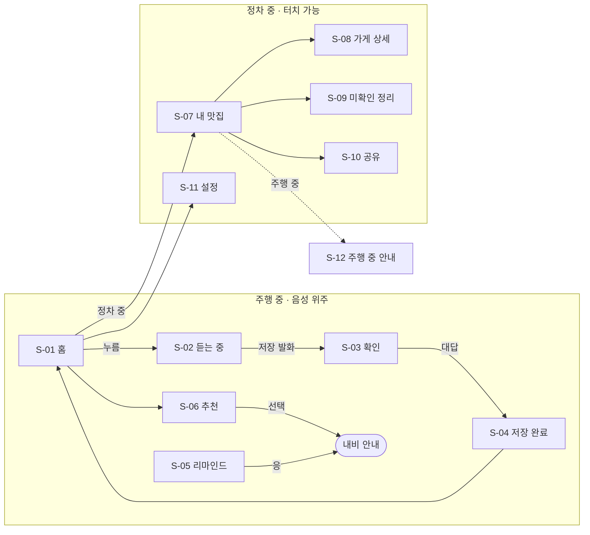
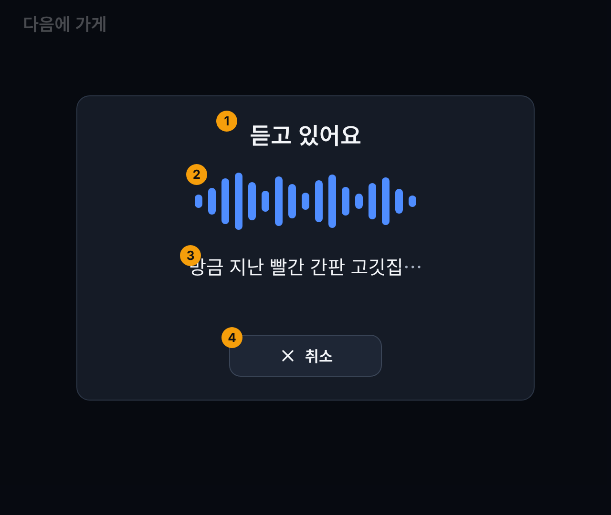
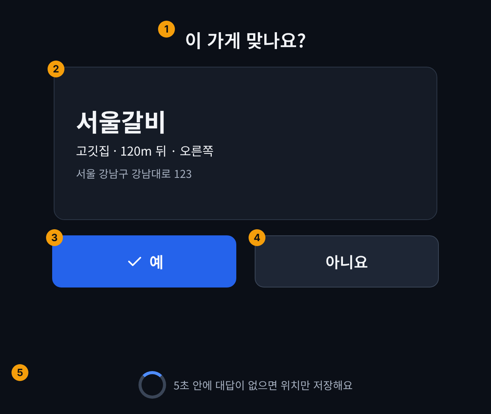
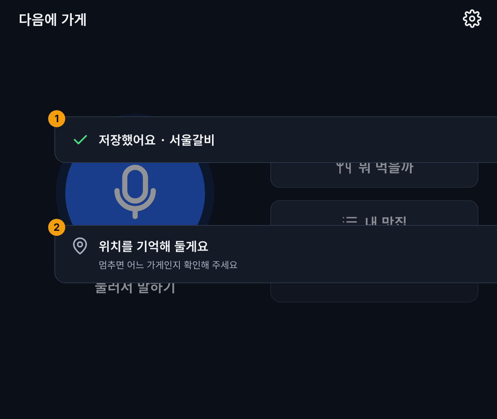
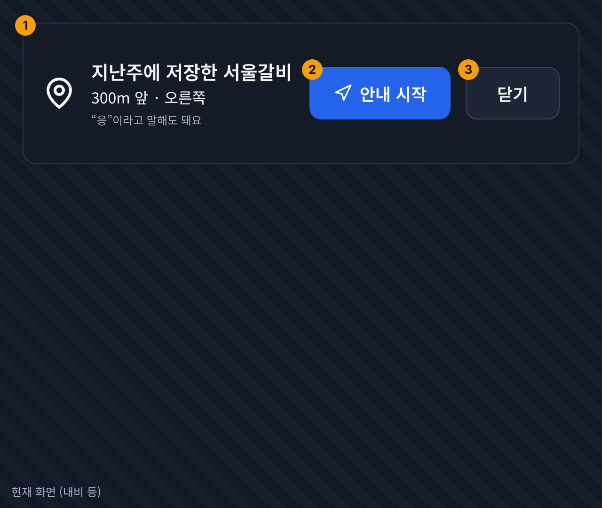
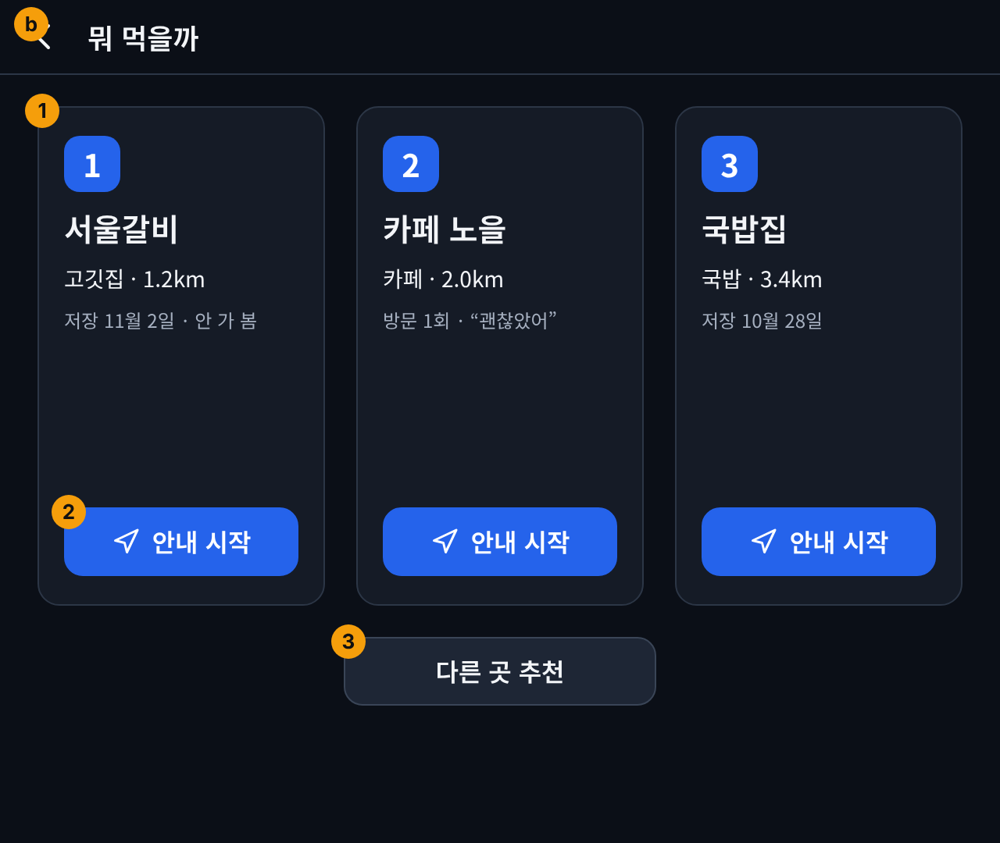
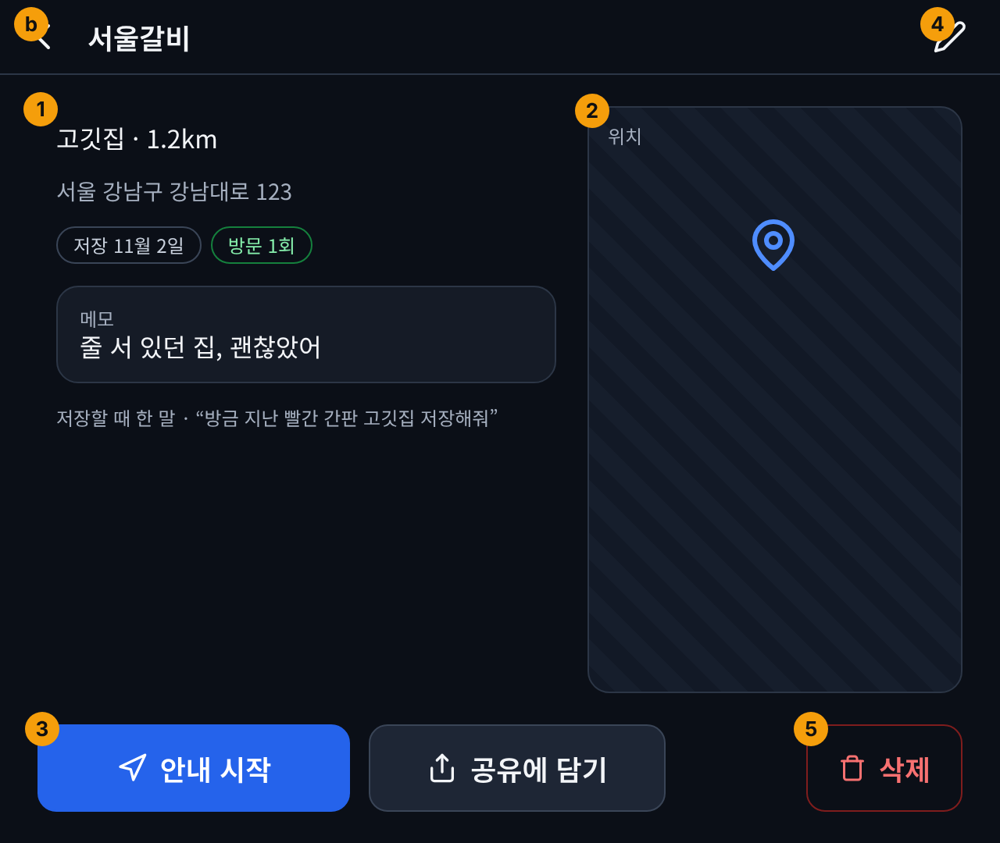
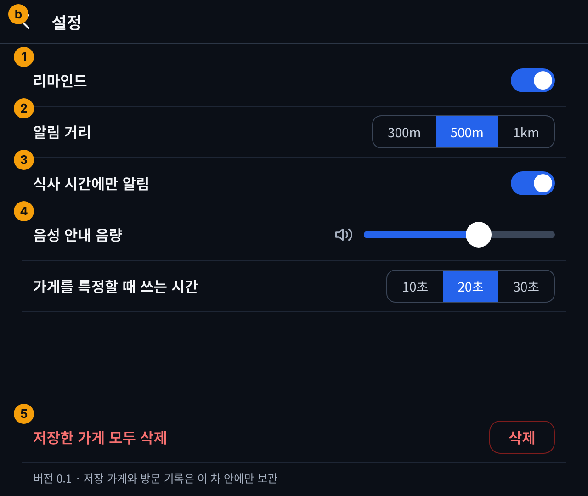

# 다음에 가게 — 화면 설계서

작성일 2026-11-09 · 작성자 재원 (easycd) · 기준 문서: [01_개발기획서](01_개발기획서.md)의 기능 ID(F-xx)를 그대로 쓴다.

주행 중에 쓰는 화면은 말하기 버튼과 큰 카드 몇 장으로 끝내고, 목록·편집·지도는 정차 중에만 연다. 화면 12개, 흐름 2개(주행 중·정차 중)다. 와이어프레임이 들어간 원본은 [02_화면설계서.html](02_화면설계서.html)이다.

## 1. 설계 기준

| 항목 | 기준 | 근거 |
| --- | --- | --- |
| 캔버스 | 1280 × 1080 (앱 영역). 전체 화면은 1920 × 1080 16:9를 좌우 1:2로 나눈 오른쪽 | Pleos Connect 17인치 16:9, 좌우 1:2 분할. 해상도 값은 가정이며 에뮬레이터 확인 뒤 조정 |
| 테마 | 다크 고정. 배경 #0B0F17, 카드 #151B26, 글자 #F3F5F8, 보조 글자 #A6B0C0 | 야간 눈부심 방지. UI/UX Pro Max: Dark Mode(OLED), Minimalism |
| 강조색 | 1순위 파랑 #2563EB(흰 글자). 삭제만 빨강 #DC2626. 미확인 주황, 방문 초록 | 빨강은 차량 경고색이라 삭제에만 |
| 글꼴 | Pretendard (없으면 Noto Sans KR). 본문 28dp, 버튼 32dp, 카드 제목 40dp, 질문 48dp, 가게 이름 64dp, 최소 24dp | 70cm 시청 거리 |
| 터치 크기 | 버튼 88dp 기본, 1순위 112dp, 목록 줄 104dp, 최소 76dp, 간격 24dp 이상 | Android Automotive 주행 중 최소 76dp |
| 한 화면 규칙 | 1순위 버튼 1개, 주행 중 글자 3줄 이내, 스크롤·키보드는 정차 중에만 | 기획서 8장 |
| 아이콘 | Lucide 선 아이콘 1종, 이모지 금지 |  |
| 동작 | 전환 200ms 이내, 토스트 4초, 확인 대기 5초, 리마인드 10초 |  |

## 2. 화면 목록

| ID | 화면 | 쓰는 상황 | 들어오는 길 | 기능 |
| --- | --- | --- | --- | --- |
| S-01 | 홈 | 주행 중 · 정차 중 | 앱 실행 | F-01, F-09, F-12, F-15 |
| S-02 | 듣는 중 | 주행 중 | S-01 말하기 / 리마인드·추천 뒤 대답 대기 | F-01, F-03 |
| S-03 | 확인 | 주행 중 | S-02 저장 발화 뒤 후보가 있을 때 | F-04, F-05 |
| S-04 | 저장 완료 | 주행 중 | S-03 뒤 / 후보 없음·오프라인 | F-06 |
| S-05 | 리마인드 | 주행 중 | 저장 가게 500m 안 진입 (시스템 알림) | F-08, F-10 |
| S-06 | 추천 | 주행 중 · 정차 중 | S-01 뭐 먹을까 / 음성 “뭐 먹을까” | F-09, F-10 |
| S-07 | 내 맛집 | 정차 중 | S-01 내 맛집 | F-12, F-07, F-13 |
| S-08 | 가게 상세 | 정차 중 | S-07 목록 / 홈 최근 저장 | F-10, F-11, F-12 |
| S-09 | 미확인 가게 정리 | 정차 중 | S-07 미확인 항목 / S-08 수정 | F-07 |
| S-10 | 맛집 지도 공유 | 정차 중 | S-07 공유 / S-08 공유에 담기 | F-13 |
| S-11 | 설정 | 정차 중 | S-01 설정 | F-15 |
| S-12 | 주행 중 안내 | 주행 중 | 주행 중 S-07~S-11 진입 시 | F-14 |

## 3. 화면 흐름

위 줄은 주행 중 음성으로 도는 흐름, 아래 줄은 정차 중 터치 화면이다. 정차 화면을 주행 중에 열면 S-12가 대신 뜬다.

## 4. 공통 요소

| 요소 | 크기 | 규칙 |
| --- | --- | --- |
| 상단 바 | 높이 96dp: 뒤로(80×80) · 제목 36dp · 오른쪽 동작 1개 | 홈에는 뒤로 없음 |
| 1순위 버튼 | 파랑, 높이 88~136dp | 화면에 1개만 |
| 2순위 버튼 | 테두리형, 높이 88dp |  |
| 카드 | 모서리 28dp, 안쪽 여백 32dp |  |
| 상태 칩 | 높이 48dp: 미확인(주황) · 방문(초록) · 선택(파랑) | 글자와 색을 같이 씀 |
| 토스트 | 하단 중앙, 높이 120dp, 4초 | 되돌리기는 삭제 뒤에만 |
| 음성 겹침 화면 | S-02를 어느 화면 위에도 띄움 |  |

## 5. 화면별 설계

### S-01 홈

주행 중 · 정차 중 · 들어오는 길: 앱 실행 · F-01, F-09, F-12, F-15

| 번호 | 요소 | 내용 | 동작 |
| --- | --- | --- | --- |
| 1 | 말하기 버튼 | 360dp 원형, 화면의 유일한 1순위 동작 | 누르면 S-02. 주행 중에도 사용 |
| 2 | 뭐 먹을까 | 추천 바로가기 | 누르면 S-06 |
| 3 | 내 맛집 | 저장 개수 표시 | 정차 중 S-07, 주행 중 S-12 |
| 4 | 최근 저장 | 마지막으로 저장한 가게 1건, 상태 칩(미확인/저장됨) | 누르면 S-08 (미확인이면 S-09) |
| 5 | 설정 |  | S-11 |

주행 중 화면은 버튼 4개가 전부다. 글자 최소 28dp, 터치 최소 88dp.

### S-02 듣는 중

주행 중 · 들어오는 길: S-01 말하기 / 리마인드·추천 뒤 대답 대기 · F-01, F-03

| 번호 | 요소 | 내용 | 동작 |
| --- | --- | --- | --- |
| 1 | 상태 문구 | 듣고 있어요 → 알아듣는 중… 순서로 바뀜 |  |
| 2 | 소리 막대 | 마이크 입력에 따라 움직임 |  |
| 3 | 인식 중 문장 | STT 부분 결과를 실시간 표시 (40dp) | 말이 끝나면 1.5초 뒤 자동 종료 |
| 4 | 취소 | 녹음 중단, 홈으로 |  |

홈 위에 겹치는 레이어. 대답(예/아니요)을 기다릴 때도 같은 레이어를 쓴다.

### S-03 확인

주행 중 · 들어오는 길: S-02 저장 발화 뒤 후보가 있을 때 · F-04, F-05

| 번호 | 요소 | 내용 | 동작 |
| --- | --- | --- | --- |
| 1 | 질문 | TTS로 같은 문장을 읽음 |  |
| 2 | 후보 카드 | 가게 이름 64dp, 업종·거리·방향, 주소 | 1순위 후보 1개만 |
| 3 | 예 | 저장 → S-04 (저장했어요) | 음성 “응·맞아”와 같음 |
| 4 | 아니요 | 2순위가 있으면 카드만 바뀜(1회), 없으면 S-04 (미확인) | 음성 “아니”와 같음 |
| 5 | 대기 표시 | 5초 카운트다운 | 시간 지나면 미확인 저장 |

### S-04 저장 완료

주행 중 · 들어오는 길: S-03 뒤 / 후보 없음·오프라인 · F-06

| 번호 | 요소 | 내용 | 동작 |
| --- | --- | --- | --- |
| 1 | 저장 토스트 | 가게 이름 포함, 4초 뒤 사라짐 | TTS “저장했어요” |
| 2 | 미확인 토스트 | 후보 없음·오프라인·두 번 아니요일 때 | TTS “위치를 기억해 둘게요” |

두 토스트는 동시에 뜨지 않는다. 그림은 두 가지 모양을 한 번에 보여 준 것.

### S-05 리마인드

주행 중 · 들어오는 길: 저장 가게 500m 안 진입 (시스템 알림) · F-08, F-10

| 번호 | 요소 | 내용 | 동작 |
| --- | --- | --- | --- |
| 1 | 알림 카드 | 가게 이름·저장 시기·거리·방향. TTS로 “…300m 앞이에요. 갈까요?” | 10초 뒤 자동으로 닫힘 |
| 2 | 안내 시작 | 내비 목적지 설정 (requestRoute) | 음성 “응”과 같음 |
| 3 | 닫기 | 오늘은 다시 알리지 않음 | 음성 “아니”·무응답과 같음 |

차량 알림(heads-up) 형태. 같은 가게는 하루 1회.

### S-06 추천

주행 중 · 정차 중 · 들어오는 길: S-01 뭐 먹을까 / 음성 “뭐 먹을까” · F-09, F-10

| 번호 | 요소 | 내용 | 동작 |
| --- | --- | --- | --- |
| 1 | 추천 카드 3장 | 번호·이름·업종·거리·메모. TTS는 번호와 이름만 읽음 | “2번” 또는 이름을 말하면 선택 |
| 2 | 안내 시작 | 카드별 1개, 내비 목적지 설정 | 선택 뒤 홈으로 |
| 3 | 다른 곳 추천 | 다음 순위 3곳으로 교체 | 최대 2회 |
| 뒤로 | 뒤로 | 홈 |  |

### S-07 내 맛집

정차 중 · 들어오는 길: S-01 내 맛집 · F-12, F-07, F-13

| 번호 | 요소 | 내용 | 동작 |
| --- | --- | --- | --- |
| 1 | 필터 칩 | 전체 / 미확인 / 방문, 정렬(가까운 순·최근 저장 순) |  |
| 2 | 가게 목록 | 이름·업종·거리·저장일 또는 방문 횟수·상태 칩, 줄 높이 104dp | 누르면 S-08, 미확인은 S-09 |
| 3 | 지도 | 저장 가게 핀(파랑), 미확인 핀(주황), 내 위치 | 핀을 누르면 목록에서 선택됨. 프로토타입은 이 자리가 비어 있을 수 있음 |
| 4 | 공유 | S-10 |  |
| 뒤로 | 뒤로 | 홈 |  |

주행 중에 열면 S-12가 대신 뜬다.

### S-08 가게 상세

정차 중 · 들어오는 길: S-07 목록 / 홈 최근 저장 · F-10, F-11, F-12

| 번호 | 요소 | 내용 | 동작 |
| --- | --- | --- | --- |
| 1 | 정보 | 업종·거리·주소·저장일·방문 횟수·메모·저장할 때 한 말 |  |
| 2 | 위치 지도 | 핀 1개 |  |
| 3 | 안내 시작 | 내비 목적지 설정 | 공유에 담기: S-10 목록에 추가 |
| 4 | 수정 | 이름·업종·메모 수정, 후보 다시 고르기(S-09) |  |
| 5 | 삭제 | 확인 창 1번 뒤 삭제, 4초 안에 되돌리기 토스트 | 다른 버튼과 떨어뜨려 배치 |

### S-09 미확인 가게 정리

정차 중 · 들어오는 길: S-07 미확인 항목 / S-08 수정 · F-07

| 번호 | 요소 | 내용 | 동작 |
| --- | --- | --- | --- |
| 1 | 그때 상황 | 저장 시각·위치·진행 방향·말한 문장 | 판단 근거 |
| 2 | 후보 5곳 | 가까운 순, 업종·거리·좌우. 기본 선택은 1순위 | 하나 고르면 지도 핀도 강조 |
| 3 | 이걸로 저장 | 선택한 후보로 확정 → S-08 |  |
| 4 | 직접 검색 | 이름으로 검색해 고르기 (정차 중 키보드) |  |
| 5 | 삭제 | 기록 삭제, 되돌리기 토스트 |  |

### S-10 맛집 지도 공유

정차 중 · 들어오는 길: S-07 공유 / S-08 공유에 담기 · F-13

| 번호 | 요소 | 내용 | 동작 |
| --- | --- | --- | --- |
| 1 | 가게 고르기 | 체크 목록, 전체 선택. 미확인 가게는 목록에 없음 |  |
| 2 | 제목 | 기본값 “이름의 맛집 N곳”, 정차 중 키보드로 수정 |  |
| 3 | QR | 동승자가 폰으로 바로 찍음 |  |
| 4 | 링크 복사 / 보내기 | 보내기는 차량의 다른 앱(문자 등)으로 전달. 링크에 가게 이름·업종·주소·좌표·메모만 담김 | 방문 기록·차량 위치는 안 들어감 |
| 5 | 받는 사람 | 웹 목록 → 앱 있으면 내 지도에 추가 |  |

### S-11 설정

정차 중 · 들어오는 길: S-01 설정 · F-15

| 번호 | 요소 | 내용 | 동작 |
| --- | --- | --- | --- |
| 1 | 리마인드 | 켜기/끄기 |  |
| 2 | 알림 거리 | 300m / 500m / 1km |  |
| 3 | 식사 시간에만 알림 | 11~14시, 17~20시 |  |
| 4 | 음성 안내 음량 |  |  |
| 5 | 모두 삭제 | 확인 창 뒤 삭제. 다른 항목과 떨어뜨림 |  |

### S-12 주행 중 안내

주행 중 · 들어오는 길: 주행 중 S-07~S-11 진입 시 · F-14

| 번호 | 요소 | 내용 | 동작 |
| --- | --- | --- | --- |
| 1 | 안내 | 정차(주차 브레이크 또는 속도 0)하면 원래 화면으로 자동 전환 |  |
| 2 | 말하기 | S-02 |  |

## 6. 상태와 예외 화면

| 상황 | 보이는 것 | 문구 |
| --- | --- | --- |
| 저장 가게 0개 | S-07 목록 자리에 안내 + 말하기 버튼 | “아직 저장한 가게가 없어요. 운전하다 말해 보세요.” |
| 인식 실패 | S-02 문구 교체 후 1회 재시도 | “다시 한 번 말해 주세요” |
| 인터넷 없음 | S-03 없이 S-04 미확인 토스트 | “위치를 기억해 둘게요” |
| 추천할 가게 없음 | S-06 카드 대신 안내 1줄 | “근처 10km 안에 저장한 가게가 없어요” |
| 삭제 뒤 | 토스트 + 되돌리기 4초 | “삭제했어요 · 되돌리기” |
| 처음 실행 | S-01 위에 안내 카드 1장 | “차 안에만 저장돼요” + 확인 |

## 7. 확인이 필요한 사항

- 캔버스 1280×1080은 가정이다. 에뮬레이터 실제 해상도를 확인하면 비율만 다시 맞춘다.
- S-07 지도는 카카오맵 SDK가 차량에서 뜨는지에 달려 있다. 안 뜨면 프로토타입은 목록만 쓰고 지도 자리는 비워 둔다.
- S-05 리마인드를 앱 밖(내비 화면 위)에 띄우려면 차량 알림 권한이 필요하다. 안 되면 앱이 켜져 있을 때만 띄운다.
- 스티어링 휠 음성 버튼 연동은 Pleos SDK에 없어 말하기 버튼은 화면에만 둔다.
