# 다음에 가게 — 화면 설계서

작성일 2026-11-09 · 작성자 재원 (easycd) · 기준 문서: [01_개발기획서](01_개발기획서.md)의 기능 ID(F-xx)를 그대로 쓴다. 생성 스크립트 tools/gen_screens.py

주행 중에 쓰는 화면은 말하기 버튼과 큰 카드 몇 장으로 끝내고, 목록·편집·지도는 정차 중에만 연다. 기능 묶음 8개, 화면·상태 34장이다. 같은 화면의 다른 상태는 S-02a·S-02b처럼 글자를 붙여 구분한다. 와이어프레임이 움직이는 원본은 [02_화면설계서.html](02_화면설계서.html)이고, 움직이는 미리보기는 screens/anim/ 의 GIF다. 화면마다 다크(screens/)와 라이트(screens/light/) 그림이 있다. 보라색 번호는 설명용 표시다.

## 1. 설계 기준

| 항목 | 기준 | 근거 |
| --- | --- | --- |
| 캔버스 | 1280 × 1080 (앱 영역). 전체 화면은 1920 × 1080 16:9를 좌우 1:2로 나눈 오른쪽 | Pleos Connect 17인치 16:9, 좌우 1:2 분할. 해상도 값은 가정이며 에뮬레이터 확인 뒤 조정 |
| 세로 창 | Pleos 앱 영역 기본값인 세로 1칸에서는 말하기 버튼을 하단 가운데에 두고, 카드(최근 저장·추천·안내)는 그 위에 쌓는다. 가로 2칸은 이 문서의 그림대로 | 재원 결정 2026-11-09. 대표 화면 5장을 6장 끝 “세로 창” 묶음(P-01 ~ P-06)에 그렸다. 구현 때 창 비율을 보고 두 배치 중 하나를 고른다 |
| 기준 위치 | 말하기 버튼(또는 뭐 먹을까 카드)을 누른 순간의 위치를 “말한 곳”으로 고정한다. 가게 찾기 · 추천의 거리와 순서는 모두 이 위치 기준이고, 결과가 나온 뒤 차가 움직여도 바뀌지 않는다 | 재원 결정 2026-11-09. 말하는 동안 최대 15초(시속 60km면 약 250m) 움직여도 검색 범위가 밀리지 않게 한다 |
| 테마 | 다크·라이트 2가지 (차량 주/야간 설정을 따름). 다크: 배경 #15100E, 글자 #FBF6F2, 보조 #B8A69B. 라이트: 배경 #F6EFEA, 글자 #1F1512, 보조 #6E5B53. 배경은 그림 없는 단색 | 다크는 야간 눈부심 방지. 색은 앱 아이콘 주황 #E4572E에서 뽑음. 이 문서의 와이어프레임은 위 단추로 다크·라이트를 바꿔 볼 수 있다 |
| 스타일 | 리퀴드 글라스: 카드·버튼·상단 버튼은 반투명 유리(다크 흰색 9~14%, 라이트 흰색 78~95%) + 흐림 28 + 밝은 윗선 + 1dp 테두리 + 그림자. 색이 있는 유리는 말하기 버튼 하나 | 유리는 콘텐츠 위 조작 층에만. 지도 화면에서는 지도가 콘텐츠 층. 투명도 줄이기를 켜면 불투명 카드 #1F1714 / #FFFFFF |
| 강조색 | 1순위 동작 주황 #E4572E 채움(흰 글자). 주황 글자·아이콘은 다크 #FF8A62 · 라이트 #B83A18. 삭제만 빨강 #C62828 채움 · 다크 #FF6B6B 글자. 미확인 노랑 #F2B544 / #8A5A00, 방문 초록 #4CC38A / #1B7F4D. 파랑은 쓰지 않음 | 빨강은 차량에서 경고색이라 삭제에만 사용. 글자 대비 4.5:1 이상 (흰 글자 위 주황은 32dp 굵은 글자만) |
| 글꼴 | Pretendard (없으면 Noto Sans KR). 본문 28dp, 버튼 32dp, 카드 제목 40dp, 질문 48dp, 가게 이름 64dp, 최소 24dp | 70cm 시청 거리 기준 |
| 터치 크기 | 버튼 높이 88dp 기본, 1순위 112dp, 목록 줄 96~112dp, 최소 76dp, 간격 24dp 이상 | Android Automotive 주행 중 최소 76dp |
| 한 화면 규칙 | 1순위 버튼은 1개(주황), 주행 중 글자 줄 수 3줄 이내, 목록 스크롤·키보드는 정차 중에만 | 기획서 8장 비기능 요구사항 |
| 아이콘 | Lucide 선 아이콘 1종, 이모지 금지. 앱 아이콘은 확정 15번(주황 핀) | design/icons/final/ |
| 동작 시간 | 화면 전환 200ms 이내, 토스트 4초, 확인 대기 5초, 리마인드·방문 메모 카드 10초 | 5장 애니메이션 기준 참고 |

## 2. 화면 목록 (기능별)

### A. 시작과 권한 · 공통 · 3장

| ID | 화면 | 쓰는 상황 | 들어오는 길 | 기능 |
| --- | --- | --- | --- | --- |
| S-00 | 시작 | 주행 중 · 정차 중 | 앱 아이콘을 누름 | 공통 |
| S-13 | 처음 실행 안내 | 정차 중 권장 | S-00 뒤 첫 실행 1회 | 공통 |
| S-17 | 권한 없음 | 주행 중 · 정차 중 | 권한이 없는 상태에서 말하기 · 리마인드 · 안내 시작을 누름 | 공통 |

### B. 음성으로 저장 · F-01 ~ F-06 · 10장

| ID | 화면 | 쓰는 상황 | 들어오는 길 | 기능 |
| --- | --- | --- | --- | --- |
| S-01 | 홈 | 주행 중 · 정차 중 | 앱 실행 | F-01, F-09, F-12, F-15 |
| S-01b | 홈 · 저장 전 | 주행 중 · 정차 중 | 저장한 가게가 0개일 때의 홈 | F-01 |
| S-02a | 듣는 중 | 주행 중 · 정차 중 | S-01 말하기 / 음성 “뭐 먹을까” / S-12 말하기 | F-01, F-03 |
| S-02b | 알아듣는 중 | 주행 중 · 정차 중 | S-02a에서 말이 끝난 뒤 | F-03 |
| S-02c | 다시 말해 주세요 | 주행 중 · 정차 중 | S-02b에서 의도를 못 찾았을 때 / 3초 넘게 응답 없을 때 | F-03 |
| S-14 | 가게 찾는 중 | 주행 중 | S-02b에서 저장 의도가 확정된 뒤 | F-02, F-04 |
| S-03 | 확인 | 주행 중 | S-14 뒤 후보가 있을 때 | F-04, F-05 |
| S-03b | 확인 · 두 번째 후보 | 주행 중 | S-03에서 아니요 1회 | F-04, F-05 |
| S-04a | 저장 완료 | 주행 중 · 정차 중 | S-03 · S-03b에서 예 | F-06 |
| S-04b | 위치만 저장 | 주행 중 · 정차 중 | 후보 없음 · 인터넷 없음 · 아니요 2회 · 5초 무응답 | F-06 |

### C. 근처 리마인드 · F-08, F-10 · 2장

| ID | 화면 | 쓰는 상황 | 들어오는 길 | 기능 |
| --- | --- | --- | --- | --- |
| S-05 | 리마인드 | 주행 중 | 저장 가게 500m 안 진입 (차량 알림) | F-08, F-10 |
| S-05b | 리마인드 · 안내 시작 | 주행 중 | S-05에서 안내 시작 · 음성 “응” | F-10 |

### D. 추천 · F-09, F-10 · 3장

| ID | 화면 | 쓰는 상황 | 들어오는 길 | 기능 |
| --- | --- | --- | --- | --- |
| S-06 | 추천 | 주행 중 · 정차 중 | S-01 뭐 먹을까 / 음성 “뭐 먹을까” | F-09, F-10 |
| S-06b | 추천할 가게 없음 | 주행 중 · 정차 중 | 반경 안에 저장 가게가 없을 때 | F-09 |
| S-06c | 추천 · 선택됨 | 주행 중 · 정차 중 | S-06에서 카드 선택 (터치 · 번호 · 이름) | F-09, F-10 |

### E. 방문 기록 · F-11 · 2장

| ID | 화면 | 쓰는 상황 | 들어오는 길 | 기능 |
| --- | --- | --- | --- | --- |
| S-15 | 방문 메모 | 주행 중 · 정차 중 | 내비 도착 + 10분 체류 뒤 다시 출발할 때 (차량 알림) | F-11 |
| S-15b | 방문 메모 저장 | 주행 중 · 정차 중 | S-15에서 말한 뒤 | F-11 |

### F. 내 맛집 · F-12, F-07 · 8장

| ID | 화면 | 쓰는 상황 | 들어오는 길 | 기능 |
| --- | --- | --- | --- | --- |
| S-07 | 내 맛집 | 정차 중 | S-01 내 맛집 | F-12, F-07, F-13 |
| S-07b | 내 맛집 · 저장 전 | 정차 중 | 저장 가게 0개일 때 S-01b 내 맛집 | F-12 |
| S-08 | 가게 상세 | 정차 중 | S-07 목록 / 홈 최근 저장 | F-10, F-11, F-12 |
| S-08b | 가게 수정 | 정차 중 | S-08 수정 | F-12 |
| S-08c | 삭제 확인 | 정차 중 | S-08 삭제 / S-09 삭제 | F-12 |
| S-08d | 삭제 뒤 되돌리기 | 정차 중 | S-08c 삭제 뒤 (목록으로 돌아옴) | F-12 |
| S-09 | 미확인 가게 정리 | 정차 중 | S-07 미확인 항목 / S-08b 후보 다시 고르기 / 홈 최근 저장(미확인) | F-07 |
| S-09b | 직접 검색 | 정차 중 | S-09 직접 검색 | F-07 |

### G. 맛집 지도 공유 · F-13 · 3장

| ID | 화면 | 쓰는 상황 | 들어오는 길 | 기능 |
| --- | --- | --- | --- | --- |
| S-10 | 맛집 지도 공유 | 정차 중 | S-07 공유 / S-08 공유에 담기 | F-13 |
| S-16 | 받은 목록 가져오기 | 정차 중 | 공유 링크를 차량에서 열었을 때 / S-10 받는 사람 | F-13 |
| S-16b | 가져오기 완료 | 정차 중 | S-16 내 지도에 추가 뒤 | F-13 |

### H. 설정과 주행 제한 · F-15, F-14 · 3장

| ID | 화면 | 쓰는 상황 | 들어오는 길 | 기능 |
| --- | --- | --- | --- | --- |
| S-11 | 설정 | 정차 중 | S-01 설정 | F-15 |
| S-11b | 모두 삭제 확인 | 정차 중 | S-11 모두 삭제 | F-15 |
| S-12 | 주행 중 안내 | 주행 중 | 주행 중 S-07 ~ S-11, S-16 진입 시 | F-14 |

## 3. 화면 흐름

```mermaid
flowchart LR
  subgraph A[A. 시작과 권한]
    A_S00[S-00 시작] -->|처음 1회| A_S13[S-13 처음 실행 안내]
    A_S13 -->|허용| A_S01[S-01 홈]
    A_S00 --> A_S01
    A_S01 -->|권한 없음| A_S17[S-17 권한 없음]
  end
  subgraph B[B. 음성으로 저장]
    B_S01[S-01 홈] -->|말하기| B_S02a[S-02a 듣는 중]
    B_S02a -->|말 끝남| B_S02b[S-02b 알아듣는 중]
    B_S02b -->|저장 의도| B_S14[S-14 가게 찾는 중]
    B_S14 -->|후보 있음| B_S03[S-03 확인]
    B_S03 -->|예| B_S04a[S-04a 저장 완료]
    B_S02b -->|못 알아들음| B_S02c[S-02c 다시 말해 주세요]
    B_S03 -->|아니요| B_S03b[S-03b 확인 · 두 번째 후보]
    B_S03b -->|예| B_S04a
    B_S03b -->|아니요| B_S04b[S-04b 위치만 저장]
    B_S14 -->|후보 없음| B_S04b
    B_S03 -->|5초 무응답| B_S04b
    B_S01b[S-01b 홈 · 저장 전] -->|말하기| B_S02a
  end
  subgraph C[C. 근처 리마인드]
    C_S05[S-05 리마인드] -->|응| C_S05b[S-05b 리마인드 · 안내 시작]
    C_S05b --> C_NAV([내비 안내])
  end
  subgraph D[D. 추천]
    D_S01[S-01 홈] -->|뭐 먹을까| D_S06[S-06 추천]
    D_S06 -->|선택| D_S06c[S-06c 추천 · 선택됨]
    D_S06c --> D_NAV([내비 안내])
    D_S06 -->|없음| D_S06b[S-06b 추천할 가게 없음]
  end
  subgraph E[E. 방문 기록]
    E_NAV([내비 안내]) -->|도착 뒤 출발| E_S15[S-15 방문 메모]
    E_S15 -->|말하기| E_S02a[S-02a 듣는 중]
    E_S02a -->|메모| E_S15b[S-15b 방문 메모 저장]
  end
  subgraph F[F. 내 맛집]
    F_S01[S-01 홈] -->|내 맛집| F_S07[S-07 내 맛집]
    F_S07 -->|가게| F_S08[S-08 가게 상세]
    F_S08 -->|수정| F_S08b[S-08b 가게 수정]
    F_S08 -->|삭제| F_S08c[S-08c 삭제 확인]
    F_S08c -->|삭제| F_S08d[S-08d 삭제 뒤 되돌리기]
    F_S07 -->|미확인| F_S09[S-09 미확인 가게 정리]
    F_S09 -->|직접 검색| F_S09b[S-09b 직접 검색]
    F_S09 -->|저장| F_S08
    F_S01 -->|0개| F_S07b[S-07b 내 맛집 · 저장 전]
  end
  subgraph G[G. 맛집 지도 공유]
    G_S07[S-07 내 맛집] -->|공유| G_S10[S-10 맛집 지도 공유]
    G_S10 -->|링크 열기| G_S16[S-16 받은 목록 가져오기]
    G_S16 -->|추가| G_S16b[S-16b 가져오기 완료]
  end
  subgraph H[H. 설정과 주행 제한]
    H_S01[S-01 홈] -->|설정| H_S11[S-11 설정]
    H_S11 -->|모두 삭제| H_S11b[S-11b 모두 삭제 확인]
    H_S07[S-07 내 맛집] -->|주행 중| H_S12[S-12 주행 중 안내]
  end
```

묶음마다 한 줄씩. 홈(S-01)은 여러 묶음에 다시 나온다. 내비 안내는 Pleos 내비 앱으로 넘어가는 바깥 화면이다. 정차 화면(F·G·H)을 주행 중에 열면 S-12가 대신 뜬다.

## 4. 공통 요소

| 요소 | 크기 | 규칙 |
| --- | --- | --- |
| 상단 바 | 높이 96dp: 뒤로(80×80) · 제목 36dp · 오른쪽 동작 1개 | 홈에는 뒤로 없음. 제목은 화면 이름 그대로 |
| 1순위 버튼 | 주황 채움 알약형, 높이 88~136dp | 화면에 1개만 |
| 2순위 버튼 | 유리 알약형, 높이 88dp |  |
| 삭제 버튼 | 테두리 빨강(상세·정리) 또는 채움 빨강(확인 창) | 다른 버튼과 떨어뜨림 |
| 카드 | 유리, 모서리 36dp, 안쪽 여백 32dp, 1dp 밝은 테두리 + 그림자 | 알림 카드·창·토스트는 더 진한 유리(다크 14% · 라이트 95%) |
| 상태 칩 | 높이 48dp: 미확인(노랑) · 방문(초록) · 선택(주황) · 저장됨(회색) | 글자와 색을 같이 써서 색만으로 구분하지 않음 |
| 토스트 | 아래쪽(위에서 900dp), 좌우 140dp 여백, 높이 120dp, 4초 | 되돌리기 버튼은 삭제 뒤에만. 한 번에 1개 |
| 확인 창 | 가운데, 폭 800dp, 질문 40dp + 설명 28dp + 버튼 2개 | 취소가 왼쪽, 실행이 오른쪽 |
| 차량 알림 카드 | 위쪽 48dp, 높이 300dp, 아래 가장자리에 남은 시간 막대 | 리마인드(S-05) · 방문 메모(S-15) |
| 음성 겹침 화면 | S-02a~c를 어느 화면 위에도 띄움 | 뒤 화면은 72% 어둡게 |
| 키보드 자리 | 아래 320dp (시스템 키보드) | 정차 중에만. 입력창은 키보드 위에 남도록 배치 |

## 5. 애니메이션 기준

| 이름 | 시간 | 이징 | 쓰는 곳 |
| --- | --- | --- | --- |
| 빠름 | 120ms | standard (0.2, 0, 0, 1) | 버튼 누름, 칩·체크·라디오·토글, 줄 선택 |
| 기본 | 200ms | standard | 화면 전환, 카드·토스트 들어옴, 목록 줄 등장, 확인 창 |
| 강조 | 240 ~ 400ms | emphasized (0.05, 0.7, 0.1, 1) | 차량 알림 카드 내려옴, 시작 아이콘·지도 핀 떨어짐 |
| 반복 | 0.8 ~ 2s | ease-in-out / linear | 소리 막대, 처리 링, 말하기 버튼 숨쉬기, 카운트다운 |
| 진행 | 5s · 10s | linear | 확인 대기 링, 알림 카드 남은 시간 막대 |

| 규칙 | 내용 | 이유 |
| --- | --- | --- |
| 주행 중 화면 | 이동 거리 24dp 이하, 페이드 위주. 화면끼리는 페이드만(슬라이드 없음) | 시선을 끌지 않기 위해 |
| 정차 중 화면 | 오른쪽 48dp에서 밀려 들어오며 페이드 (뒤로 가기는 반대) | 화면 깊이를 알게 |
| 겹침 화면 (듣는 중·확인 창) | 어두운 배경 160ms 페이드 + 창 96 → 100% 확대 200ms | 어느 화면 위에서나 같음 |
| 토스트 | 아래에서 24dp 올라오며 페이드 인 200ms, 4초 뒤 페이드 아웃 200ms | 한 번에 1개 |
| 차량 알림 카드 | 위에서 32dp 내려옴 240ms, 닫힐 때 위로 200ms | 리마인드 · 방문 메모 |
| 반복 애니메이션 | 듣는 중 막대, 처리 링, 말하기 숨쉬기, 카운트다운 네 곳만 | 그 밖에는 반복 없음 |
| 동작 줄이기 | 차량 설정이 동작 줄이기면 전환은 페이드만, 반복은 소리 막대만 남김 |  |
| 소리 | 애니메이션에 효과음을 붙이지 않음. TTS만 | 차량 알림음과 겹치지 않게 |

화면별 모션은 6장 각 화면의 “모션” 표에 있다.

## 6. 화면별 설계

### A. 시작과 권한 · 공통

#### S-00 시작

주행 중 · 정차 중 · 들어오는 길: 앱 아이콘을 누름 · 공통

| 다크 | 라이트 |
| --- | --- |
| 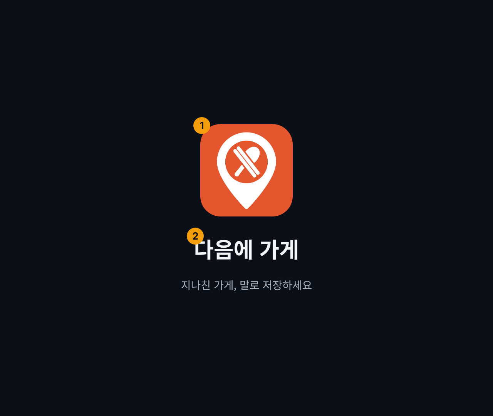 | 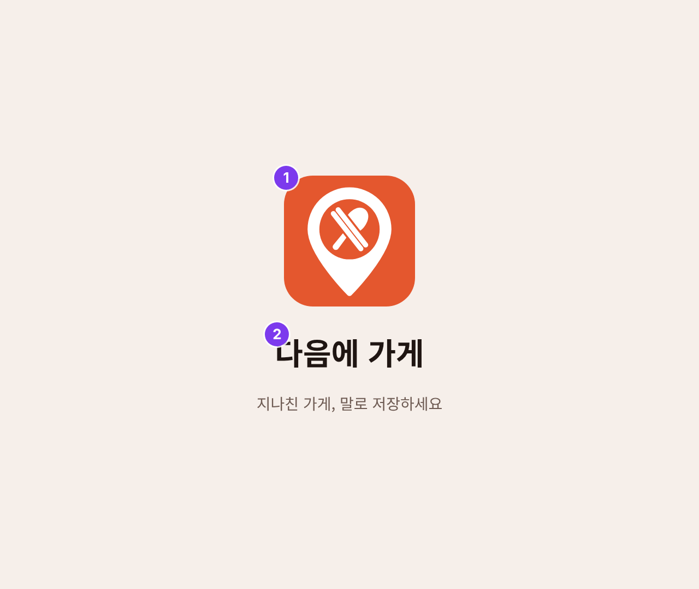 |

움직이는 미리보기: 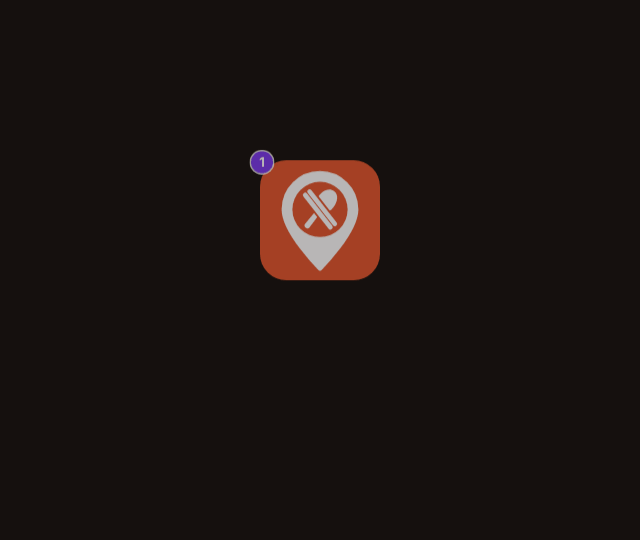

| 번호 | 요소 | 내용 | 동작 |
| --- | --- | --- | --- |
| 1 | 앱 아이콘 | 확정 아이콘(15번) 240dp | 0.8초 안에 S-01 홈으로. 처음 실행이면 S-13 |
| 2 | 앱 이름 | 56dp |  |

불러올 것이 없으면 이 화면은 0.3초만 보인다. 로딩 막대는 두지 않는다.

모션

| 요소 | 움직임 | 시간 · 이징 | 계기 |
| --- | --- | --- | --- |
| 앱 아이콘 | 위에서 48dp 떨어지며 살짝 튕김 | 400ms · emphasized | 화면 열릴 때 |
| 앱 이름·문구 | 페이드 인 | 160ms · 250ms 지연 | 아이콘 뒤이어 |
| 홈으로 전환 | 페이드 | 200ms | 불러오기 끝나면(최대 0.8초) |

#### S-13 처음 실행 안내

정차 중 권장 · 들어오는 길: S-00 뒤 첫 실행 1회 · 공통

| 다크 | 라이트 |
| --- | --- |
| 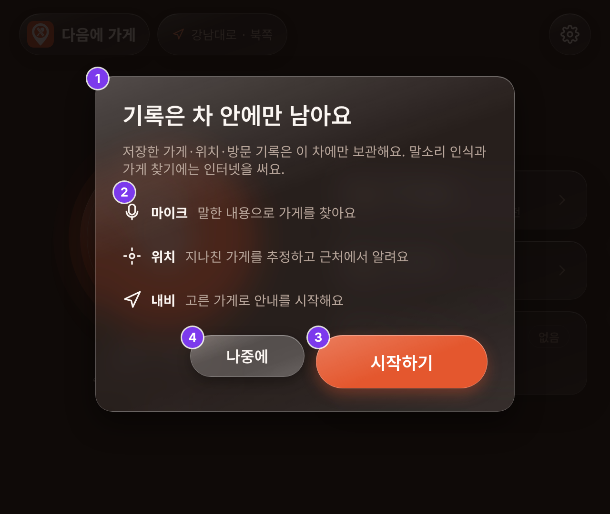 | 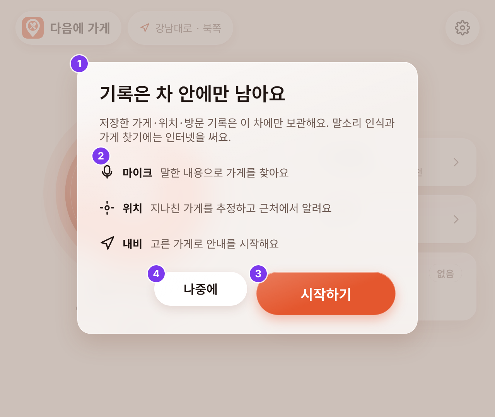 |

| 번호 | 요소 | 내용 | 동작 |
| --- | --- | --- | --- |
| 1 | 안내 카드 | 차 안에만 저장된다는 고지 1장 |  |
| 2 | 허용 항목 3줄 | 마이크 · 위치 · 내비, 각각 쓰는 이유 한 줄 |  |
| 3 | 시작하기 | 시스템 권한 창을 마이크 → 위치 → 내비 순서로 띄움 | 모두 끝나면 S-01 |
| 4 | 나중에 | 권한 없이 홈으로. 말하기 버튼을 누르면 S-17 |  |

모션

| 요소 | 움직임 | 시간 · 이징 | 계기 |
| --- | --- | --- | --- |
| 어두운 배경 | 페이드 인 | 160ms | 카드 열릴 때 |
| 안내 카드 | 96% → 100% 확대 + 페이드 | 200ms · standard | 어두운 배경 뒤이어 |
| 닫힘 | 카드 페이드 아웃 | 160ms | 시작하기 · 나중에 |

#### S-17 권한 없음

주행 중 · 정차 중 · 들어오는 길: 권한이 없는 상태에서 말하기 · 리마인드 · 안내 시작을 누름 · 공통

| 다크 | 라이트 |
| --- | --- |
| 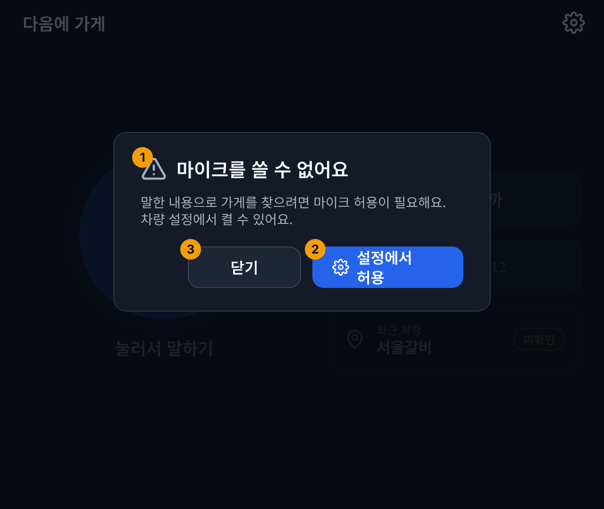 | 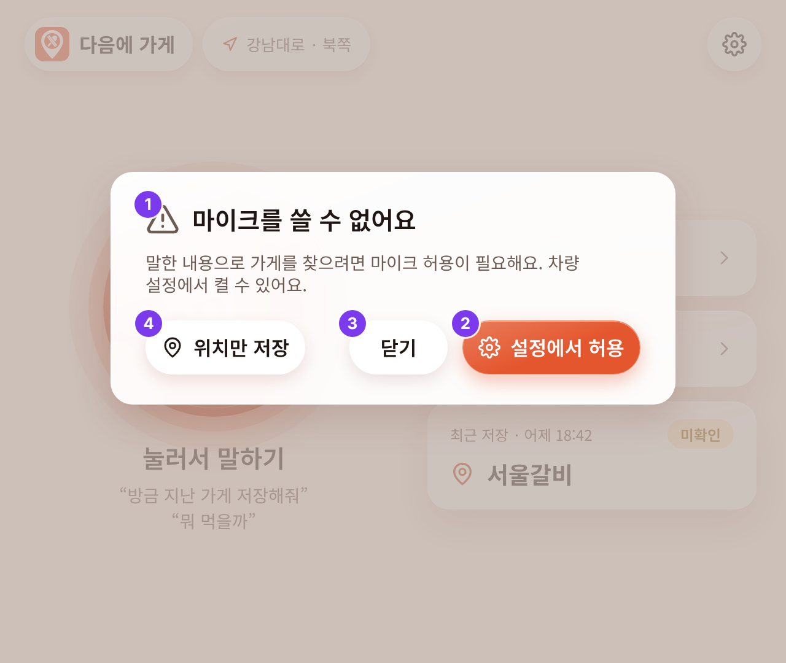 |

| 번호 | 요소 | 내용 | 동작 |
| --- | --- | --- | --- |
| 1 | 안내 | 무엇을 못 쓰는지 한 줄 + 왜 필요한지 한 줄 | 위치면 “위치를 쓸 수 없어요 · 지나친 가게를 찾으려면 필요해요”, 음성 서비스 오류면 “음성 서비스를 쓸 수 없어요 · 잠시 뒤 다시 해 보세요” |
| 2 | 설정에서 허용 | 차량 앱 권한 설정 화면을 염 | 주행 중이면 버튼 대신 “멈춘 뒤 설정에서 허용해 주세요” 문구 |
| 3 | 닫기 | 원래 화면으로 |  |

모션

| 요소 | 움직임 | 시간 · 이징 | 계기 |
| --- | --- | --- | --- |
| 창 열림 | 어두운 배경 페이드 + 창 96% → 100% | 160ms / 200ms | 버튼을 눌렀을 때 |
| 창 닫힘 | 페이드 아웃 | 160ms | 닫기 · 설정으로 이동 |

### B. 음성으로 저장 · F-01 ~ F-06

#### S-01 홈

주행 중 · 정차 중 · 들어오는 길: 앱 실행 · F-01, F-09, F-12, F-15

| 다크 | 라이트 |
| --- | --- |
|  | 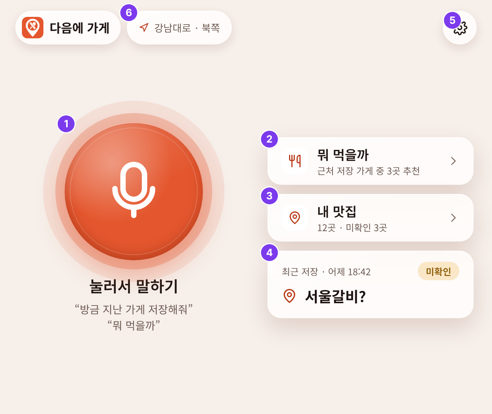 |

움직이는 미리보기: 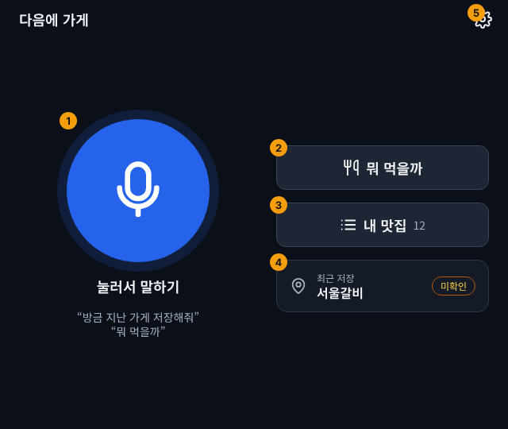

| 번호 | 요소 | 내용 | 동작 |
| --- | --- | --- | --- |
| 1 | 말하기 버튼 | 360dp 원형, 화면의 유일한 1순위 동작 | 누르면 S-02a. 주행 중에도 사용 |
| 2 | 뭐 먹을까 | 추천 바로가기 | 누르면 S-06 |
| 3 | 내 맛집 | 저장 개수 표시 | 정차 중 S-07, 주행 중 S-12 |
| 4 | 최근 저장 | 마지막으로 저장한 가게 1건, 상태 칩(미확인/저장됨) | 누르면 S-08 (미확인이면 S-09). 0건이면 S-01b |
| 5 | 설정 |  | S-11 |
| 6 | 현재 위치 | 지금 달리는 도로 이름과 방향. 누를 수 없음 | 위치 권한이 없으면 숨김 |

주행 중 화면은 버튼 4개가 전부다. 글자 최소 28dp, 터치 최소 88dp.

모션

| 요소 | 움직임 | 시간 · 이징 | 계기 |
| --- | --- | --- | --- |
| 말하기 버튼 | 바깥 그림자가 24 → 40dp로 숨 쉬듯 커졌다 작아짐 | 2s · ease-in-out 반복 | 항상. 대비가 낮아 주행 중에도 허용 |
| 버튼 누름 | 96%로 줄었다 복귀 | 120ms · standard | 모든 버튼 공통 |
| 최근 저장 카드 | 내용이 바뀔 때 페이드 교체 | 200ms | 저장 완료 뒤 |
| 화면 전환 | 주행 중 화면끼리는 페이드만(이동 없음) | 160ms | S-02a · S-06 · S-12로 |

#### S-01b 홈 · 저장 전

주행 중 · 정차 중 · 들어오는 길: 저장한 가게가 0개일 때의 홈 · F-01

| 다크 | 라이트 |
| --- | --- |
| 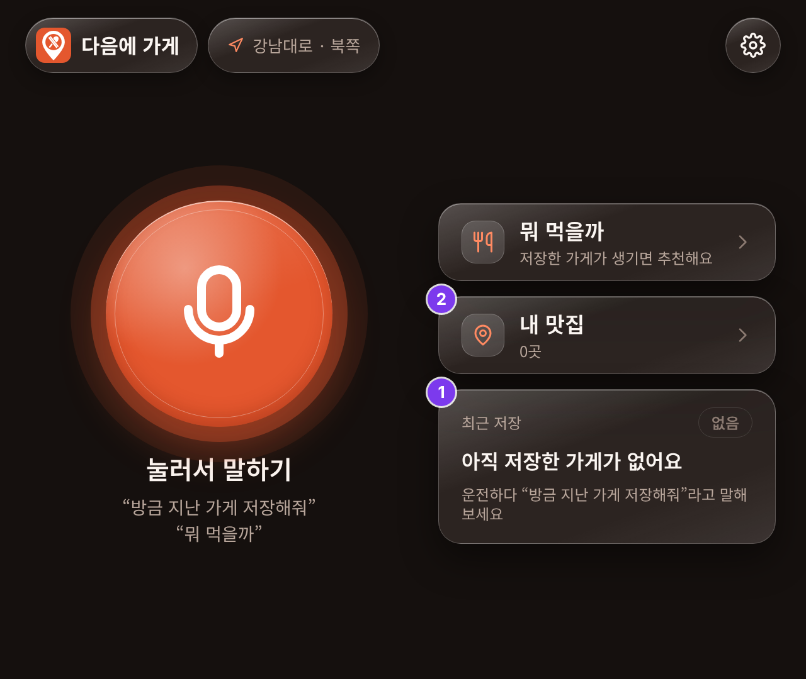 | 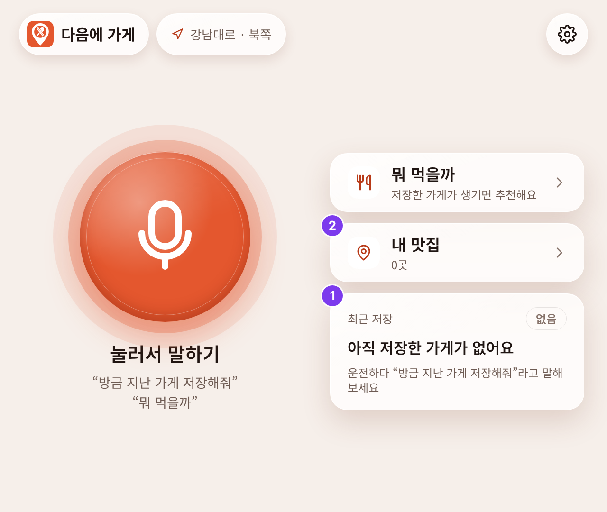 |

| 번호 | 요소 | 내용 | 동작 |
| --- | --- | --- | --- |
| 1 | 안내 카드 | 최근 저장 자리에 안내 2줄 | 누를 수 없음 |
| 2 | 내 맛집 0 | 개수 0 표시 | 누르면 S-07b |

모션

| 요소 | 움직임 | 시간 · 이징 | 계기 |
| --- | --- | --- | --- |
| 말하기 버튼 | S-01과 같은 숨쉬기 | 2s 반복 |  |
| 첫 저장 뒤 | 안내 카드가 최근 저장 카드로 페이드 교체 | 200ms | S-04a 뒤 |

#### S-02a 듣는 중

주행 중 · 정차 중 · 들어오는 길: S-01 말하기 / 음성 “뭐 먹을까” / S-12 말하기 · F-01, F-03

| 다크 | 라이트 |
| --- | --- |
| 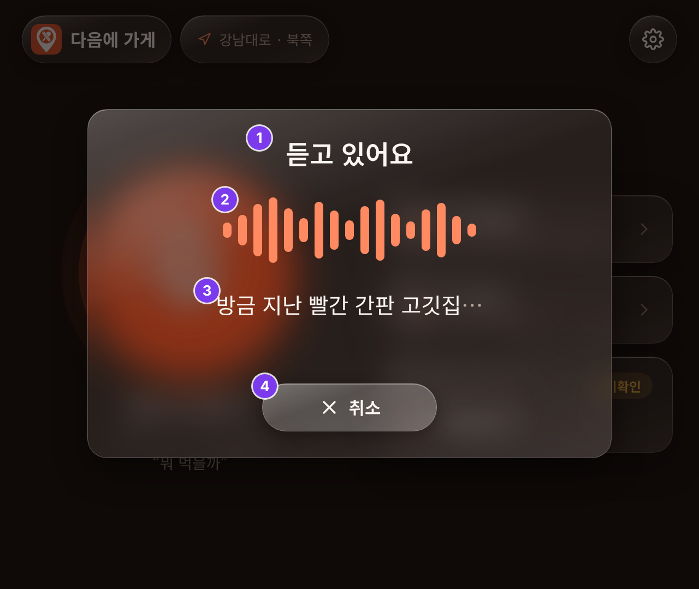 | 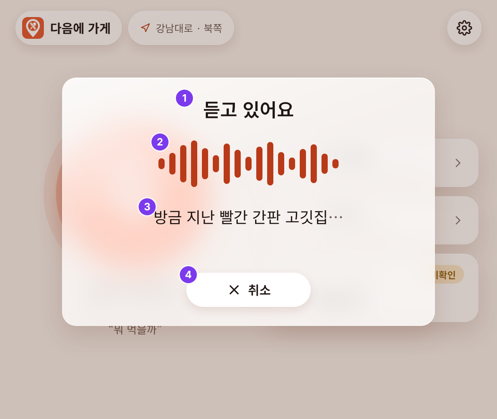 |

움직이는 미리보기: 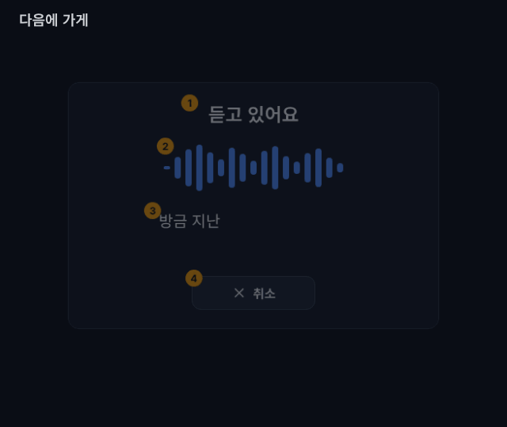

| 번호 | 요소 | 내용 | 동작 |
| --- | --- | --- | --- |
| 1 | 상태 문구 | “듣고 있어요” | 말이 끝나면 S-02b |
| 2 | 소리 막대 | 마이크 입력 크기에 따라 17개 막대가 움직임 |  |
| 3 | 인식 중 문장 | STT 부분 결과를 실시간 표시 (40dp) | 말이 끝나고 1.5초 지나면 자동 종료 |
| 4 | 취소 | 녹음 중단, 원래 화면으로 |  |

어느 화면 위에도 겹쳐 뜨는 레이어. 뒤 화면은 흐리게만 하고 내용은 바꾸지 않는다.

모션

| 요소 | 움직임 | 시간 · 이징 | 계기 |
| --- | --- | --- | --- |
| 어두운 배경 | 페이드 인 | 160ms | 말하기 버튼을 누른 직후 |
| 카드 | 96% → 100% 확대 + 페이드 | 200ms · standard | 배경과 함께 |
| 소리 막대 | 높이 30% ↔ 100% 반복, 막대마다 60ms씩 어긋남 | 900ms · ease-in-out 반복 | 마이크 입력 크기에 비례 |
| 인식 문장 | 단어가 들어올 때마다 페이드로 붙음 | 80ms | STT 부분 결과 |

#### S-02b 알아듣는 중

주행 중 · 정차 중 · 들어오는 길: S-02a에서 말이 끝난 뒤 · F-03

| 다크 | 라이트 |
| --- | --- |
| 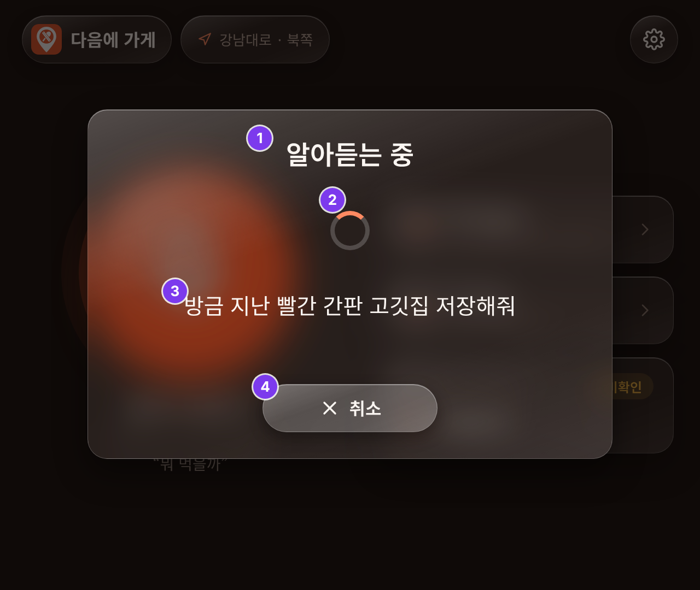 | 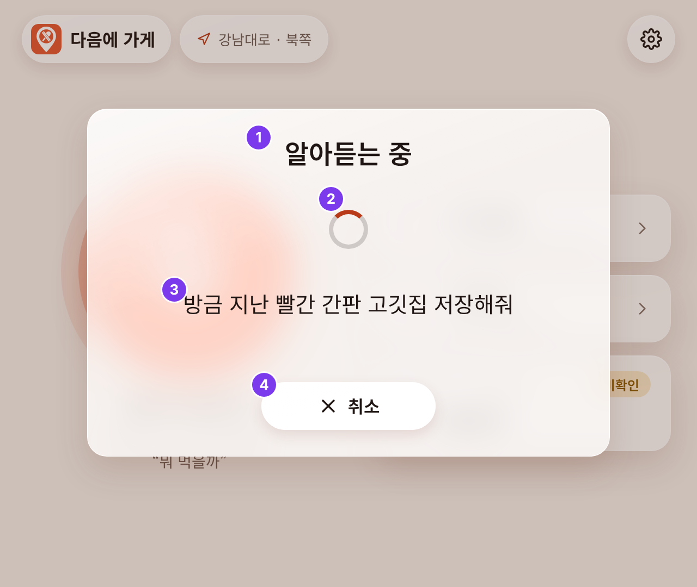 |

움직이는 미리보기: 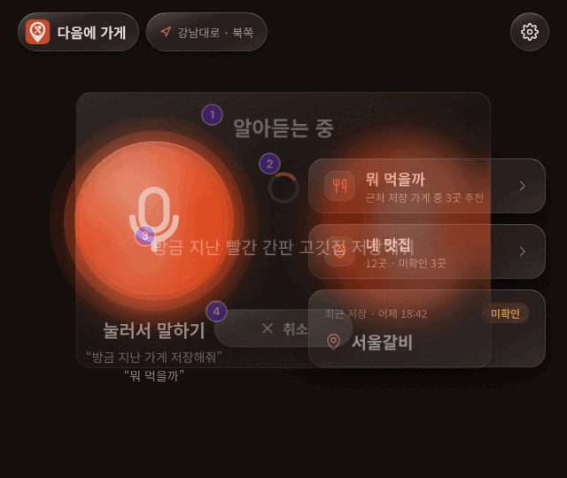

| 번호 | 요소 | 내용 | 동작 |
| --- | --- | --- | --- |
| 1 | 상태 문구 | “알아듣는 중” | 규칙 분석은 0.3초 안에 끝남 |
| 2 | 처리 표시 | 회전하는 링 72dp | 1초를 넘기면 그대로 유지, 3초를 넘기면 S-02c |
| 3 | 확정 문장 | 최종 인식 문장 | 저장이면 S-14, 추천이면 S-06, 취소면 닫힘 |
| 4 | 취소 | 분석 중단, 원래 화면으로 |  |

모션

| 요소 | 움직임 | 시간 · 이징 | 계기 |
| --- | --- | --- | --- |
| 소리 막대 → 링 | 막대가 페이드 아웃되고 링이 페이드 인 | 160ms | 말이 끝났을 때 |
| 링 | 한 바퀴 회전 반복 | 1s · linear 반복 | 분석 끝날 때까지 |
| 다음 화면으로 | 카드 페이드 아웃 | 160ms | 의도 판정 뒤 |

#### S-02c 다시 말해 주세요

주행 중 · 정차 중 · 들어오는 길: S-02b에서 의도를 못 찾았을 때 / 3초 넘게 응답 없을 때 · F-03

| 다크 | 라이트 |
| --- | --- |
| 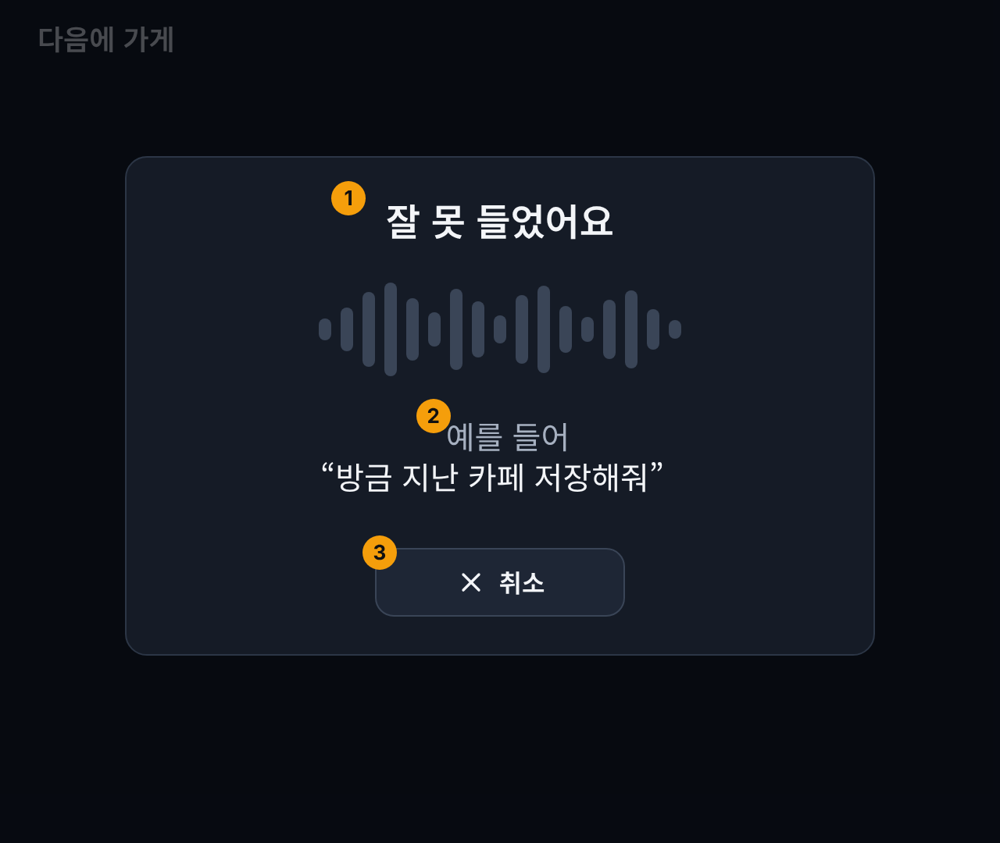 | 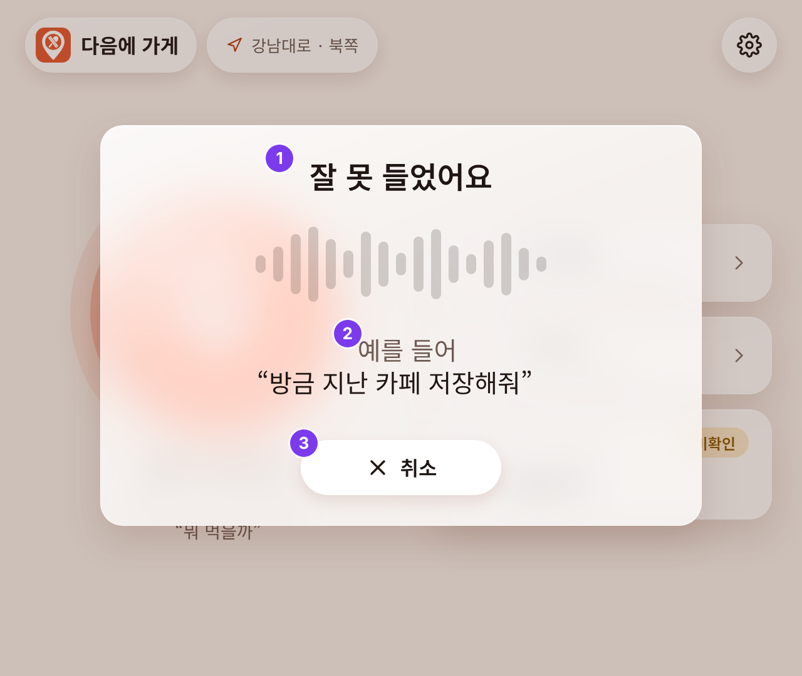 |

| 번호 | 요소 | 내용 | 동작 |
| --- | --- | --- | --- |
| 1 | 상태 문구 | “잘 못 들었어요” + TTS “다시 한 번 말해 주세요” | 1초 뒤 자동으로 다시 듣기(S-02a). 재시도는 1회만 |
| 2 | 예시 문구 | 쓸 수 있는 말 한 줄 |  |
| 3 | 취소 | 닫기 | 두 번째도 실패하면 자동으로 닫히고 토스트 “다음에 다시 말해 주세요” |

모션

| 요소 | 움직임 | 시간 · 이징 | 계기 |
| --- | --- | --- | --- |
| 문구 교체 | 페이드 | 160ms | 실패 판정 직후 |
| 카드 | 좌우 8dp 흔들림 1회 | 240ms · ease-in-out | 문구와 함께 |
| 막대 | 주황 → 회색 페이드 | 160ms |  |

#### S-14 가게 찾는 중

주행 중 · 들어오는 길: S-02b에서 저장 의도가 확정된 뒤 · F-02, F-04

| 다크 | 라이트 |
| --- | --- |
| 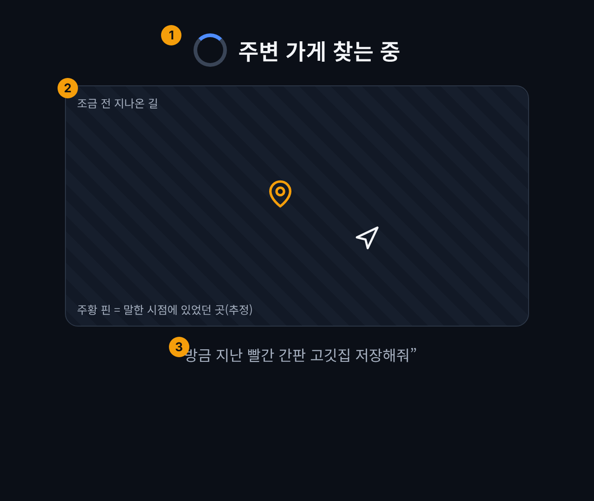 | 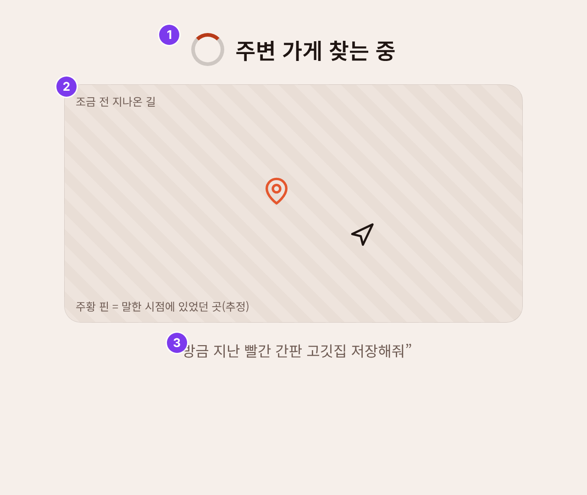 |

움직이는 미리보기: 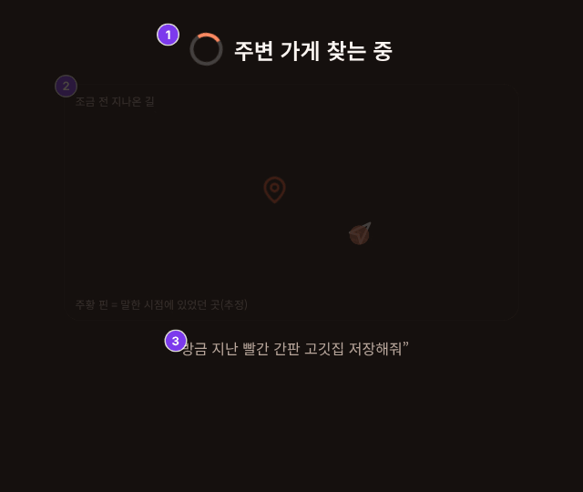

| 번호 | 요소 | 내용 | 동작 |
| --- | --- | --- | --- |
| 1 | 문구 + 링 | “주변 가게 찾는 중” | 후보가 나오면 S-03, 2초를 넘기거나 인터넷이 없으면 S-04b |
| 2 | 추정 위치 지도 | 위치 버퍼로 계산한 지점(주황)과 현재 위치 | 지도가 없으면 이 자리는 비움 |
| 3 | 말한 문장 | 확정 문장 그대로 |  |

보통 1초 안에 지나가는 화면이라 글자는 두 줄뿐이다.

모션

| 요소 | 움직임 | 시간 · 이징 | 계기 |
| --- | --- | --- | --- |
| 링 | 회전 반복 | 1s · linear | 검색 중 |
| 현재 위치 핀 | 원이 퍼지며 사라지는 맥박 | 1.2s · ease-out 반복 | 검색 중 |
| 지도 | 페이드 인 | 160ms | 화면 열릴 때 |
| 다음 화면으로 | 페이드 | 160ms | 후보 확정 |

#### S-03 확인

주행 중 · 들어오는 길: S-14 뒤 후보가 있을 때 · F-04, F-05

| 다크 | 라이트 |
| --- | --- |
|  | 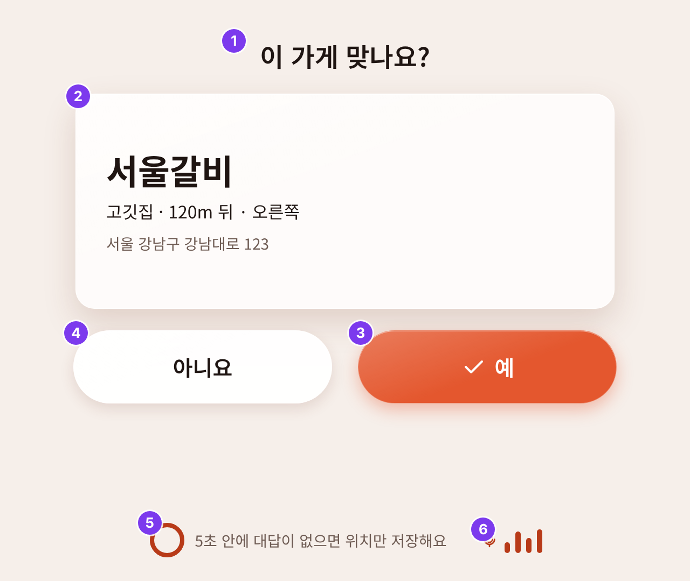 |

움직이는 미리보기: 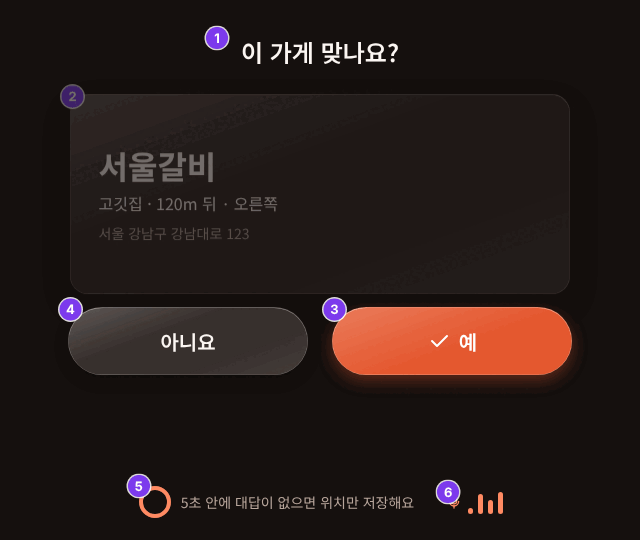

| 번호 | 요소 | 내용 | 동작 |
| --- | --- | --- | --- |
| 1 | 질문 | TTS로 같은 문장을 읽음 |  |
| 2 | 후보 카드 | 가게 이름 64dp, 업종·거리·방향, 주소 | 1순위 후보 1개만 |
| 3 | 예 | 저장 → S-04a | 음성 “응·맞아”와 같음 |
| 4 | 아니요 | 2순위가 있으면 S-03b, 없으면 S-04b | 음성 “아니”와 같음 |
| 5 | 대기 표시 | 5초 카운트다운 링 | 시간이 지나면 S-04b |
| 6 | 듣는 중 표시 | 대답을 듣는 동안 작은 막대가 움직임 | TTS가 끝난 뒤부터 |

모션

| 요소 | 움직임 | 시간 · 이징 | 계기 |
| --- | --- | --- | --- |
| 후보 카드 | 아래에서 24dp 올라오며 페이드 인 | 200ms · standard | 화면 열릴 때 |
| 카운트다운 링 | 원 테두리가 5초 동안 줄어듦 | 5s · linear | TTS가 끝난 뒤 시작 |
| 듣는 중 막대 | 4개 막대 높이 반복 | 800ms 반복 | TTS 끝난 뒤 |
| 예 누름 | 카드가 페이드 아웃되고 S-04a 토스트 | 160ms | 버튼 · 음성 응 |
| 아니요 누름 | 카드가 왼쪽으로 48dp 밀려 나가고 새 카드가 오른쪽에서 들어옴 | 200ms | S-03b로 |

#### S-03b 확인 · 두 번째 후보

주행 중 · 들어오는 길: S-03에서 아니요 1회 · F-04, F-05

| 다크 | 라이트 |
| --- | --- |
| 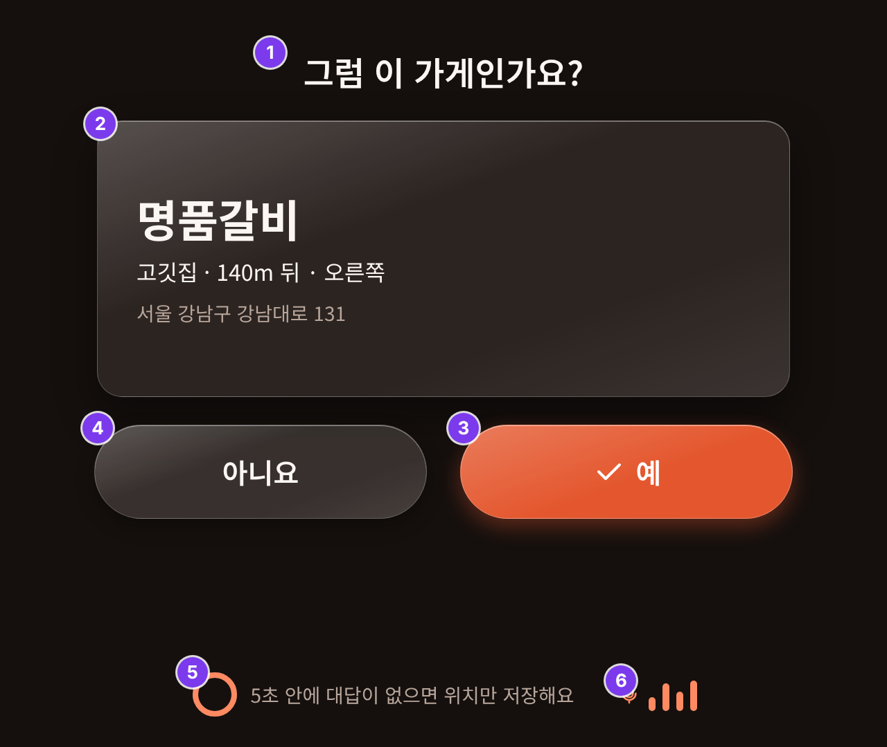 | 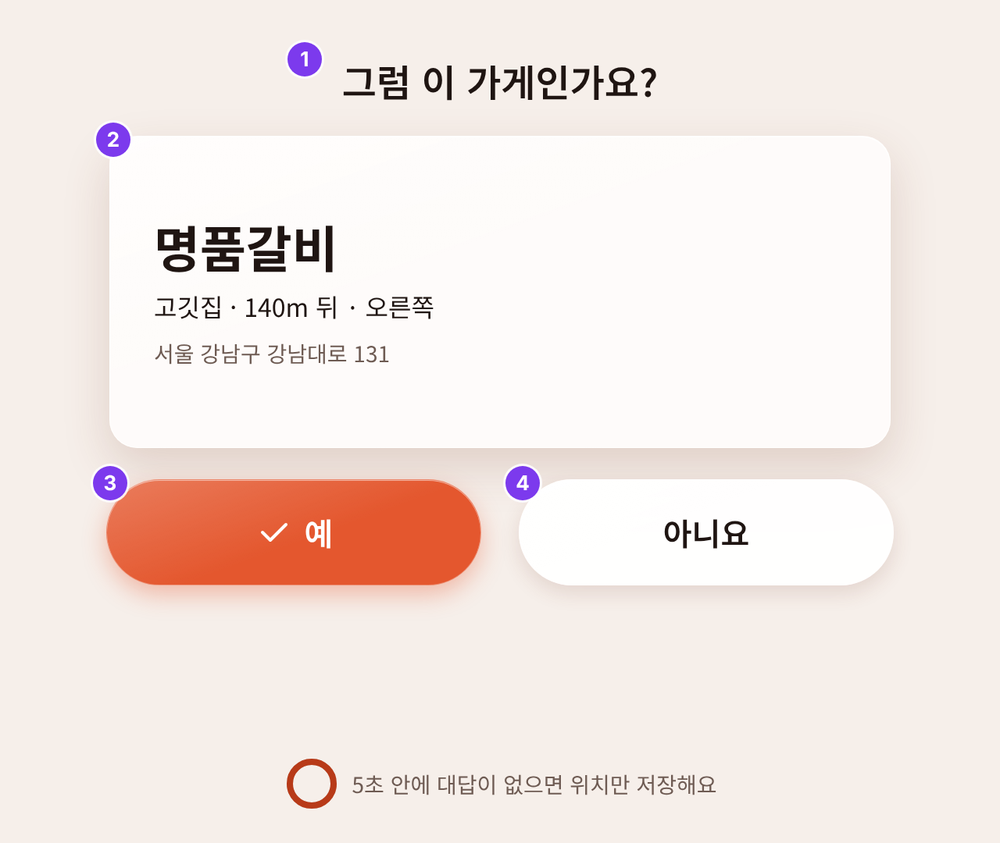 |

| 번호 | 요소 | 내용 | 동작 |
| --- | --- | --- | --- |
| 1 | 질문 | “그럼 이 가게인가요?” TTS 동일 |  |
| 2 | 2순위 카드 | S-03과 같은 구성 | 세 번째 후보는 묻지 않음 |
| 3 | 예 | 저장 → S-04a |  |
| 4 | 아니요 | S-04b (위치만 저장) |  |

모션

| 요소 | 움직임 | 시간 · 이징 | 계기 |
| --- | --- | --- | --- |
| 카드 교체 | 이전 카드는 왼쪽으로 나가고 새 카드가 오른쪽 48dp에서 들어옴 | 200ms · standard | 아니요 직후 |
| 카운트다운 링 | 처음부터 다시 5초 | 5s · linear | 새 TTS 끝난 뒤 |

#### S-04a 저장 완료

주행 중 · 정차 중 · 들어오는 길: S-03 · S-03b에서 예 · F-06

| 다크 | 라이트 |
| --- | --- |
| 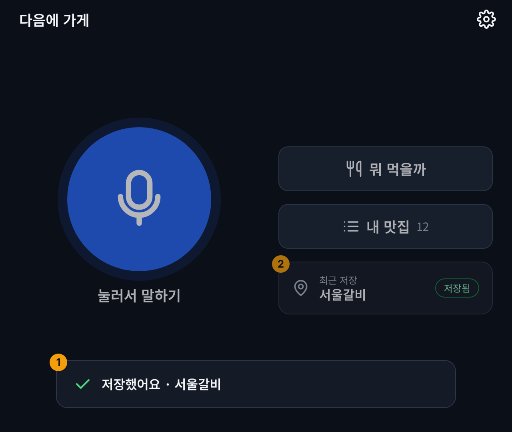 | 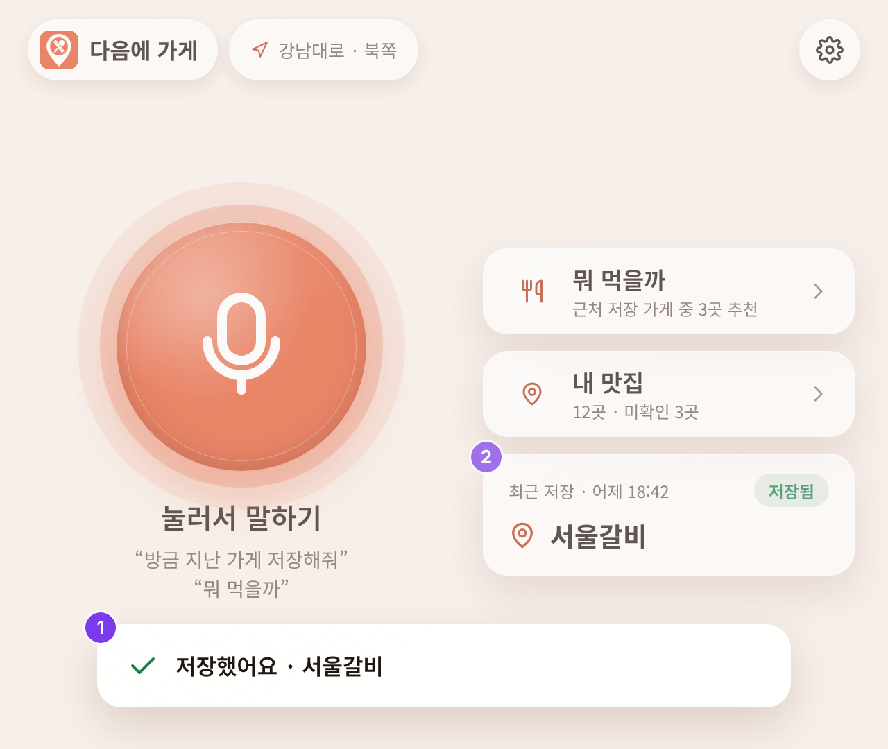 |

움직이는 미리보기: 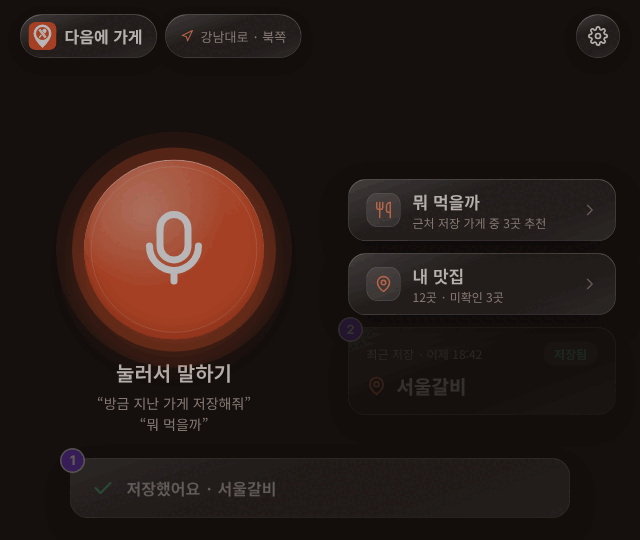

| 번호 | 요소 | 내용 | 동작 |
| --- | --- | --- | --- |
| 1 | 저장 토스트 | 가게 이름 포함, 4초 뒤 사라짐 | TTS “저장했어요” |
| 2 | 최근 저장 카드 | 방금 저장한 가게로 바뀜, 칩 “저장됨” |  |

토스트가 떠 있는 동안에도 말하기 버튼은 바로 누를 수 있다.

모션

| 요소 | 움직임 | 시간 · 이징 | 계기 |
| --- | --- | --- | --- |
| 토스트 | 아래에서 24dp 올라오며 페이드 인, 4초 뒤 페이드 아웃 | 200ms 들어옴 · 200ms 나감 | 저장 직후 |
| 체크 아이콘 | 선이 그려지듯 나타남 | 300ms | 토스트와 함께 |
| 최근 저장 카드 | 내용 페이드 교체 | 200ms | 토스트와 동시 |

#### S-04b 위치만 저장

주행 중 · 정차 중 · 들어오는 길: 후보 없음 · 인터넷 없음 · 아니요 2회 · 5초 무응답 · F-06

| 다크 | 라이트 |
| --- | --- |
| 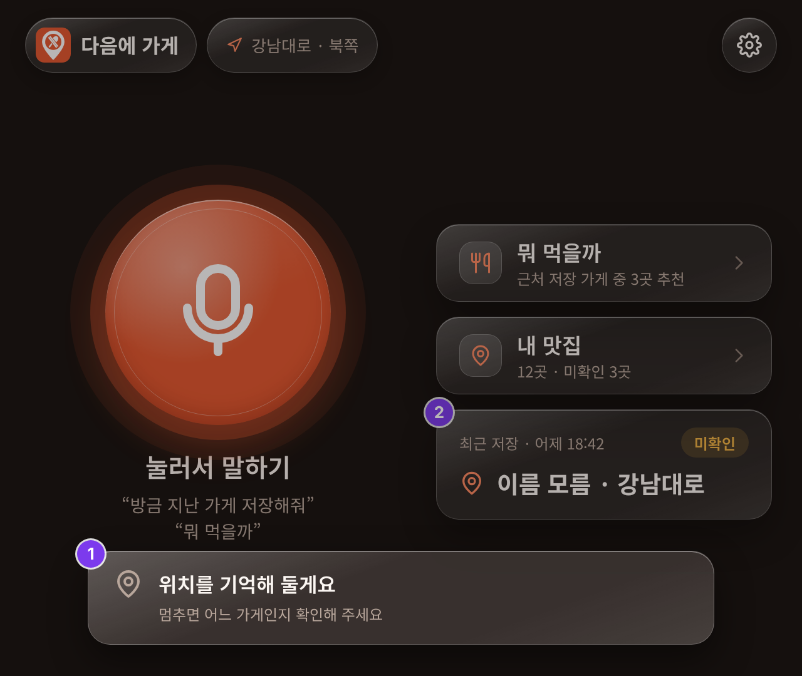 | 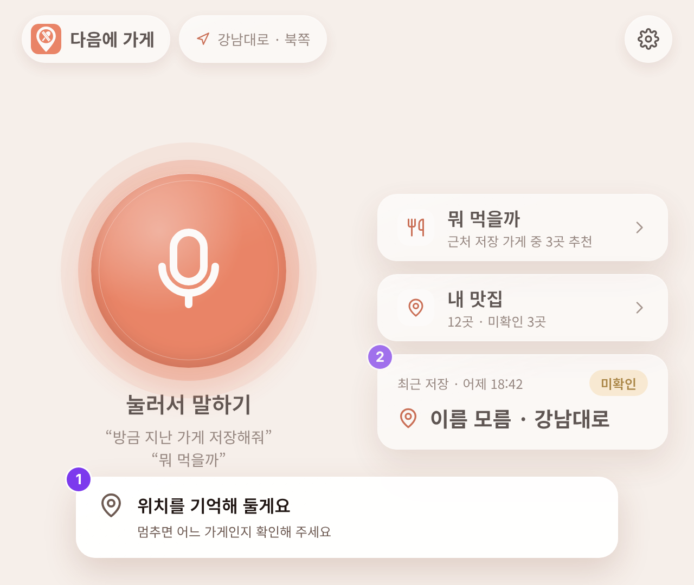 |

| 번호 | 요소 | 내용 | 동작 |
| --- | --- | --- | --- |
| 1 | 미확인 토스트 | 2줄, 4초 | TTS “위치를 기억해 둘게요” |
| 2 | 최근 저장 카드 | “이름 모름 · 도로명” + 칩 “미확인” | 누르면 S-09 (정차 중) |

S-04a와 동시에 뜨지 않는다. 둘 중 하나만.

모션

| 요소 | 움직임 | 시간 · 이징 | 계기 |
| --- | --- | --- | --- |
| 토스트 | S-04a와 같은 들어옴·나감 | 200ms / 200ms |  |
| 최근 저장 카드 | 페이드 교체 | 200ms |  |

### C. 근처 리마인드 · F-08, F-10

#### S-05 리마인드

주행 중 · 들어오는 길: 저장 가게 500m 안 진입 (차량 알림) · F-08, F-10

| 다크 | 라이트 |
| --- | --- |
|  | 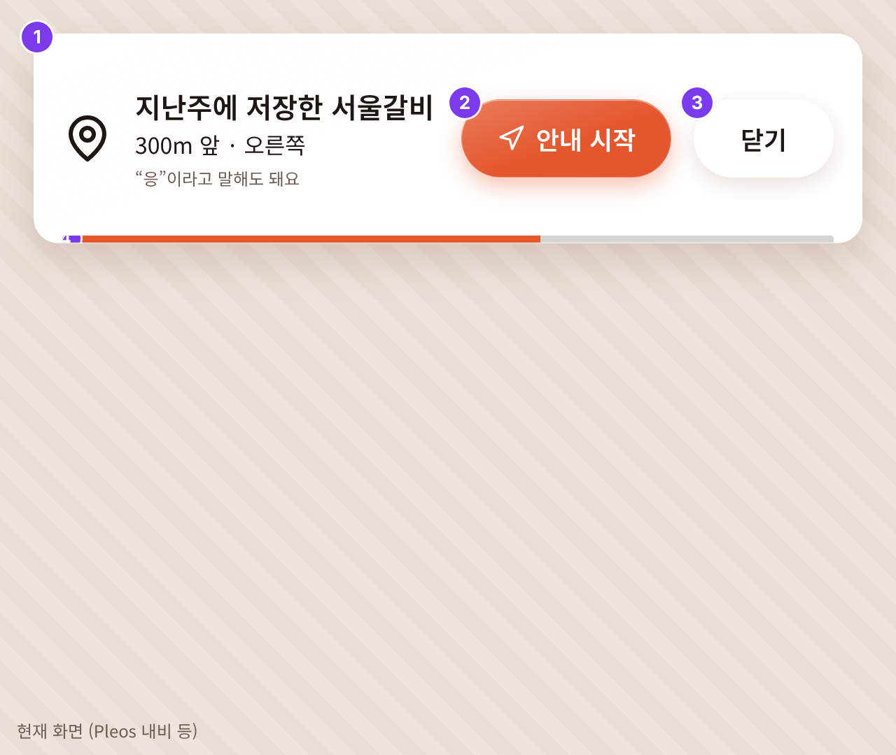 |

움직이는 미리보기: 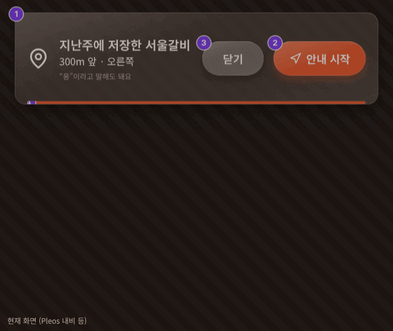

| 번호 | 요소 | 내용 | 동작 |
| --- | --- | --- | --- |
| 1 | 알림 카드 | 가게 이름·저장 시기·거리·방향. TTS “…300m 앞이에요. 갈까요?” | 10초 뒤 자동으로 닫힘 |
| 2 | 안내 시작 | 내비 목적지 설정 (requestRoute) → S-05b | 음성 “응”과 같음 |
| 3 | 닫기 | 오늘은 다시 알리지 않음 | 음성 “아니”·무응답과 같음 |
| 4 | 남은 시간 막대 | 카드 아래 가장자리, 10초 동안 줄어듦 |  |

차량 알림(heads-up) 형태. 같은 가게는 하루 1회. 설정에서 식사 시간에만 받을 수 있다.

모션

| 요소 | 움직임 | 시간 · 이징 | 계기 |
| --- | --- | --- | --- |
| 알림 카드 | 위에서 32dp 내려오며 페이드 인 | 240ms · emphasized | 500m 진입 |
| 남은 시간 막대 | 가로 길이가 100 → 0% | 10s · linear | TTS 끝난 뒤 |
| 닫힘 | 위로 32dp 올라가며 페이드 아웃 | 200ms | 닫기 · 시간 끝 · 아니 |

#### S-05b 리마인드 · 안내 시작

주행 중 · 들어오는 길: S-05에서 안내 시작 · 음성 “응” · F-10

| 다크 | 라이트 |
| --- | --- |
| 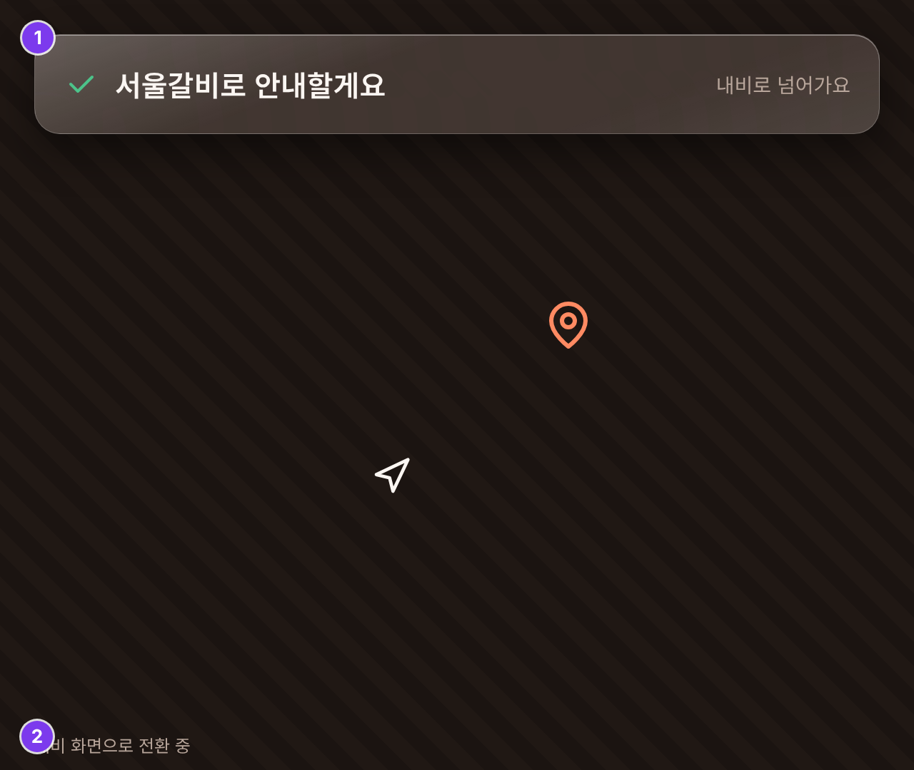 | 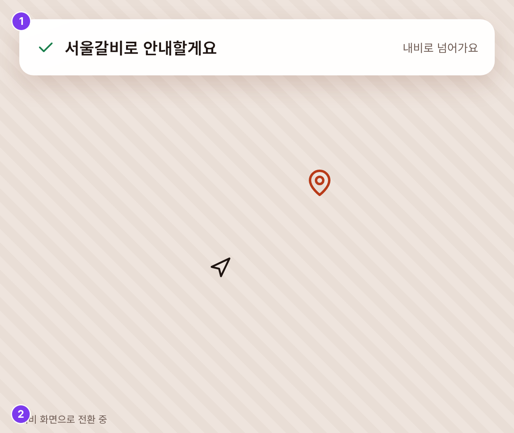 |

| 번호 | 요소 | 내용 | 동작 |
| --- | --- | --- | --- |
| 1 | 확인 문구 | TTS로 같은 문장. 1.5초 뒤 사라짐 |  |
| 2 | Pleos 내비 화면 | 차량 기본 내비 앱이 화면을 넘겨받아 길안내. 앱은 목적지(가게 좌표 · 이름)만 넘기고 길을 그리지 않음 | 도착하면 F-11 방문 기록 → S-15 |

길안내는 Pleos 내비가 한다. 이 앱에는 길안내 화면이 없고, NaviHelper SDK로 목적지만 설정한다. 확인 문구는 Pleos 내비 화면 위에 잠깐 겹쳐 보인다.

모션

| 요소 | 움직임 | 시간 · 이징 | 계기 |
| --- | --- | --- | --- |
| 카드 줄어듦 | 높이 300 → 140dp, 버튼 사라짐 | 200ms · standard | 응답 직후 |
| 카드 닫힘 | 위로 올라가며 페이드 | 200ms | 1.5초 뒤 |

### D. 추천 · F-09, F-10

#### S-06 추천

주행 중 · 정차 중 · 들어오는 길: S-01 뭐 먹을까 / 음성 “뭐 먹을까” · F-09, F-10

| 다크 | 라이트 |
| --- | --- |
|  | 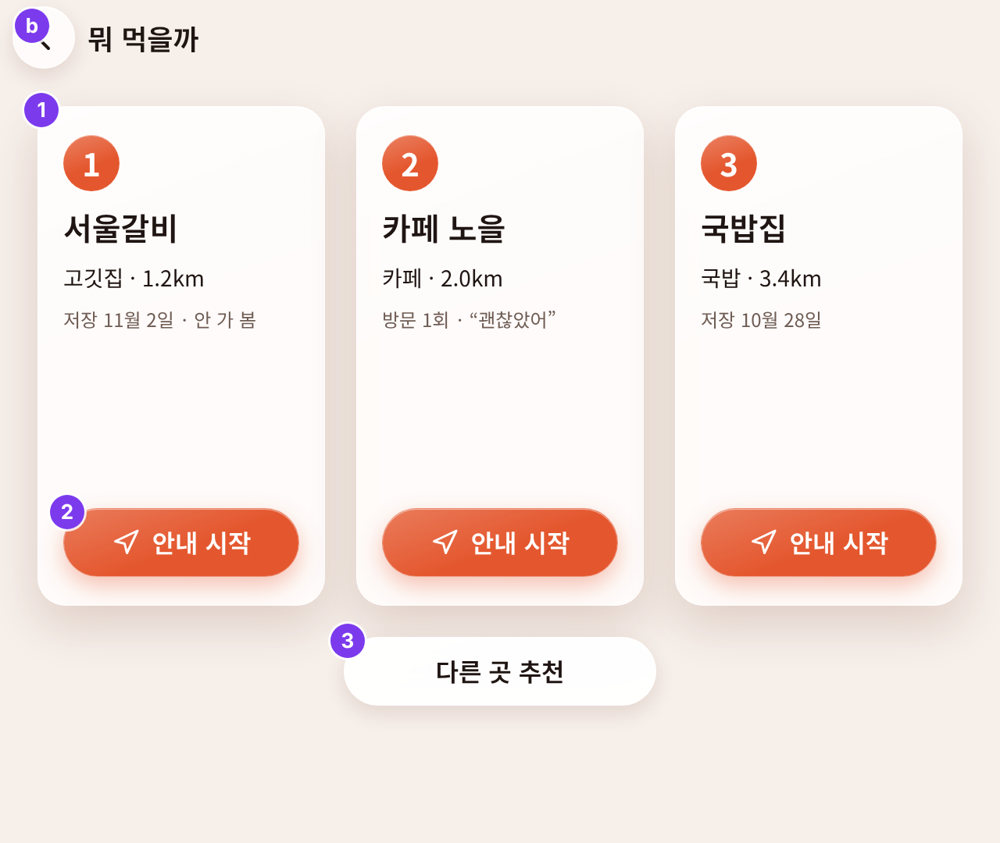 |

움직이는 미리보기: 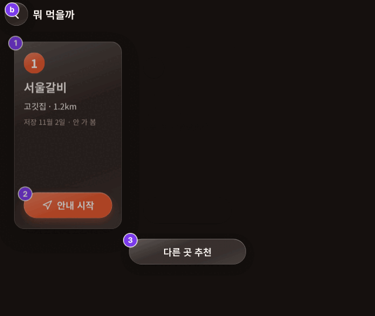

| 번호 | 요소 | 내용 | 동작 |
| --- | --- | --- | --- |
| 1 | 추천 카드 3장 | 번호·이름·업종·거리·메모. 거리는 말한 곳 기준이고 화면이 열린 뒤 다시 계산하지 않음. TTS는 번호와 이름만 읽음 | “2번” 또는 이름을 말하면 선택 → S-06c |
| 2 | 안내 시작 | 카드별 1개 | 누르면 S-06c |
| 3 | 다른 곳 추천 | 다음 순위 3곳으로 교체 | 최대 2회. 더 없으면 S-06b |
| 뒤로 | 뒤로 | 홈 |  |

모션

| 요소 | 움직임 | 시간 · 이징 | 계기 |
| --- | --- | --- | --- |
| 카드 3장 | 아래에서 24dp 올라오며 차례로 등장(60ms 간격) | 200ms × 3 · standard | 화면 열릴 때 |
| 읽는 카드 강조 | TTS가 번호를 읽는 동안 그 카드 테두리만 주황 | 120ms | 카드마다 차례로 |
| 다른 곳 추천 | 세 장이 왼쪽으로 나가고 새 세 장이 오른쪽에서 들어옴 | 200ms | 버튼 · 음성 “다른 데” |

#### S-06b 추천할 가게 없음

주행 중 · 정차 중 · 들어오는 길: 반경 안에 저장 가게가 없을 때 · F-09

| 다크 | 라이트 |
| --- | --- |
| 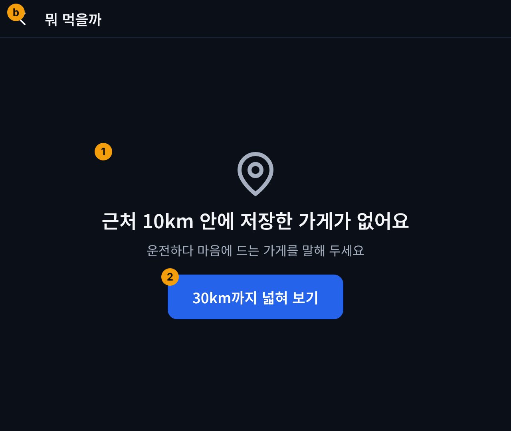 | 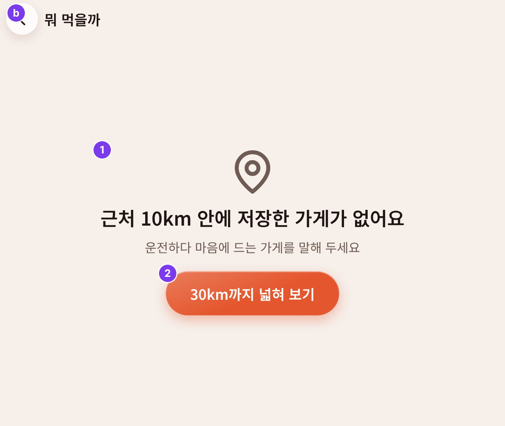 |

| 번호 | 요소 | 내용 | 동작 |
| --- | --- | --- | --- |
| 1 | 안내 | 한 줄 + TTS 동일 문장 |  |
| 2 | 30km까지 넓혀 보기 | 반경을 넓혀 S-06 다시 | 그래도 없으면 버튼이 사라지고 “저장한 가게가 없어요” |
| 뒤로 | 뒤로 | 홈 |  |

모션

| 요소 | 움직임 | 시간 · 이징 | 계기 |
| --- | --- | --- | --- |
| 안내 | 페이드 인 | 160ms | 화면 열릴 때 |

#### S-06c 추천 · 선택됨

주행 중 · 정차 중 · 들어오는 길: S-06에서 카드 선택 (터치 · 번호 · 이름) · F-09, F-10

| 다크 | 라이트 |
| --- | --- |
| 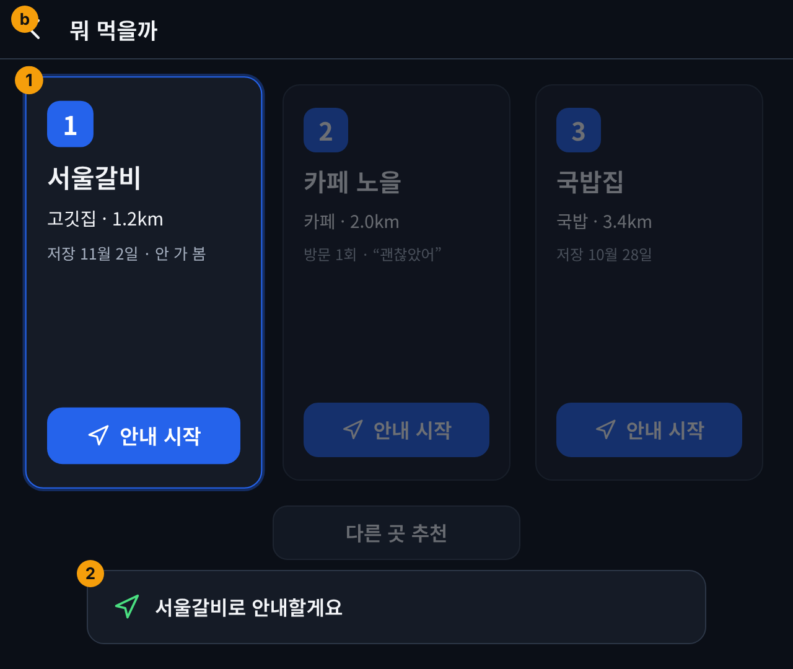 | 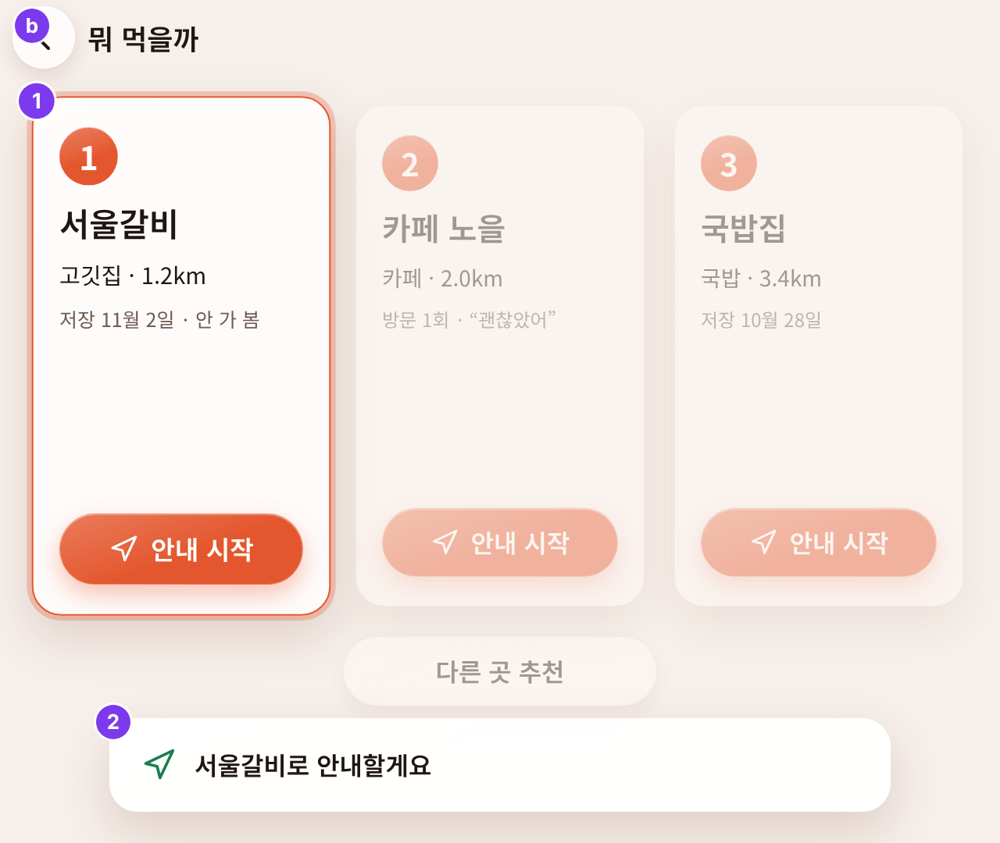 |

| 번호 | 요소 | 내용 | 동작 |
| --- | --- | --- | --- |
| 1 | 선택한 카드 | 테두리 주황 + 4% 확대, 나머지 카드는 흐려짐 | 1.5초 뒤 홈으로 돌아가고 Pleos 내비가 안내 시작 (S-05b와 같음) |
| 2 | 안내 토스트 | “서울갈비로 안내할게요” + TTS 동일 |  |
| 뒤로 | 뒤로 | 홈 (선택 취소) |  |

모션

| 요소 | 움직임 | 시간 · 이징 | 계기 |
| --- | --- | --- | --- |
| 선택 카드 | 100 → 104% 확대, 테두리 주황 | 200ms · standard | 선택 직후 |
| 나머지 카드 | 불투명도 100 → 40% | 200ms | 선택 카드와 동시 |
| 토스트 | 아래에서 올라옴 | 200ms | 선택 직후 |
| 홈으로 | 페이드 | 160ms | 1.5초 뒤 |

### E. 방문 기록 · F-11

#### S-15 방문 메모

주행 중 · 정차 중 · 들어오는 길: 내비 도착 + 10분 체류 뒤 다시 출발할 때 (차량 알림) · F-11

| 다크 | 라이트 |
| --- | --- |
| 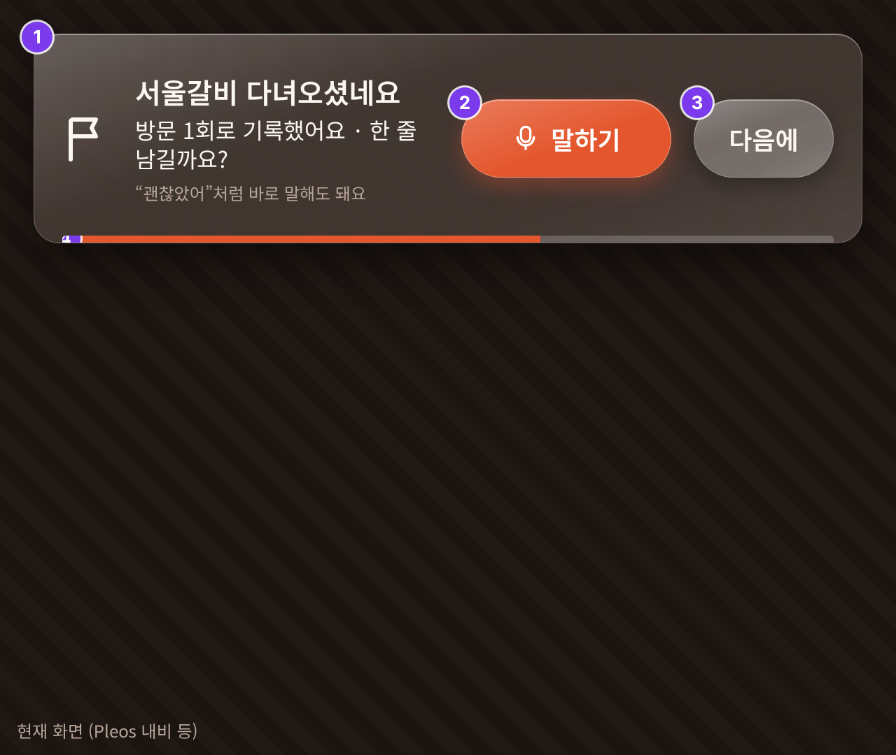 | 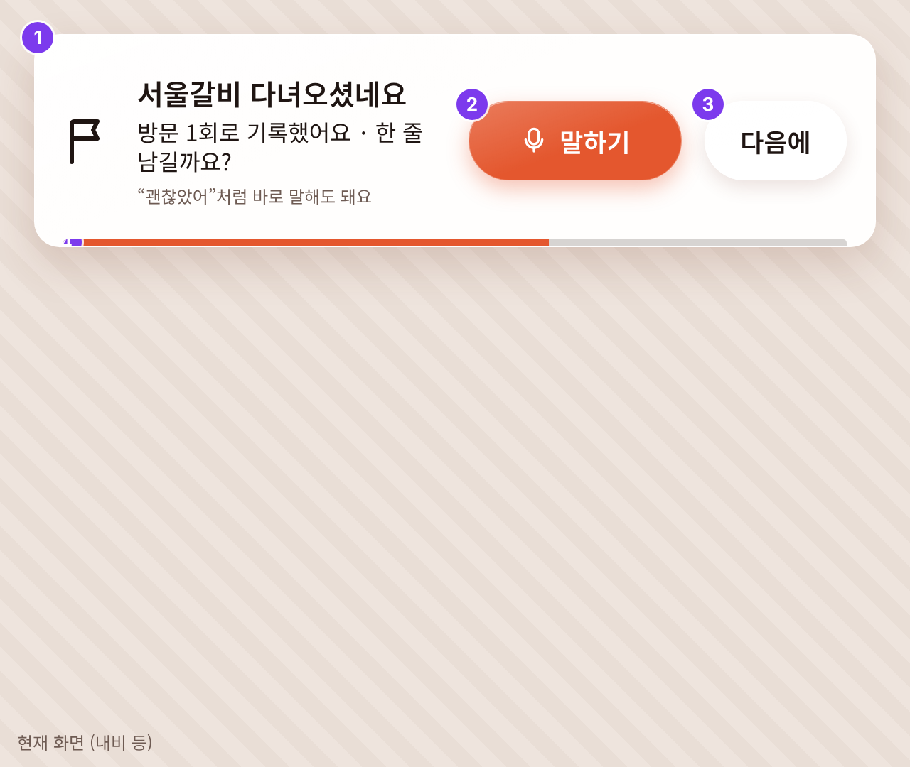 |

움직이는 미리보기: 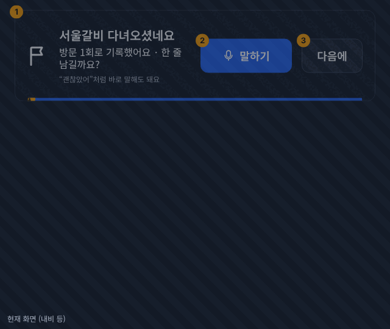

| 번호 | 요소 | 내용 | 동작 |
| --- | --- | --- | --- |
| 1 | 알림 카드 | 가게 이름, 방문 횟수 기록됨, 질문. TTS “…다녀오셨네요. 한 줄 남길까요?” | 방문 기록 자체는 이미 저장됨 |
| 2 | 말하기 | S-02a로 메모 한 문장 받음 → S-15b | 바로 말하면 버튼 없이 진행 |
| 3 | 다음에 | 메모 없이 닫힘 | 무응답 10초와 같음 |
| 4 | 남은 시간 막대 | 10초 |  |

리마인드(S-05)와 같은 틀을 쓴다. 주행 중이면 TTS와 음성만으로 끝낸다.

모션

| 요소 | 움직임 | 시간 · 이징 | 계기 |
| --- | --- | --- | --- |
| 알림 카드 | 위에서 32dp 내려오며 페이드 인 | 240ms · emphasized | 출발 감지 |
| 남은 시간 막대 | 100 → 0% | 10s · linear | TTS 끝난 뒤 |
| 닫힘 | 위로 올라가며 페이드 아웃 | 200ms |  |

#### S-15b 방문 메모 저장

주행 중 · 정차 중 · 들어오는 길: S-15에서 말한 뒤 · F-11

| 다크 | 라이트 |
| --- | --- |
| 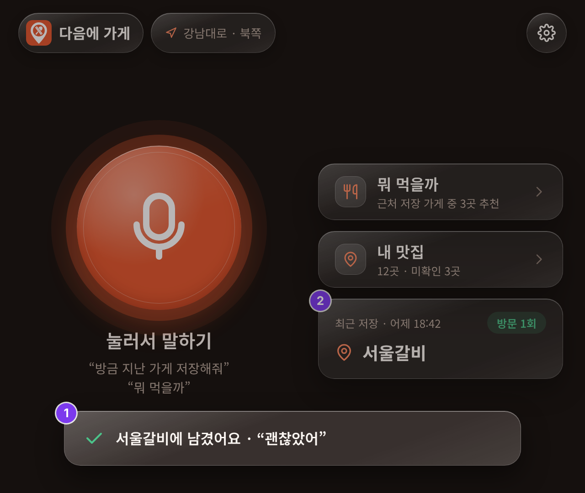 | 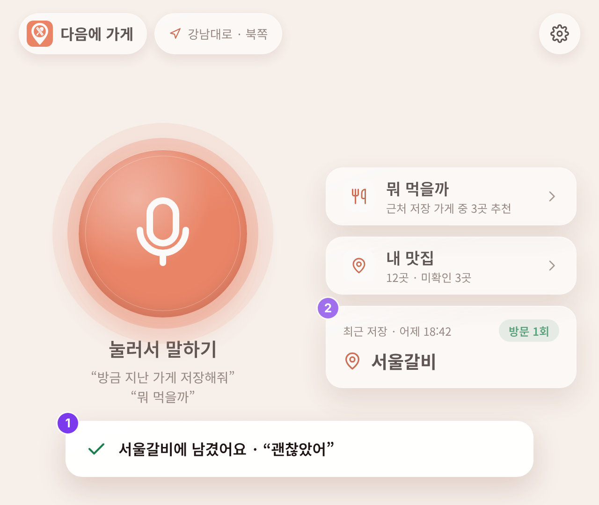 |

| 번호 | 요소 | 내용 | 동작 |
| --- | --- | --- | --- |
| 1 | 토스트 | 메모 문장 포함, 4초 | TTS “남겼어요” |
| 2 | 최근 저장 카드 | 칩이 “방문 1회”로 | 상세(S-08)에 메모가 쌓임 |

모션

| 요소 | 움직임 | 시간 · 이징 | 계기 |
| --- | --- | --- | --- |
| 토스트 | S-04a와 같음 | 200ms / 200ms |  |
| 칩 교체 | 페이드 | 200ms |  |

### F. 내 맛집 · F-12, F-07

#### S-07 내 맛집

정차 중 · 들어오는 길: S-01 내 맛집 · F-12, F-07, F-13

| 다크 | 라이트 |
| --- | --- |
| 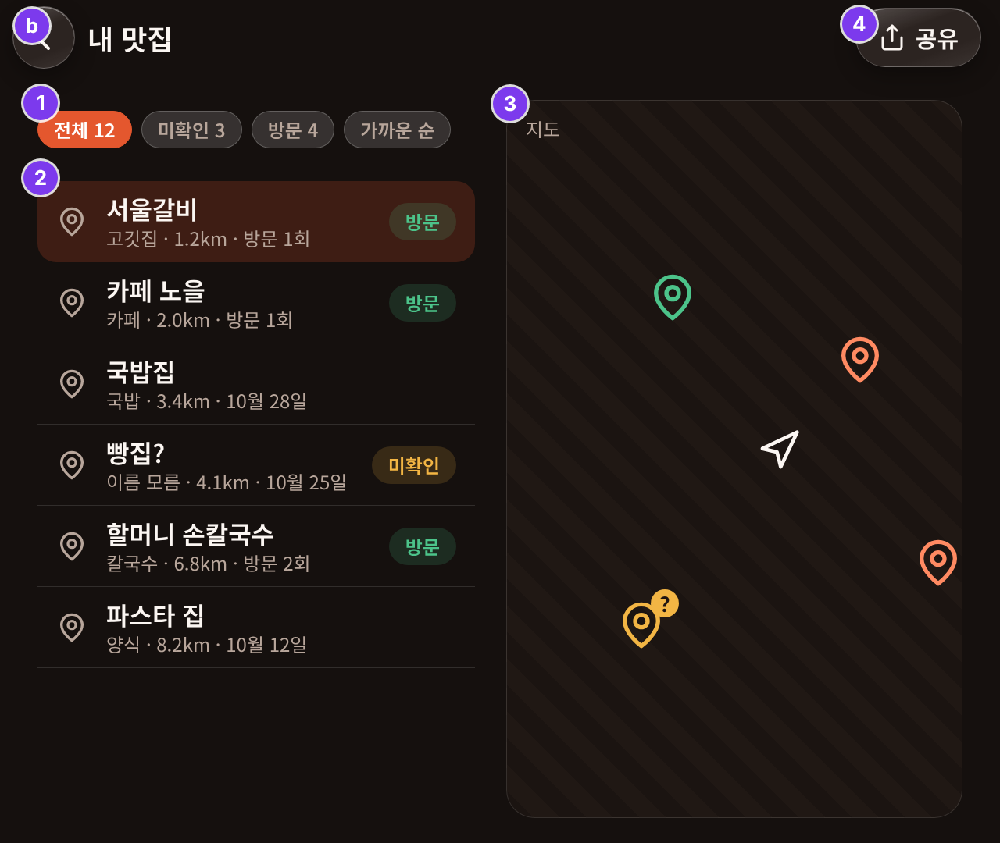 | 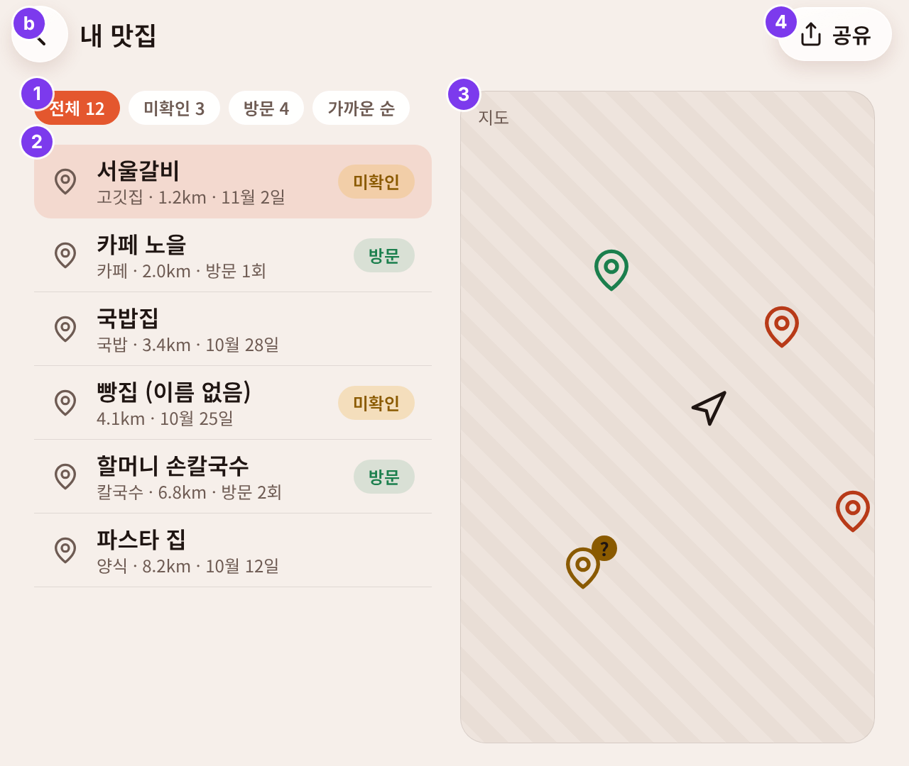 |

| 번호 | 요소 | 내용 | 동작 |
| --- | --- | --- | --- |
| 1 | 필터 칩 | 전체 / 미확인 / 방문, 정렬(가까운 순·최근 저장 순) | 누르면 목록만 바뀜 |
| 2 | 가게 목록 | 이름·업종·거리·저장일 또는 방문 횟수·상태 칩, 줄 높이 104dp | 누르면 S-08, 미확인은 S-09. 0건이면 S-07b |
| 3 | 지도 | 저장 가게 핀(주황), 미확인 핀(노랑), 내 위치 | 핀을 누르면 목록에서 선택됨. 지도 SDK가 안 되면 비움 |
| 4 | 공유 | S-10 |  |
| 뒤로 | 뒤로 | 홈 |  |

주행 중에 열면 S-12가 대신 뜬다.

모션

| 요소 | 움직임 | 시간 · 이징 | 계기 |
| --- | --- | --- | --- |
| 화면 전환 | 정차 화면끼리는 오른쪽 48dp에서 밀려 들어오며 페이드 | 200ms · standard | S-01 → S-07 |
| 목록 줄 | 위에서부터 차례로 페이드 인(40ms 간격, 최대 8줄) | 200ms | 화면 열릴 때 · 필터 바꿀 때 |
| 줄 선택 | 배경이 주황 톤으로 | 120ms | 터치 · 지도 핀 터치 |
| 지도 핀 선택 | 핀이 8dp 튀어 오름 | 200ms | 목록 줄 터치 |

#### S-07b 내 맛집 · 저장 전

정차 중 · 들어오는 길: 저장 가게 0개일 때 S-01b 내 맛집 · F-12

| 다크 | 라이트 |
| --- | --- |
| 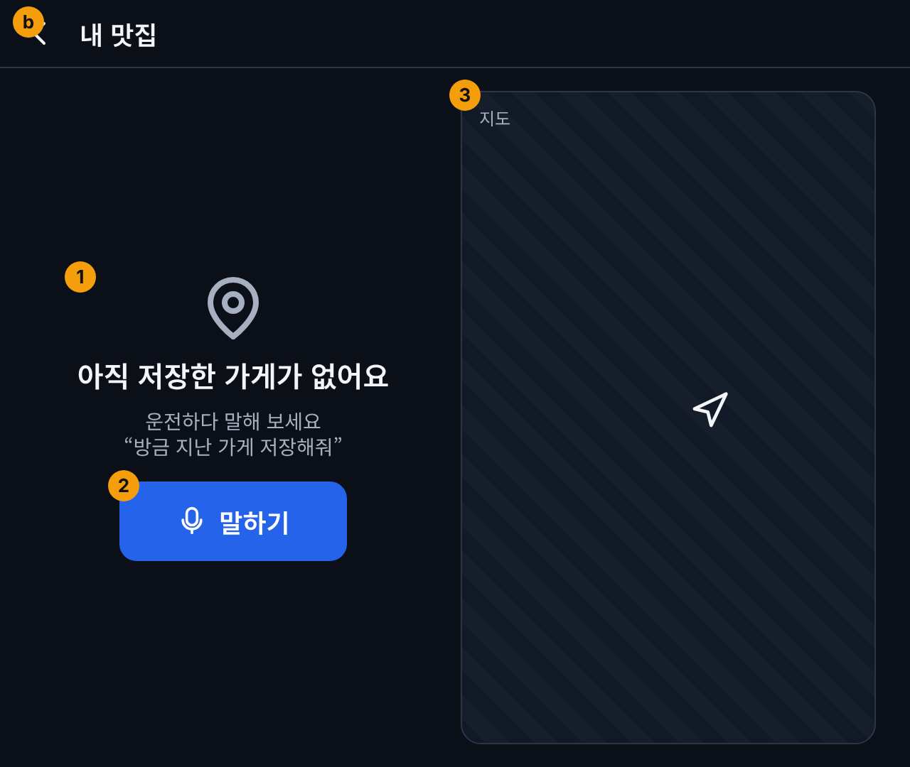 |  |

| 번호 | 요소 | 내용 | 동작 |
| --- | --- | --- | --- |
| 1 | 안내 | 2줄 + 예시 문장 |  |
| 2 | 말하기 | S-02a |  |
| 3 | 지도 | 내 위치만 |  |
| 뒤로 | 뒤로 | 홈 |  |

모션

| 요소 | 움직임 | 시간 · 이징 | 계기 |
| --- | --- | --- | --- |
| 화면 전환 | S-07과 같음 | 200ms |  |

#### S-08 가게 상세

정차 중 · 들어오는 길: S-07 목록 / 홈 최근 저장 · F-10, F-11, F-12

| 다크 | 라이트 |
| --- | --- |
|  |  |

| 번호 | 요소 | 내용 | 동작 |
| --- | --- | --- | --- |
| 1 | 정보 | 업종·거리·주소·저장일·방문 횟수·메모·저장할 때 한 말 |  |
| 2 | 위치 지도 | 핀 1개 |  |
| 3 | 안내 시작 | 내비 목적지 설정 → 홈 + 토스트 “안내할게요” |  |
| 4 | 수정 | S-08b |  |
| 5 | 삭제 | S-08c 확인 창 | 다른 버튼과 떨어뜨려 배치 |
| 6 | 공유에 담기 | S-10 목록에 추가. 누르면 “담았어요”로 바뀜 |  |
| 뒤로 | 뒤로 | S-07 (홈에서 왔으면 홈) |  |

모션

| 요소 | 움직임 | 시간 · 이징 | 계기 |
| --- | --- | --- | --- |
| 화면 전환 | 오른쪽 48dp에서 밀려 들어오며 페이드 | 200ms · standard | S-07 → S-08 |
| 지도 핀 | 위에서 떨어지며 튕김 | 400ms · emphasized | 화면 열릴 때 |
| 공유에 담기 | 버튼 글자가 체크 + “담았어요”로 페이드 교체 | 160ms | 누른 직후 |

#### S-08b 가게 수정

정차 중 · 들어오는 길: S-08 수정 · F-12

| 다크 | 라이트 |
| --- | --- |
|  |  |

| 번호 | 요소 | 내용 | 동작 |
| --- | --- | --- | --- |
| 1 | 이름 | 글자 입력. 비우면 저장 불가 |  |
| 2 | 업종 | 칩에서 하나 고름 |  |
| 3 | 메모 | 한 줄 |  |
| 4 | 후보 다시 고르기 | S-09로 가서 다른 가게로 바꿈 |  |
| 5 | 저장 | S-08로 돌아감 + 토스트 “수정했어요” |  |
| 6 | 취소 | 바뀐 내용 버림 |  |
| 7 | 키보드 자리 | 입력창을 누르면 시스템 키보드가 아래 320dp를 차지 | 주행 중이면 S-12 |
| 뒤로 | 뒤로 | 취소와 같음 |  |

모션

| 요소 | 움직임 | 시간 · 이징 | 계기 |
| --- | --- | --- | --- |
| 화면 전환 | 오른쪽에서 밀려 들어옴 | 200ms | S-08 → S-08b |
| 입력창 포커스 | 테두리가 주황으로, 바깥 4dp 번짐 | 120ms | 입력창 터치 |
| 키보드 | 아래에서 올라옴 (시스템) | 240ms | 입력창 터치 |

#### S-08c 삭제 확인

정차 중 · 들어오는 길: S-08 삭제 / S-09 삭제 · F-12

| 다크 | 라이트 |
| --- | --- |
|  |  |

움직이는 미리보기: 

| 번호 | 요소 | 내용 | 동작 |
| --- | --- | --- | --- |
| 1 | 질문 | 가게 이름을 넣은 한 줄 |  |
| 2 | 설명 | 무엇이 함께 지워지는지, 되돌리기 안내 |  |
| 3 | 삭제 | 빨강 채움 버튼. 삭제 → S-08d | 빨강은 이 버튼과 설정의 모두 삭제에만 |
| 4 | 취소 | 창 닫기 |  |

모션

| 요소 | 움직임 | 시간 · 이징 | 계기 |
| --- | --- | --- | --- |
| 어두운 배경 | 페이드 인 | 160ms | 삭제 누름 |
| 창 | 96% → 100% + 페이드 | 200ms · standard | 배경과 함께 |
| 닫힘 | 페이드 아웃 | 160ms |  |

#### S-08d 삭제 뒤 되돌리기

정차 중 · 들어오는 길: S-08c 삭제 뒤 (목록으로 돌아옴) · F-12

| 다크 | 라이트 |
| --- | --- |
|  |  |

움직이는 미리보기: 

| 번호 | 요소 | 내용 | 동작 |
| --- | --- | --- | --- |
| 1 | 토스트 + 되돌리기 | 4초. 되돌리기를 누르면 줄이 제자리에 다시 생김 | 되돌리기 버튼은 삭제 뒤에만 씀 |
| 2 | 목록 | 지운 줄이 접히며 사라짐, 개수 칩 갱신 |  |
| 뒤로 | 뒤로 | 홈 |  |

모션

| 요소 | 움직임 | 시간 · 이징 | 계기 |
| --- | --- | --- | --- |
| 지운 줄 | 높이 104 → 0dp로 접히며 페이드 | 200ms · standard | 삭제 직후 |
| 토스트 | 아래에서 올라옴, 4초 뒤 사라짐 | 200ms / 200ms |  |
| 되돌리기 | 줄이 다시 펼쳐짐 | 200ms | 되돌리기 누름 |

#### S-09 미확인 가게 정리

정차 중 · 들어오는 길: S-07 미확인 항목 / S-08b 후보 다시 고르기 / 홈 최근 저장(미확인) · F-07

| 다크 | 라이트 |
| --- | --- |
|  |  |

| 번호 | 요소 | 내용 | 동작 |
| --- | --- | --- | --- |
| 1 | 그때 상황 | 저장 시각·위치·진행 방향·말한 문장 | 판단 근거 |
| 2 | 후보 5곳 | 가까운 순, 업종·거리·좌우. 기본 선택은 1순위 | 하나 고르면 지도 핀도 강조 |
| 3 | 이걸로 저장 | 선택한 후보로 확정 → S-08 + 토스트 “저장했어요” |  |
| 4 | 직접 검색 | S-09b |  |
| 5 | 삭제 | S-08c 확인 창 |  |
| 뒤로 | 뒤로 | S-07 |  |

모션

| 요소 | 움직임 | 시간 · 이징 | 계기 |
| --- | --- | --- | --- |
| 화면 전환 | 오른쪽에서 밀려 들어옴 | 200ms |  |
| 후보 선택 | 라디오 채움 + 줄 배경 | 120ms | 줄 터치 |
| 지도 핀 강조 | 선택한 후보의 핀이 120%로 | 200ms · standard | 줄 터치와 동시 |

#### S-09b 직접 검색

정차 중 · 들어오는 길: S-09 직접 검색 · F-07

| 다크 | 라이트 |
| --- | --- |
|  |  |

| 번호 | 요소 | 내용 | 동작 |
| --- | --- | --- | --- |
| 1 | 검색창 | 이름 일부로 검색. 그때 위치 2km 안을 먼저 보여 줌 |  |
| 2 | 결과 목록 | 이름·업종·주소·거리, 하나 선택 | 한 글자 칠 때마다 갱신 |
| 3 | 이걸로 저장 | S-08 + 토스트 “저장했어요” |  |
| 4 | 키보드 자리 | 시스템 키보드 320dp |  |
| 뒤로 | 뒤로 | S-09 |  |

모션

| 요소 | 움직임 | 시간 · 이징 | 계기 |
| --- | --- | --- | --- |
| 결과 목록 | 갱신될 때 페이드 교체 | 160ms | 글자 입력마다 |
| 키보드 | 아래에서 올라옴 | 240ms | 화면 열릴 때 |

### G. 맛집 지도 공유 · F-13

#### S-10 맛집 지도 공유

정차 중 · 들어오는 길: S-07 공유 / S-08 공유에 담기 · F-13

| 다크 | 라이트 |
| --- | --- |
|  |  |

| 번호 | 요소 | 내용 | 동작 |
| --- | --- | --- | --- |
| 1 | 가게 고르기 | 체크 목록, 전체 선택. 미확인 가게는 목록에 없음 | 고를 때마다 링크·QR이 다시 만들어짐 |
| 2 | 제목 | 기본값 “이름의 맛집 N곳”, 정차 중 키보드로 수정 |  |
| 3 | QR | 동승자가 폰으로 바로 찍음 |  |
| 4 | 링크 복사 / 보내기 | 보내기는 차량의 다른 앱(문자 등)으로. 링크에 가게 이름·업종·주소·좌표·메모만 담김 | 방문 기록·차량 위치는 안 들어감 |
| 5 | 받는 사람 | 웹 목록 → 앱 있으면 S-16 가져오기 |  |
| 뒤로 | 뒤로 | S-07 |  |

모션

| 요소 | 움직임 | 시간 · 이징 | 계기 |
| --- | --- | --- | --- |
| 화면 전환 | 오른쪽에서 밀려 들어옴 | 200ms |  |
| 체크 토글 | 채움 + 체크 표시 | 120ms | 줄 터치 |
| QR | 다시 만들어질 때 페이드 교체 | 200ms | 선택·제목 바뀔 때 |
| 링크 복사 | 버튼 글자가 체크 + “복사했어요”로 1.5초 바뀜 | 160ms | 누른 직후 |

#### S-16 받은 목록 가져오기

정차 중 · 들어오는 길: 공유 링크를 차량에서 열었을 때 / S-10 받는 사람 · F-13

| 다크 | 라이트 |
| --- | --- |
|  |  |

| 번호 | 요소 | 내용 | 동작 |
| --- | --- | --- | --- |
| 1 | 제목 · 보낸 사람 | 링크에 담긴 제목과 날짜 |  |
| 2 | 목록 | 체크로 고름. 이미 있는 가게는 “이미 있음” 칩과 함께 빠짐 |  |
| 3 | 지도 | 받은 가게 핀 |  |
| 4 | 내 지도에 추가 | 선택한 가게를 저장 → S-16b | 받은 가게는 방문 기록 없이 “저장됨” |
| 5 | 닫기 | 저장 안 함 |  |
| 뒤로 | 뒤로 | 닫기와 같음 |  |

차량에서 링크를 열 브라우저가 없으면 폰에서 보는 웹 목록만 쓴다(기획서 9장 결정 대기).

모션

| 요소 | 움직임 | 시간 · 이징 | 계기 |
| --- | --- | --- | --- |
| 화면 전환 | 오른쪽에서 밀려 들어옴 | 200ms |  |
| 추가 누름 | 줄마다 체크가 차례로 채워짐(40ms 간격) | 120ms × N | 추가 직후 |

#### S-16b 가져오기 완료

정차 중 · 들어오는 길: S-16 내 지도에 추가 뒤 · F-13

| 다크 | 라이트 |
| --- | --- |
|  |  |

| 번호 | 요소 | 내용 | 동작 |
| --- | --- | --- | --- |
| 1 | 토스트 | 추가한 개수, 4초 |  |
| 2 | 새 줄 강조 | 추가된 줄 배경이 주황 톤에서 서서히 원래대로 | 정렬은 최근 저장 순으로 바뀜 |
| 뒤로 | 뒤로 | 홈 |  |

모션

| 요소 | 움직임 | 시간 · 이징 | 계기 |
| --- | --- | --- | --- |
| 새 줄 배경 | 주황 톤 → 투명 | 1.2s · ease-out | 목록 열릴 때 |
| 토스트 | 아래에서 올라옴 | 200ms |  |

### H. 설정과 주행 제한 · F-15, F-14

#### S-11 설정

정차 중 · 들어오는 길: S-01 설정 · F-15

| 다크 | 라이트 |
| --- | --- |
|  |  |

| 번호 | 요소 | 내용 | 동작 |
| --- | --- | --- | --- |
| 1 | 리마인드 | 켜기/끄기 |  |
| 2 | 알림 거리 | 300m / 500m / 1km |  |
| 3 | 식사 시간에만 알림 | 11~14시, 17~20시 |  |
| 4 | 음성 안내 음량 |  |  |
| 5 | 모두 삭제 | S-11b 확인 창. 다른 항목과 떨어뜨림 |  |
| 6 | 가게를 특정할 때 쓰는 시간 | 말한 시점에서 얼마나 거슬러 올라가 위치를 잡을지 (10 / 20 / 30초) |  |
| 뒤로 | 뒤로 | 홈 |  |

모션

| 요소 | 움직임 | 시간 · 이징 | 계기 |
| --- | --- | --- | --- |
| 화면 전환 | 오른쪽에서 밀려 들어옴 | 200ms |  |
| 토글 | 손잡이가 좌우로 이동 + 배경색 | 160ms · standard | 터치 |
| 구간 선택 | 주황 배경이 옆 칸으로 미끄러짐 | 160ms | 터치 |
| 음량 | 손잡이가 손가락을 따라 즉시 이동 | 0ms | 드래그 |

#### S-11b 모두 삭제 확인

정차 중 · 들어오는 길: S-11 모두 삭제 · F-15

| 다크 | 라이트 |
| --- | --- |
|  |  |

| 번호 | 요소 | 내용 | 동작 |
| --- | --- | --- | --- |
| 1 | 질문 | 개수를 넣은 한 줄 |  |
| 2 | 경고 | 되돌릴 수 없음을 분명히 |  |
| 3 | 모두 삭제 | 빨강 채움. 삭제 뒤 S-01b | 되돌리기 토스트 없음 |
| 4 | 취소 | 창 닫기 |  |

모션

| 요소 | 움직임 | 시간 · 이징 | 계기 |
| --- | --- | --- | --- |
| 창 열림 | S-08c와 같음 | 160ms / 200ms |  |
| 삭제 뒤 | 설정 → 홈(S-01b)으로 페이드 | 200ms |  |

#### S-12 주행 중 안내

주행 중 · 들어오는 길: 주행 중 S-07 ~ S-11, S-16 진입 시 · F-14

| 다크 | 라이트 |
| --- | --- |
|  |  |

| 번호 | 요소 | 내용 | 동작 |
| --- | --- | --- | --- |
| 1 | 안내 | 정차(주차 브레이크 또는 속도 0)하면 원래 화면으로 자동 전환 | 제목은 열려던 화면 이름 |
| 2 | 말하기 | S-02a |  |
| 뒤로 | 뒤로 | 홈 |  |

모션

| 요소 | 움직임 | 시간 · 이징 | 계기 |
| --- | --- | --- | --- |
| 대신 뜰 때 | 페이드만 (이동 없음) | 160ms | 주행 중 정차 화면 진입 |
| 정차 감지 | 원래 화면으로 페이드 | 200ms | 주차 브레이크 · 속도 0 2초 유지 |
| 주행 다시 시작 | 열려 있던 정차 화면이 이 화면으로 페이드 | 160ms | 속도 > 0 |

### 세로 창 (1칸) · 640×1080 가정 · 5장

Pleos 앱 영역은 기본이 세로 1칸이다. 세로 창에서는 말하기 버튼(또는 그 화면의 결정 버튼)을 하단 가운데에 두고, 카드는 그 위에 쌓는다. 주행 중에 쓰는 대표 화면 5장만 그렸고, 나머지 화면도 같은 규칙으로 옮긴다. 모션은 가로 화면과 같다. 크기 640×1080은 가정이며 에뮬레이터에서 확인한다.

#### P-01 홈

가로 화면 S-01의 세로 배치

| 다크 | 라이트 |
| --- | --- |
|  |  |

| 번호 | 요소 | 내용 | 동작 |
| --- | --- | --- | --- |
| 1 | 말하기 버튼 | 240dp 원형, 하단 가운데 고정 | S-01과 같음 (누르면 P-02a) |
| 2 | 최근 저장 | 카드 묶음 맨 위 | S-01과 같음 |
| 3 | 뭐 먹을까 | 카드 높이 112dp | S-01과 같음 |
| 4 | 내 맛집 | 카드 높이 112dp | S-01과 같음 |
| 5 | 설정 | 오른쪽 위 | S-11 |
| 6 | 현재 위치 | 앱 이름 아래 한 줄로 내림 | 누를 수 없음 |

말하기 버튼이 손이 닿기 쉬운 아래쪽 가운데에 오고, 카드 3장은 그 위에 쌓인다. 가로 화면의 왼쪽 버튼 · 오른쪽 카드를 위아래로 바꾼 배치다.

#### P-02a 듣는 중

가로 화면 S-02a의 세로 배치

| 다크 | 라이트 |
| --- | --- |
|  |  |

| 번호 | 요소 | 내용 | 동작 |
| --- | --- | --- | --- |
| 1 | 상태 문구 | S-02a와 같음 |  |
| 2 | 소리 막대 | 17개, 폭 464dp |  |
| 3 | 인식 중 문장 | 40dp, 두 줄까지 |  |
| 4 | 취소 | 말하기 버튼이 있던 하단 가운데 자리 | 누르면 녹음 중단 |

카드는 위, 누를 것은 아래 가운데라는 규칙을 겹침 화면에도 그대로 쓴다. 취소가 말하기 버튼 자리에 오므로 같은 손 위치에서 바로 멈출 수 있다.

#### P-03 확인

가로 화면 S-03의 세로 배치

| 다크 | 라이트 |
| --- | --- |
|  |  |

| 번호 | 요소 | 내용 | 동작 |
| --- | --- | --- | --- |
| 1 | 질문 | S-03과 같음 |  |
| 2 | 후보 카드 | 폭 576dp, 이름 64dp |  |
| 3 | 예 | 하단 오른쪽, 높이 136dp | S-03과 같음 |
| 4 | 아니요 | 하단 왼쪽, 높이 136dp | S-03과 같음 |
| 5 | 대기 표시 | 카드 아래 한 줄 | 5초 지나면 위치만 저장 |
| 6 | 듣는 중 표시 | 대기 표시 오른쪽 |  |

예 · 아니요가 아래 가운데에 나란히 놓인다. 예는 오른쪽(확인 창의 실행 위치와 같음).

#### P-04a 저장 완료

가로 화면 S-04a의 세로 배치

| 다크 | 라이트 |
| --- | --- |
|  |  |

| 번호 | 요소 | 내용 | 동작 |
| --- | --- | --- | --- |
| 1 | 저장 토스트 | 말하기 버튼 바로 위(위에서 560dp) | 4초 뒤 사라짐. 버튼을 가리지 않음 |
| 2 | 최근 저장 카드 | 방금 저장한 가게, 칩 “저장됨” |  |

세로 창에서 토스트는 말하기 버튼을 가리지 않도록 버튼 바로 위에 뜬다. 가로 화면(아래쪽 900dp)과 다른 유일한 위치 규칙이다.

#### P-06 추천

가로 화면 S-06의 세로 배치

| 다크 | 라이트 |
| --- | --- |
|  |  |

| 번호 | 요소 | 내용 | 동작 |
| --- | --- | --- | --- |
| 1 | 추천 카드 3장 | 위에서 아래로 1 · 2 · 3 | S-06과 같음 (번호 · 이름으로 선택) |
| 2 | 안내 시작 | 카드 오른쪽 둥근 버튼 96dp | 누르면 S-06c |
| 3 | 다른 곳 추천 | 하단 가운데 | S-06과 같음 |
| 뒤로 | 뒤로 | 홈 |  |

가로 화면의 카드 3장 가로 배치를 세로로 쌓고, 안내 시작 버튼은 글자 없이 아이콘만 둔다(폭이 좁아서). TTS가 “1번 서울갈비 …”로 읽으므로 번호는 크게 유지한다.

## 7. 상태와 예외 → 화면

| 상황 | 화면 |
| --- | --- |
| 저장 가게 0개 | S-01b 홈 · 저장 전, S-07b 내 맛집 · 저장 전 |
| 인식 실패 | S-02c 다시 말해 주세요 (1회 재시도) |
| 인터넷 없음 · 후보 없음 | S-14 → S-04b 위치만 저장 |
| 추천할 가게 없음 | S-06b |
| 삭제 뒤 | S-08d 되돌리기 토스트 |
| 처음 실행 | S-13 처음 실행 안내 |
| 권한 거부 · 음성 서비스 오류 | S-17 권한 없음 |
| 주행 중 정차 화면 진입 | S-12 주행 중 안내 |

## 8. 확인이 필요한 사항

- 캔버스 1280×1080은 가정이다. 에뮬레이터 실제 해상도를 확인하면 비율만 다시 맞춘다. 세로 1칸은 640×1080으로 가정해 대표 화면 5장(P-01 ~ P-06)을 그렸다. 실제 창 크기를 확인하면 함께 맞춘다.
- S-07·S-14 지도는 카카오맵 SDK가 차량에서 뜨는지에 달려 있다. 안 뜨면 프로토타입은 목록만 쓰고 지도 자리는 비워 둔다.
- S-05 리마인드·S-15 방문 메모를 앱 밖(내비 화면 위)에 띄우려면 차량 알림 권한이 필요하다. 안 되면 앱이 켜져 있을 때만 띄운다.
- S-16 받은 목록 가져오기는 차량에서 링크를 열 수 있을 때만 의미가 있다. 안 되면 폰 웹 목록으로 끝낸다 (기획서 9장).
- 스티어링 휠 음성 버튼 연동은 Pleos SDK에 없어 말하기 버튼은 화면에만 둔다.
- 라이트 테마 와이어프레임은 홈(S-01·S-02a·S-04a)만 design/home/에 있다. 나머지는 색 토큰만 바꾸면 되므로 구현 때 맞춘다.
