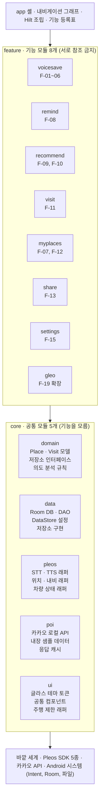
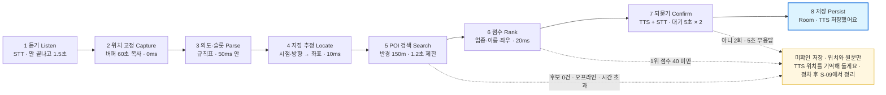
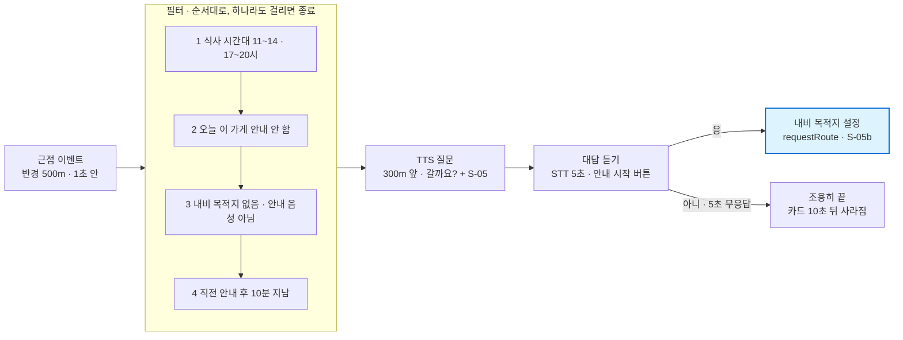

# 다음에 가게 — 기술서

작성일 2026-11-09 · 작성자 재원 (easycd) · 기준 문서: [01_개발기획서](01_개발기획서.md), [02_화면설계서](02_화면설계서.md). 편집 원본은 [Claude Doc](https://claude.ai/artifact/TEbNEvND5SEzQuwQbZ8E6L)이다.

앱은 기능마다 따로 떼어낸 모듈로 나누고, 의존은 한 방향(기능 → 공통)으로만 흐르게 만든다. 새 기능은 기존 코드를 고치지 않고 모듈 하나와 등록 클래스 하나를 더해서 넣는다. 이 문서는 [개발 기획서](01_개발기획서.md)의 기능 ID(F-01~F-19)와 화면 설계서의 화면 ID(S-00~S-17)를 그대로 쓴다.

## 1. 설계 원칙

재원 님이 정한 다섯 가지 기준을 아래 방법으로 지킨다. 규칙은 사람이 기억하는 대신 빌드와 자동 검사가 막도록 둔다.

| 기준 | 지키는 방법 | 자세히 |
| --- | --- | --- |
| 1. 기능 추가가 쉬운 구조 | 기능 = 모듈 1개. 음성 명령·추천 점수·리마인드 필터·화면 이동·글레오 기능은 등록표(플러그인) 방식이라 클래스 하나만 더하면 붙는다 | 3장, 6장 |
| 2. 기능별로 파일 나눠 코딩 | 화면마다 Screen·Route·ViewModel·UiState·Action 파일 5개, 파일 1개에 공개 클래스 1개. 파일 300줄, 함수 40줄 상한 | 4장 |
| 3. 스파게티 코드 금지 | 기능 모듈끼리 서로 모름(컴파일러가 막음). SDK·DB·네트워크는 인터페이스 뒤에만. 구조 규칙은 테스트로 검사해 어기면 빌드 실패 | 5장 |
| 4. 흐름도와 파이프라인 설계 | 음성 저장·리마인드는 단계(Stage)를 잇는 파이프라인. 단계마다 입력·출력·제한 시간·실패 시 다음 행동을 정해 둔다 | 7장 |
| 5. 최적화 | 응답 시간·메모리·배터리 목표를 수치로 정하고, 단계별 시간 예산을 나눠 잰다. 고정 크기 버퍼, 격자 색인, 캐시, 지연 초기화 | 9장 |

두 가지는 내가 정한 가정이다. 모듈을 Gradle 모듈로 나누는 것(패키지만 나누면 서로 참조를 막을 수 없음)과 의존성 주입에 Hilt를 쓰는 것이다. 1인 개발에서 모듈이 많으면 설정이 늘어나므로, 공통 빌드 설정을 build-logic 한 곳에 모아 모듈마다 3줄로 끝낸다.

## 2. 기술 스택과 개발 환경

Kotlin + Jetpack Compose 단일 앱이고, Pleos Connect SDK 5종을 전부 쓴다. 서버는 없고 외부 호출은 카카오 로컬 API 하나다. 라이브러리 버전은 개발 시작일에 안정 최신으로 고정하고 gradle/libs.versions.toml 한 곳에만 적는다.

| 영역 | 선택 | 이유 |
| --- | --- | --- |
| 언어·빌드 | Kotlin 2.x, JDK 17, Android Gradle Plugin 8.x, minSdk 28, targetSdk는 Emulator 이미지 기준 | Pleos Connect Emulator 2.1.0이 API 28 이상 |
| UI | Jetpack Compose, Navigation Compose, Material3 위에 자체 글라스 테마(core/ui) | 화면 설계서의 다크·라이트 토큰을 코드로 옮김. 세로·가로 창 모두 대응 |
| 구조 | 멀티모듈, 단방향 데이터 흐름(UiState + Action), Hilt 의존성 주입 | 3장 |
| 비동기 | Kotlin Coroutines, Flow, StateFlow | SDK 콜백을 전부 Flow로 바꿔 파이프라인에 흘림 |
| 저장 | Room(가게·방문·공유 목록), DataStore(설정) | 8장 |
| 네트워크 | Retrofit + OkHttp + kotlinx.serialization | 카카오 로컬 REST API 1개. 응답 캐시는 OkHttp 캐시 디렉터리 |
| 백그라운드 | WorkManager | 네트워크 복구 후 미확인 가게 후보 재검색 1건뿐 |
| Pleos SDK | SpeechToText 3.3.1, TextToSpeech 3.3.1, FusedLocation 1.1.3, NaviHelper 3.0.5, Vehicle 2.3.2 (Maven nexus-playground.pleos.ai) | 전부 core/pleos 모듈 안 인터페이스 뒤에 둔다 |
| 외부 API | 카카오 로컬 API(POI), 카카오맵 SDK(지도, AAOS 동작 미확인), ZXing(QR) | 기획서 9장 1안 |
| 글레오 연동 | assets/schema.json + Intent/Broadcast (F-19, 확장) | SDK 없음, 안드로이드 기본 API만 |
| 테스트 | JUnit5, MockK, Turbine(Flow), Konsist(구조 규칙), Compose UI 테스트 | 10장 |
| 코드 품질 | ktlint, detekt, Android Lint, Git pre-commit 훅 | 5장 |
| 개발 환경 | Android Studio, Pleos Connect Emulator 2.1.0 + Virtual Console, Windows PC 2대(C:\Project, C:\work) | 저장소 GitHub easycd/Hyundai_Pleos_App_Competition, 앱 코드는 app/ 폴더 |

패키지명은 기획서 13장의 가정대로 com.easycd.nextplace를 쓴다.

## 3. 전체 구조

모듈은 세 층이다. app 셀은 조립만 하고, feature 모듈 8개가 기능을 갖고, core 모듈 5개가 공통 재료를 준다. 화살표는 아래로만 향하고, feature끼리는 서로 모른다.



*그림: 모듈 구조 · app 1 + feature 8 + core 5*

feature는 이웃 feature를 참조할 수 없고 core는 어떤 feature도 모른다. 그래서 기능 하나를 빼거나 더해도 나머지는 그대로 컴파일된다.

| 층 | 모듈 | 하는 일 | 할 수 없는 일 |
| --- | --- | --- | --- |
| app | app | 내비게이션 그래프 조립, Hilt 루트, 기능 등록표(6장), 시작 화면 S-00·S-13·S-17 | 업무 로직 |
| feature | voicesave, remind, recommend, visit, myplaces, share, settings, gleo | 화면(Compose) + ViewModel + 그 기능만의 유스케이스·파이프라인 | 다른 feature 참조, SDK 직접 호출, Room 직접 접근 |
| core | domain | Place·Visit·ShareList 모델, 저장소·SDK 인터페이스, 의도·슬롯 규칙, 점수 함수 | Android 의존(순수 Kotlin) |
| core | data | Room 엔티티·DAO·마이그레이션, DataStore, 저장소 구현 | 화면, SDK |
| core | pleos | SDK 5종을 Flow·suspend 함수로 감싼 래퍼, 재연결, 가짜 구현(Emulator용) | 업무 판단 |
| core | poi | 카카오 로컬 API 클라이언트, 내장 샘플, 응답 캐시 | 점수 계산(그건 domain) |
| core | ui | 글라스 테마 토큰(다크·라이트), 버튼·카드·칩·토스트·확인 창, 주행 중 잠금 래퍼 | 데이터 접근 |

화면 한 장 안에서는 단방향으로 흐른다. 사용자 입력은 Action 하나로 ViewModel에 들어가고, ViewModel은 유스케이스를 부른 뒤 UiState 하나를 내보낸다. 화면은 UiState만 그린다. 음성 저장처럼 여러 단계를 거치는 일은 ViewModel이 아니라 파이프라인(7장)이 맡고, ViewModel은 그 진행 상태를 구독만 한다.

## 4. 폴더와 파일 구조

파일은 기능 이름으로 찾는다. 화면 하나는 정해진 파일 5개로 이루어지고, 기능의 나머지는 그 feature 폴더 안에만 있다. 아래는 저장소의 app/ 폴더 트리다(docs/는 지금 문서가 있는 곳).

```text
app/
├─ settings.gradle.kts            ← 모듈 목록 (feature 추가 시 한 줄)
├─ gradle/libs.versions.toml      ← 라이브러리 버전 한 곳
├─ build-logic/                   ← 공통 빌드 설정 (feature·core 플러그인)
├─ app/                           ← 앱 셸
│  ├─ NextPlaceApp.kt            Hilt 루트
│  ├─ MainActivity.kt           창 1개, 테마·주행 상태 제공
│  ├─ navigation/AppNavGraph.kt  화면 등록표 조립
│  ├─ registry/FeatureRegistry.kt 기능 등록표 (6장)
│  ├─ start/SplashScreen.kt      S-00
│  ├─ start/OnboardingScreen.kt  S-13
│  └─ start/PermissionDeniedScreen.kt  S-17
├─ feature/
│  ├─ voicesave/                 F-01~F-06 · S-01, S-01b, S-02a~c, S-14, S-03, S-03b, S-04a, S-04b
│  │  ├─ ui/home/               HomeScreen.kt HomeRoute.kt HomeViewModel.kt HomeUiState.kt HomeAction.kt
│  │  ├─ ui/listen/             ListenOverlay.kt ListenViewModel.kt ListenUiState.kt ListenAction.kt
│  │  ├─ ui/confirm/            ConfirmCard.kt ConfirmViewModel.kt ConfirmUiState.kt ConfirmAction.kt
│  │  ├─ pipeline/              SavePipeline.kt · stage/ (ListenStage CaptureStage ParseStage LocateStage SearchStage RankStage ConfirmStage PersistStage)
│  │  ├─ parse/                 IntentParser.kt SlotExtractor.kt (규칙표는 res/raw/intent_rules.json)
│  │  ├─ rank/                  CandidateScorer.kt
│  │  └─ VoiceSaveFeature.kt    등록 객체 (화면·음성 명령·글레오 기능 선언)
│  ├─ remind/                    F-08 · S-05, S-05b
│  │  ├─ ui/                    RemindCard.kt RemindViewModel.kt RemindUiState.kt RemindAction.kt
│  │  ├─ pipeline/              RemindPipeline.kt · filter/ (MealTimeFilter DailyOnceFilter NaviBusyFilter CooldownFilter)
│  │  ├─ geofence/              ProximityWatcher.kt (SDK 근접 알림 또는 직접 거리 계산)
│  │  └─ RemindFeature.kt
│  ├─ recommend/                 F-09, F-10 · S-06, S-06b, S-06c
│  │  ├─ ui/                    RecommendScreen.kt … 5개
│  │  ├─ score/                 RecommendScorer.kt · rule/ (DistanceRule OpenNowRule MemoRule LastVisitRule)
│  │  └─ RecommendFeature.kt
│  ├─ visit/                     F-11 · S-15, S-15b
│  ├─ myplaces/                  F-07, F-12 · S-07~S-09 (목록·상세·수정·삭제·미확인 정리·지도)
│  ├─ share/                     F-13 · S-10, S-16, S-16b
│  ├─ settings/                  F-15 · S-11, S-11b
│  └─ gleo/                      F-19 · GleoActionReceiver.kt GleoResponder.kt (assets/schema.json은 app/에)
├─ core/
│  ├─ domain/                    model/ repository/(인터페이스) sdk/(인터페이스) usecase/ pipeline/(Stage 기반 클래스) Tunables.kt
│  ├─ data/                      db/ (NextPlaceDb PlaceDao VisitDao ShareDao migration/) entity/ mapper/ repository/(구현) prefs/
│  ├─ pleos/                     stt/ tts/ location/ navi/ vehicle/ · 각 폴더에 Real*.kt Fake*.kt
│  ├─ poi/                       KakaoLocalApi.kt KakaoPoiSource.kt SamplePoiSource.kt PoiCache.kt
│  └─ ui/                        theme/ (Color Glass Type) component/ (GlassCard PillButton StatusChip Toast ConfirmDialog) drive/ (DriveLock · S-12, F-14)
└─ docs/ (기존)
```

**파일 나누기 규칙**

| 규칙 | 내용 |
| --- | --- |
| 화면 1개 = 파일 5개 | Screen(그리기만), Route(ViewModel 연결·이동), ViewModel(상태 전환), UiState(data class), Action(sealed interface). Screen은 UiState와 onAction만 받는 순수 함수라 미리보기와 테스트가 쉽다. 상태가 없는 시작 화면 S-00·S-13·S-17은 Screen 파일 1개만 둔다 |
| 파일 1개 = 공개 클래스 1개 | 파일 이름 = 클래스 이름. private 보조 클래스는 같은 파일에 둘 수 있다 |
| 크기 상한 | 파일 300줄, 함수 40줄, 함수 인자 5개, 중첩 3단. detekt가 검사 |
| 단계 1개 = 파일 1개 | 파이프라인 Stage와 필터 Rule은 각각 파일 하나. 새 규칙은 파일 추가로 끝난다 |
| 문자열과 숫자 | 음성 안내 문장은 res/values/strings_voice.xml, 임계값(반경 150m, 대기 5초 등)은 core/domain/Tunables.kt 한 곳 |
| 시험 파일 위치 | 같은 모듈의 src/test 에 같은 패키지 경로, 파일명 + Test |

## 5. 코드 규칙

스파게티 코드는 의존이 얽히고, 한 클래스가 여러 일을 하고, 상태가 여기저기 흩어질 때 생긴다. 세 가지를 각각 규칙과 자동 검사로 막는다. 규칙을 어기면 커밋 전 훅과 GitHub Actions에서 빌드가 실패한다.

| 번호 | 규칙 | 막는 문제 | 검사 방법 |
| --- | --- | --- | --- |
| R1 | 의존은 app → feature → core 방향만. feature끼리, core → feature 금지 | 얽힌 참조 | Gradle 모듈 경계 + Konsist 테스트 |
| R2 | SDK·Room·Retrofit 클래스는 core/pleos, core/data, core/poi 안에서만 import | 바깥 라이브러리가 기능 코드에 퍼짐 | Konsist: feature 모듈에 ai.pleos, androidx.room, retrofit2 import 금지 |
| R3 | 화면은 UiState만 그리고 Action만 보낸다. Composable 안에 ViewModel·저장소 직접 호출 금지 | 화면에 로직이 박힘 | Konsist: `*Screen.kt`는 ViewModel 타입을 파라미터로 받지 않음 |
| R4 | ViewModel은 단계를 모른다. 순서가 있는 일은 파이프라인 클래스로 | ViewModel이 800줄이 되는 것 | detekt 파일 300줄 상한 |
| R5 | 클래스는 이름이 말하는 일 하나만. Manager·Helper·Util 이름 금지 | 무엇이든 넣는 클래스 | detekt 이름 규칙 |
| R6 | 상태는 한 곳. 화면 상태는 ViewModel의 StateFlow 1개, 진행 중인 음성 작업은 파이프라인의 StateFlow 1개 | 상태가 흩어져 서로 어긋남 | 코드 리뷰 체크리스트 |
| R7 | 콜백 금지. SDK 콜백은 래퍼에서 Flow 또는 suspend로 바꾼다 | 콜백 지옥 | Konsist: feature 모듈에 Listener 인터페이스 구현 금지 |
| R8 | 숫자와 문장은 코드에 직접 쓰지 않는다 | 임계값이 여기저기 | detekt MagicNumber, 문자열 리소스 Lint |
| R9 | null 반환 대신 Result 또는 sealed 결과. 예외는 래퍼 경계에서 잡아 결과로 바꾼다 | 실패 경로가 숨음 | 코드 리뷰 |
| R10 | 기능 플래그로 미완성 기능을 감싼다. 주석 처리 코드, TODO 방치 금지 | 죽은 코드 | detekt ForbiddenComment |

**이름 규칙**

| 대상 | 형식 | 예 |
| --- | --- | --- |
| 화면 파일 | 기능명 + Screen / Route / ViewModel / UiState / Action | HomeScreen.kt, HomeAction.kt |
| 파이프라인 단계 | 동사 + Stage | LocateStage, RankStage |
| 필터·규칙 | 조건 + Filter / Rule | MealTimeFilter, DistanceRule |
| 유스케이스 | 동사 + 목적어 + UseCase | SavePlaceUseCase |
| SDK 래퍼 | 인터페이스는 역할명, 구현은 Real/Fake 접두 | SpeechRecognizer ← RealSpeechRecognizer, FakeSpeechRecognizer |
| 저장소 | 모델명 + Repository | PlaceRepository (인터페이스 domain, 구현 data) |
| 임계값 | Tunables 객체의 상수, 단위 접미 | Tunables.POI_RADIUS_M = 150, CONFIRM_WAIT_MS = 5000 |

커밋 전 훅은 ktlint 자동 정렬 → detekt → 바뀐 모듈의 단위 테스트 순서로 1분 안에 끝내도록 한다. 더 오래 걸리는 테스트는 GitHub Actions에서만 돌린다.

## 6. 기능 추가 방법

새 기능은 기존 파일을 고치지 않고 넣는다. 확장 지점은 일곱 곳이고, 모두 "클래스 하나 더하고 등록표에 한 줄"으로 끝난다.

| 확장 지점 | 인터페이스 | 등록하는 곳 | 예 |
| --- | --- | --- | --- |
| 새 화면 | Feature.routes(): `List<FeatureRoute>` | 각 feature의 `*Feature.kt` → app/registry/FeatureRegistry.kt | 방문 인증 리뷰 화면(F-17) |
| 새 음성 명령 | VoiceCommand { 트리거 단어, 우선순위, handle(문장, 슬롯) } | Feature.voiceCommands() | "여기 평점 4점" → RateCommand |
| 새 파이프라인 단계 | `Stage<입력, 출력> { run, timeout, onFail }` | SavePipeline의 단계 목록 | LLM 보강(F-16) = ParseStage 뒤에 LlmParseStage 추가 |
| 새 추천·리마인드 규칙 | Rule { weight, score(place, context) } / Filter { pass(event) } | RecommendScorer, RemindPipeline의 규칙 목록 | "최근 평점 높은 가게 우선" = RatingRule |
| 새 글레오 기능 | GleoFunction { name, params, handle } | Feature.gleoFunctions() → 빌드가 assets/schema.json 생성 | RECOMMEND_PLACE |
| 새 데이터 필드 | Room 마이그레이션 클래스 | core/data/db/migration/ | Visit.rating (F-17) |
| 새 바깥 서비스 | domain의 인터페이스 + Real/Fake 구현 | Hilt 모듈 1개 | 네이버 POI로 교체 = NaverPoiSource |

**새 기능 추가 순서 (예: F-17 방문 인증 리뷰)**

1. settings.gradle.kts에 모듈 한 줄: include(":feature:review"). build-logic 플러그인이 설정을 얻어 build 파일은 3줄이다.
2. 필요한 데이터가 있으면 core/domain 모델에 필드를 더하고 core/data에 마이그레이션 1개.
3. feature/review 안에 화면 파일 5개와 유스케이스를 만든다. 다른 feature는 건드리지 않는다.
4. ReviewFeature.kt에 화면·음성 명령·글레오 기능을 선언하고 FeatureRegistry에 한 줄 등록.
5. 단위 테스트와 화면 미리보기를 같은 모듈에 둔다. Konsist가 R1~R3을 자동으로 검사한다.
6. 기능 플래그 FeatureFlags.REVIEW를 꺼 둔 채 합치고, 준비되면 켠다.

등록표는 리플렉션이 아니라 손으로 쓴 목록이다. 목록이 보이고, 빌드가 빠르고, 어떤 기능이 켜져 있는지 한 파일에서 읽히기 때문이다.

## 7. 핵심 흐름도와 파이프라인

순서가 있는 일은 전부 파이프라인이다. 파이프라인은 Stage 목록을 차례로 실행하는 작은 클래스 하나(core/domain/pipeline/Pipeline.kt)이고, 단계마다 입력 타입·출력 타입·제한 시간·실패 시 행동이 정해져 있다. 진행 상태는 `StateFlow<PipelineState>` 하나로 나가고 ViewModel은 그걸 화면 상태로 바꾸기만 한다. 화면 사이의 이동은 화면 설계서 3장 흐름도를 그대로 따른다.

**7-1. 음성 저장 (F-01~F-06, 흐름 A)**



*그림: 저장 파이프라인 · 8단계, 실패 경로 1개*

2~7단계는 말이 끝난 뒤 2초 안에 되묻기가 시작되도록 시간을 나눠 쓴다. 어느 단계가 실패하든 미확인 저장으로 떨어지므로 기록은 항상 남는다.

| 단계 | 입력 → 출력 | 시간 예산 | 실패 시 |
| --- | --- | --- | --- |
| 1 Listen | 버튼 → 발화 텍스트 (부분 결과는 화면 S-02a에) | 말 끝나고 1.5초 무음이면 종료, 최대 15초 | 빈 문장: "다시 말해 주세요" 1회 (S-02c), 그 뒤 종료 |
| 2 Capture | 버튼 누른 시각 → 위치 버퍼 60건 복사본 + 현재 위치·방향 | 0ms (메모리 복사) | 위치 없음: 미확인 저장으로 (좌표 null) |
| 3 Parse | 텍스트 → Intent + Slots(업종·시점·방향·외관·이름·메모) (S-02b) | 50ms | 의도 불명: SAVE로 간주 |
| 4 Locate | 버퍼 + 시점 슬롯 → 추정 좌표 (방금 = 설정값 N초 전 구간 중점, 기본 10~20초 · S-11 6번) + 좌우 판정용 진행 방향 | 10ms | 버퍼 부족: 현재 위치 사용 |
| 5 Search | 좌표 + 업종 → POI 후보 최대 15건 (캐시 먼저, 없으면 카카오) (S-14) | 1.2초 제한 | 0건·오프라인·시간 초과: 미확인 저장, 복구 후 WorkManager가 재검색 |
| 6 Rank | 후보 → 점수순 상위 5 (업종 일치 40 · 이름 일부 30 · 거리 20 · 좌우 10) | 20ms | 1위 점수 < 40: 미확인 저장 (HIG 제안 ⑯) |
| 7 Confirm | 1위 → TTS "○○ 맞나요?" → STT 예/아니오 (S-03, S-03b) | 대기 5초, 최대 2회 | 아니 2회·무응답: 미확인 저장. 1위가 2위보다 30점(Tunables, 시험으로 조정) 이상 높고 업종 일치면 되묻지 않고 바로 8 |
| 8 Persist | 확정 후보 또는 미확인 → Room Place 1행 + TTS + 토스트 (S-04a, S-04b) | 100ms | DB 오류: 메모리 큐에 보관 후 재시도 3회 |

일부 단계는 동시에 돌린다. 1단계에서 부분 결과가 들어오는 동안 3·4단계를 미리 돌려 두고, 업종이 나오는 순간 5단계 검색을 시작한다. 그래서 말이 끝났을 때 후보가 이미 와 있는 경우가 많다.

**7-2. 근처 리마인드 (F-08, 흐름 B)**



*그림: 리마인드 파이프라인 · 필터 4개, 결과 2개*

| 요소 | 내용 |
| --- | --- |
| 이벤트 원천 | 1안 FusedLocation addProximityAlert(가게마다 500m). 파라미터 미확인이면 2안: 1초 위치 콜백에서 격자 색인(9장)으로 가까운 가게만 거리 계산. 둘 다 ProximityWatcher 인터페이스 뒤에 있어 필터 이후는 같다 |
| 필터 | Filter 4개를 목록 순서로. 걸리면 이유를 로그만 남기고 소리 없이 끝난다. 새 조건은 Filter 클래스 추가 |
| 질문 | TTS 1문장(25자 안) + 차량 알림 카드 S-05 10초. 내비 안내 음성과 겹치면 필터 3에서 이미 걸러짐 |
| 대답 | STT 5초 또는 카드 버튼. 응 → NaviHelper.requestRoute, S-05b. 아니·무응답 → 카드만 사라짐 |
| 빈도 상한 | 같은 가게 하루 1회(Place.lastRemindedAt), 전체 10분 1회(DataStore에 마지막 시각) |

**7-3. 추천 (F-09, F-10, 흐름 C)**

1. 후보 수집: 현재 위치 10km 안 저장 가게 (미확인 제외). 격자 색인으로 1ms 안.
2. 점수: Rule 4개의 가중 합. 거리 40 · 영업 중(시간대 정보 있을 때만) 20 · 메모·좋았다는 방문 기록 20 · 마지막 방문 오래될수록 20. 상위 3.
3. 제시: 카드 3장(S-06) + TTS가 번호와 이름을 읽는 동안 해당 카드 테두리 강조. 0건이면 S-06b.
4. 선택: STT(번호·이름) 또는 터치. "다른 곳"은 4~6위로 교체.
5. 실행: requestRoute, S-06c 토스트, 1.5초 뒤 홈.

**7-4. 방문 기록 (F-11)**

1. NaviHelper onDestinationArrived 또는 (이벤트가 안 오면) 목적지 50m 진입 → 도착 후보.
2. 10분 체류 타이머: 위치가 가게 100m 안에 머물면 Visit 생성(verified = 내비 목적지였는가).
3. 다시 출발이 감지되면(100m 이탈, Visit.leftAt 기록) S-15 카드 10초 + TTS "한 줄 남길까요?". NOTE 의도만 받는 짧은 Listen 단계 재사용.
4. 메모는 Visit.note에, Place.status는 VISITED로.

**7-5. 글레오 연동 (F-19, 확장)**

1. 글레오가 기능 이름(SAVE_PASSED_PLACE 등)을 action으로 Intent를 보낸다. GleoActionReceiver가 받아 ACTION_PARAM JSON을 파싱한다.
2. 같은 SavePipeline에 2단계부터 넣는다. 1단계 Listen 대신 placeDescription 텍스트가 입력이다. 새 코드는 없다.
3. 결과를 APP_ACTION_RESPONSE 브로드캐스트로 돌려주면 글레오가 대답한다. 이때 앱의 TTS는 쓰지 않고 7단계 되묻기도 생략한다(글레오가 대화를 맡음).
4. schema.json은 빌드 시 FeatureRegistry의 gleoFunctions()에서 생성해 assets/에 넣는다.

## 8. 데이터 설계

데이터는 기획서 7장의 세 엔티티(Place, Visit, ShareList)를 Room 테이블로 그대로 옮기고, 위치 버퍼는 메모리에만 둔다. 필드 목록은 기획서와 같으므로 여기에는 저장 방식과 색인만 적는다.

| 테이블 | 키·색인 | 저장 방식 | 이유 |
| --- | --- | --- | --- |
| place | PK id(UUID 문자열). 색인: status, (gridLat, gridLon), poiId UNIQUE | cues·candidates는 JSON 문자열 컬럼(TypeConverter). 좌표는 Double 2개 + 격자 컬럼 2개(위도·경도를 0.01도 ≈ 1km 칸으로 내림) | 격자 컬럼이 있어야 "반경 500m 안 가게"를 전체 탐색 없이 고른다. poiId가 같으면 중복 저장 대신 기존 행 갱신 |
| visit | PK id. FK placeId(ON DELETE CASCADE). 색인: placeId, arrivedAt | 가게당 여러 행 | 마지막 방문 조회가 추천 점수에 매번 필요 |
| share_list | PK id(짧은 무작위 문자열 8자). places JSON | 내보낼 때만 쓴다 | 받은 목록은 저장하지 않고 바로 place로 가져온다 |
| 설정 (DataStore) | 키 7개: 리마인드 켜기, 반경, 식사 시간만, 음량, 가게 특정 시간(10·20·30초, S-11 6번), 마지막 리마인드 시각, 첫 실행 여부 | Proto 대신 Preferences DataStore | 7개뿐이라 스키마 파일이 과하다 |

**상태 값과 전이**

Place.status는 UNCONFIRMED → CONFIRMED → VISITED 한 방향으로만 간다. 미확인 가게를 정리 화면(S-09)에서 후보로 확정하면 CONFIRMED, 방문 기록이 생기면 VISITED다. 삭제는 행 삭제이고 되돌리기 토스트 4초 동안은 메모리에 들고 있다가 지나면 지운다.

**위치 버퍼 (메모리)**

| 항목 | 값 |
| --- | --- |
| 구조 | 고정 크기 원형 버퍼 60칸, 칸 = (시각 Long, 위도·경도 Double, 방향 Float, 속도 Float). 객체 생성 없이 배열 5개에 덮어쓴다 |
| 채우기 | FusedLocation 콜백이 올 때마다(목표 1Hz). 속도는 직전 칸과의 거리/시간으로 계산(SDK에 speed 없음) |
| 읽기 | Capture 단계가 60칸을 복사해 불변 스냅샷으로 넘긴다. 그 뒤 버퍼가 바뀌어도 파이프라인은 영향 없음 |
| 정차 판단 (F-14) | 버퍼 최근 3칸(약 2초, 화면 설계서 S-12와 같음) 속도 모두 < 1m/s 또는 Vehicle Brake 주차 브레이크 ON → 정차. 주행 제한 래퍼(core/ui/drive/DriveLock)가 이 값 하나만 본다 |
| 수명 | 앱 프로세스와 같다. 디스크에 쓰지 않는다 |

**마이그레이션**

프로토타입 단계(v1)는 파괴적 마이그레이션을 허용하고, 공모전 제출 빌드부터는 버전마다 Migration 클래스를 core/data/db/migration/에 둔다. 확장 기능의 필드(Visit.rating 등)는 그때 더한다.

## 9. 최적화

목표는 기획서 8장 비기능 요구사항의 수치를 그대로 쓰고, 여기에 측정 방법과 달성 방법을 붙인다. 측정은 Emulator에서 하고, 파이프라인 단계마다 걸린 시간을 디버그 빌드에서 로그로 남긴다.

| 항목 | 목표 | 측정 | 달성 방법 |
| --- | --- | --- | --- |
| 버튼 → 녹음 시작 | 0.5초 안 | 버튼 터치 시각 ~ STT 첫 콜백 | STT·TTS·위치는 앱 시작 시 미리 초기화, 내비·차량은 처음 필요할 때 |
| 말 끝 → 되묻기 시작 | 2초 안 | 단계 2~7 합계 로그 | 듣는 동안 Parse·Locate·Search를 미리 돌림(7-1). POI 검색 1.2초 제한, 초과 시 미확인 저장 |
| 리마인드 | 반경 진입 후 3초 안 | 위치 이벤트 시각 ~ TTS 시작 | 후보 검색은 격자 색인, 필터 4개는 메모리 값만 봄 |
| 화면 전환 | 200ms 안 (화면 설계서 5장) | Compose 프레임 로그 | 애니메이션은 alpha·scale·translate만. 목록은 LazyColumn + key |
| 시작 → 홈 | 0.8초 안 (S-00) | 콜드 스타트 Macrobenchmark | Baseline Profile, Hilt 지연 주입, 시작 시 DB 조회는 최근 저장 1건뿐 |
| 메모리 | 앱 히프 120MB 안 | Android Studio Profiler | 이미지 없음, 위치 버퍼 고정 배열, POI 캐시 200건 상한 |
| 배터리·위치 | 위치 1Hz, 앱이 뒤에 있을 때는 리마인드가 켜져 있을 때만 | 콜백 횟수 로그 | 근접 감시는 SDK addProximityAlert에 맡김. 안 되면 1Hz 콜백에서 격자 1칸만 검사 |
| DB | 가게 1,000건에서 목록·근처 조회 50ms 안 | Room 쿼리 시간 로그 | 격자 색인, 목록은 페이징 50건, 지도 핀은 화면 범위만 |
| 네트워크 | 저장 1회당 POI 요청 1회 (기획서 12장 상한은 2회) | OkHttp 로그 | 좌표 100m 반올림 + 업종 키로 24시간 캐시. 같은 길을 다시 지나면 요청 없음 |
| 앱 크기 | APK 15MB 안 | 빌드 결과 | R8 축소, 벡터 아이콘만, 글꼴은 시스템 글꼴 |

**글라스 화면의 비용**

배경 흐림(blur)은 GPU 비용이 크다. 배경이 단색이므로 실제로는 흐림 없이 반투명 단색 + 밝은 테두리 + 그림자만으로 같은 모양을 낸다. 진짜 흐림은 지도 위에 뜨는 카드(S-05, S-05b, S-15)에만 쓰고, Android 12 미만이거나 프레임이 떨어지면 불투명 카드(#1F1714 / #FFFFFF)로 자동 전환한다. 화면 설계서 1장 스타일 행의 "투명도 줄이기" 대체와 같다.

**하지 않는 것**

프로토타입에서는 측정 없이 최적화하지 않는다. 위 표의 목표를 넘는 항목만 고치고, 나머지는 코드를 단순하게 둔다.

## 10. 오류 처리와 테스트

오류는 래퍼 경계에서 결과 값으로 바뀌고, 기능 코드는 예외를 보지 않는다. 사용자에게는 화면 설계서 7장 "상태와 예외"에 정한 화면으로만 보인다.

| 오류 | 감지하는 곳 | 처리 | 사용자에게 |
| --- | --- | --- | --- |
| SDK 연결 실패 | core/pleos 래퍼 | 2·4·8초 간격 재연결 3회, 그 뒤 Unavailable 상태 | 말하기 버튼은 살아 있고 누르면 S-17 "음성 서비스를 쓸 수 없어요" |
| 권한 없음 | 래퍼 호출 전 검사 | 기능별 권한 표를 보고 필요한 것만 요청 | S-13 첫 실행 안내, 거부 후에는 S-17 |
| STT 빈 결과·시간 초과 | Listen 단계 | 1회 재시도 | S-02c |
| 네트워크 없음·POI 실패 | core/poi | 캐시 → 내장 샘플(개발 빌드) → 미확인 저장. WorkManager가 연결 복구 후 1회 재검색 | S-04b, 나중에 후보 카드 |
| STT 서버 불가 | SDK | HYBRID 모드가 온디바이스로 자동 전환 | 없음 |
| 내비 요청 실패 | NaviHelper 래퍼 | 1회 재시도 후 실패 토스트 | "안내를 시작하지 못했어요" 토스트 4초 |
| DB 쓰기 실패 | core/data | 메모리 큐 보관 후 3회 재시도 | 성공 시까지 토스트 보류 |
| 주행 중 정차 화면 요청 | DriveLock | 화면 대신 S-12 | "멈추면 볼 수 있어요" |
| 예상 못 한 예외 | Pipeline 실행기 | 단계 실패로 바꿔 미확인 저장, 로그 파일 1개(최근 1MB) | 앱은 죽지 않음 |

**테스트 구성**

| 층 | 대상 | 도구 | 기준 |
| --- | --- | --- | --- |
| 단위 (순수 Kotlin) | IntentParser·SlotExtractor: 발화 예시 50문장 표 주도. CandidateScorer, RecommendScorer, Filter 4개, Locate 계산 | JUnit5 파라미터 테스트 | 기획서 6장 대표 발화 전부 통과, 커밋 훅에서 10초 안 |
| 파이프라인 | SavePipeline·RemindPipeline을 Fake SDK·Fake POI로 끝까지 | JUnit5 + Turbine + 가상 시간 | 7장 표의 실패 경로마다 1개 |
| 데이터 | DAO 조회·격자 색인·마이그레이션 | Room 인메모리 테스트 | 상태 전이 3개, cascade 삭제 |
| 화면 | 34장 × 다크·라이트 미리보기 스크린샷, 버튼 크기 76dp·글자 24sp 검사 | Compose Preview + 스크린샷 비교 | 화면 설계서의 자동 검사(check_layout.js) 기준을 앱에서 다시 검사 |
| 구조 | 5장 R1~R3, R7 | Konsist | 어기면 빌드 실패 |
| 수동 시나리오 | 저장·추천·리마인드 3개를 Emulator + Virtual Console 경로로 | 체크리스트 | 제출 전 1회, 영상 촬영 |

GitHub Actions는 push마다 ktlint·detekt·단위·파이프라인·Konsist를 돌리고, 화면 스크린샷은 밤에 1회 돌린다. Fake SDK는 테스트뿐 아니라 Emulator에서 SDK가 안 될 때 개발 빌드가 쓰는 대체이기도 하다. 가짜 위치는 docs/에 둔 경로 파일(강남대로 60초)을 1Hz로 재생한다.

## 11. 프로토타입 구현 범위와 확인이 필요한 사항

2026년 11월 18일 제출 프로토타입은 이 구조를 그대로 쓰되 모듈을 비워 둔다. 구조를 나중에 바꾸는 것보다 빈 모듈을 두는 편이 싸다. 기획서 11장 10일 계획과 같은 순서다.

| 모듈 | 프로토타입(11/18) | 본개발 |
| --- | --- | --- |
| app, core/domain, core/data, core/ui | 전부. 테마 토큰과 공통 컴포넌트 5종 | 그대로 |
| core/pleos | STT·TTS·위치·내비 Real + Fake. 차량은 Fake만 | Vehicle Real |
| core/poi | 카카오 + 내장 샘플. 캐시는 없음 | 캐시 |
| feature/voicesave | 파이프라인 8단계 전부, 화면 S-01~S-04 | 동시 실행 최적화 |
| feature/recommend | 점수 Rule 2개(거리, 마지막 방문) + 카드 3장 + requestRoute | Rule 4개 |
| feature/remind | 거리 계산 방식, 필터 4개, S-05·S-05b | addProximityAlert 전환 |
| feature/myplaces | 목록·상세·삭제. 지도는 카카오맵이 Emulator에서 뜨면 | 수정·미확인 정리·지도 |
| feature/visit, share, settings | 화면 뼈대만 (UiState 고정값) | 동작 |
| feature/gleo | 없음 (모듈도 만들지 않음) | 승인 확인 후 |
| 테스트 | 단위(파서·점수·필터) + Konsist | 전 층 |

**확인이 필요한 사항**

- [ ] Emulator 6개 항목(기획서 10장): 인터넷, Virtual Console 위치 주입, STT 한국어, requestRoute·onDestinationArrived, addProximityAlert 파라미터, 카카오맵 SDK. 결과에 따라 Real/Fake 선택이 바뀐다.
- [x] 세로 창 레이아웃: Pleos 앱 영역은 기본이 세로 1칸이다. 결정(11월 9일, 재원 님): 세로 창에서는 말하기 버튼을 하단 가운데에 두고, 카드(최근 저장·추천·안내)는 그 위에 쌓는다. 가로 2칸은 화면 설계서 그림대로. core/ui의 화면 틀이 창 비율을 보고 두 배치 중 하나를 고르며, 세로 창 와이어프레임은 아직 없다(화면 설계서 1장 '세로 창' 행).
- [ ] 글라스 흐림 성능: Emulator에서 지도 위 카드 흐림이 60fps를 유지하는지. 안 되면 불투명 카드로 고정.
- [ ] Hilt 대신 수동 주입으로 두고 싶은지: 모듈이 14개라 Hilt를 권하지만, 빌드 시간이 부담이면 수동 주입 객체 1개로 바꿀 수 있다.
- [ ] 저장소 폴더: 앱 코드를 저장소 루트에 둘지 app/ 아래에 둘지. 이 문서는 app/로 가정.
- [ ] 글레오 승인 절차와 Emulator 시험 가능 여부 (기획서 13장).
- [ ] Apple HIG 점검 결정 B(앱 내 테마 수동 전환)·C(삭제 확인 창 제거): 설정 화면과 삭제 흐름 코드에 영향. C와 별개로, 화면 설계서 S-08d의 되돌리기 4초는 기획서 8장 "삭제는 복구하지 않는다"와 어긋나므로 기획서 문장을 고쳐야 한다.
