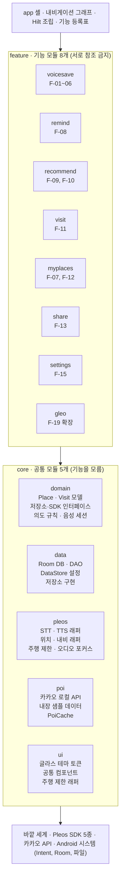
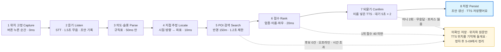
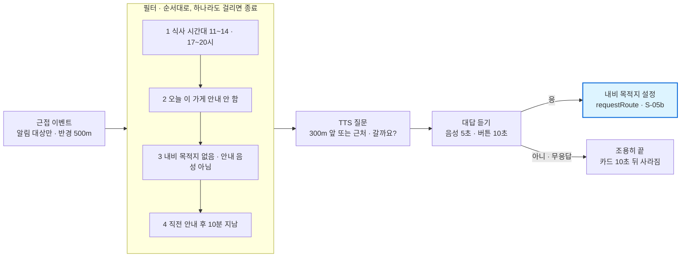

# 다음에 가게 — 기술서

작성일 2026-11-09 · 개정 2026-11-10 (문서 검토 보고서 53건 반영) · 작성자 재원 (easycd) · 기준 문서: [01_개발기획서](01_개발기획서.md), [02_화면설계서](02_화면설계서.md). 편집 원본은 [Claude Doc](https://claude.ai/artifact/TEbNEvND5SEzQuwQbZ8E6L)이다.

앱은 기능마다 따로 떼어낸 모듈로 나누고, 의존은 한 방향(기능 → 공통)으로만 흐르게 만든다. 새 기능은 기존 코드를 고치지 않고 모듈 하나와 등록 클래스 하나를 더해서 넣는다. 이 문서는 [개발 기획서](01_개발기획서.md)의 기능 ID(F-01~F-19)와 화면 설계서의 화면 ID(S-00~S-17)를 그대로 쓴다.

## 1. 설계 원칙

재원 님이 정한 다섯 가지 기준을 아래 방법으로 지킨다. 규칙은 사람이 기억하는 대신 빌드와 자동 검사가 막도록 둔다.

| 기준 | 지키는 방법 | 자세히 |
| --- | --- | --- |
| 1. 기능 추가가 쉬운 구조 | 기능 = 모듈 1개. 음성 명령·추천 점수·리마인드 필터·화면 이동·글레오 기능은 등록표(플러그인) 방식이라 클래스 하나만 더하면 붙는다 | 3장, 6장 |
| 2. 기능별로 파일 나눠 코딩 | 화면마다 Screen·Route·ViewModel·UiState·Action 파일 5개, 파일 1개에 공개 클래스 1개. 파일 300줄, 함수 40줄 상한 | 4장 |
| 3. 스파게티 코드 금지 | 기능 모듈끼리 서로 모름(컴파일러가 막음). SDK·DB·네트워크는 인터페이스 뒤에만. 구조 규칙은 테스트로 검사해 어기면 빌드 실패 | 5장 |
| 4. 흐름도와 파이프라인 설계 | 음성 저장·리마인드는 단계(Stage)를 잇는 파이프라인. 단계마다 입력·출력·제한 시간·실패 시 다음 행동을 정해 둔다 | 7장 |
| 5. 최적화 | 응답 시간·메모리·배터리 목표를 수치로 정하고, 단계별 시간 예산을 나눠 잰다. 고정 크기 버퍼, 격자 색인, 캐시, 지연 초기화 | 9장 |

두 가지는 내가 정한 가정이다. 모듈을 Gradle 모듈로 나누는 것(패키지만 나누면 서로 참조를 막을 수 없음)과 의존성 주입에 Hilt를 쓰는 것이다. 1인 개발에서 모듈이 많으면 설정이 늘어나므로, 공통 빌드 설정을 build-logic 한 곳에 모아 모듈마다 3줄로 끝낸다.

## 2. 기술 스택과 개발 환경

Kotlin + Jetpack Compose 단일 앱이고, Pleos Connect SDK 5종을 전부 쓴다. 앱이 직접 부르는 서버는 없고 외부 호출은 카카오 로컬 API(가게 검색·좌표→주소) 하나다. 단, STT·TTS를 서버(HYBRID) 모드로 쓰면 SDK가 음성을 Pleos 서버에서 처리한다(기획서 8장 개인정보). 라이브러리 버전은 개발 시작일에 안정 최신으로 고정하고 gradle/libs.versions.toml 한 곳에만 적는다.

| 영역 | 선택 | 이유 |
| --- | --- | --- |
| 언어·빌드 | Kotlin 2.x, JDK 17, Android Gradle Plugin 8.x, minSdk 28, targetSdk는 Emulator 이미지 기준 | Pleos Connect Emulator 2.1.0이 API 28 이상 |
| UI | Jetpack Compose, Navigation Compose, Material3 위에 자체 글라스 테마(core/ui) | 화면 설계서의 다크·라이트 토큰을 코드로 옮김. 세로·가로 창 모두 대응 |
| 구조 | 멀티모듈, 단방향 데이터 흐름(UiState + Action), Hilt 의존성 주입 | 3장 |
| 비동기 | Kotlin Coroutines, Flow, StateFlow | SDK 콜백을 전부 Flow로 바꿔 파이프라인에 흘림 |
| 저장 | Room(가게·방문·공유 목록), DataStore(설정) | 8장 |
| 네트워크 | Retrofit + OkHttp + kotlinx.serialization | 카카오 로컬 REST API 1개. 응답 캐시는 HTTP 캐시가 아니라 앱의 PoiCache(9장) |
| 백그라운드 | WorkManager, 위치 포그라운드 서비스 | WorkManager는 네트워크 복구 후 미확인 가게 후보 재검색 1건. 포그라운드 서비스는 리마인드 켜짐·방문 판정 중에만 위치를 받음(7-4) |
| 주행 제한 | Android CarUxRestrictionsManager | 플랫폼이 지역 규칙까지 반영한 제한 상태를 준다. 속도·브레이크로 직접 판단하지 않음 (기획서 9장) |
| 공유 웹 뷰어 | 정적 HTML 1장 (GitHub Pages, 가정) | 링크 # 뒤 목록을 폰 브라우저에서 풀어 보여 줌. 서버 없음 (8장 공유 링크 형식) |
| Pleos SDK | SpeechToText 3.3.1, TextToSpeech 3.3.1, FusedLocation 1.1.3, NaviHelper 3.0.5, Vehicle 2.3.2 (Maven nexus-playground.pleos.ai) | 전부 core/pleos 모듈 안 인터페이스 뒤에 둔다 |
| 외부 API | 카카오 로컬 API(POI), 카카오맵 SDK(지도, AAOS 동작 미확인), ZXing(QR) | 기획서 9장 1안 |
| 글레오 연동 | assets/schema.json + Intent/Broadcast (F-19, 확장) | SDK 없음, 안드로이드 기본 API만 |
| 테스트 | JUnit5, MockK, Turbine(Flow), Konsist(구조 규칙), Compose UI 테스트 | 10장 |
| 코드 품질 | ktlint, detekt, Android Lint, Git pre-commit 훅 | 5장 |
| 개발 환경 | Android Studio, Pleos Connect Emulator 2.1.0 + Virtual Console, Windows PC 2대(C:\Project, C:\work) | 저장소 GitHub easycd/Hyundai_Pleos_App_Competition, 앱 코드는 저장소 루트(docs/와 나란히) |

패키지명은 기획서 13장의 가정대로 com.easycd.nextplace를 쓴다.

## 3. 전체 구조

모듈은 세 층이다. app 셸은 조립만 하고, feature 모듈 8개가 기능을 갖고, core 모듈 5개가 공통 재료를 준다. 화살표는 아래로만 향하고, feature끼리는 서로 모른다.



*그림: 모듈 구조 · app 1 + feature 8 + core 5*

feature는 이웃 feature를 참조할 수 없고 core는 어떤 feature도 모른다. 그래서 기능 하나를 빼거나 더해도 나머지는 그대로 컴파일된다.

| 층 | 모듈 | 하는 일 | 할 수 없는 일 |
| --- | --- | --- | --- |
| app | app | 내비게이션 그래프 조립, Hilt 루트, 기능 등록표(6장), 시작 화면 S-00·S-13·S-17 | 업무 로직 |
| feature | voicesave, remind, recommend, visit, myplaces, share, settings, gleo | 화면(Compose) + ViewModel + 그 기능만의 유스케이스·파이프라인 | 다른 feature 참조, SDK 직접 호출, Room 직접 접근 |
| core | domain | Place·Visit·VisitSession·ShareList 모델, 저장소·SDK 인터페이스, 의도·슬롯 규칙(IntentParser), 음성 세션 조정(VoiceSession), 여러 기능이 같이 쓰는 단계(Capture·Listen)와 실행 계약(SaveRunner 등) | Android 의존(순수 Kotlin), 기능별 점수 계산(그건 각 feature) |
| core | data | Room 엔티티·DAO·마이그레이션, DataStore, 저장소 구현 | 화면, SDK |
| core | pleos | SDK 5종과 Android 차량 API(주행 제한)·오디오 포커스를 Flow·suspend 함수로 감싼 래퍼, 재연결, 위치 포그라운드 서비스, 가짜 구현(Emulator용) | 업무 판단 |
| core | poi | 카카오 로컬 API 클라이언트(검색·좌표→주소), 내장 샘플, PoiCache | 점수 계산(그건 각 feature) |
| core | ui | 글라스 테마 토큰(다크·라이트), 버튼·카드·칩·토스트·확인 창, 주행 제한 화면 래퍼(DriveLock) | 데이터 접근 |

기능끼리 같은 흐름을 써야 할 때(추천·방문·글레오가 저장의 Capture·Listen이나 저장 파이프라인을 쓰는 경우)도 feature를 직접 참조하지 않는다. 여러 기능이 쓰는 단계(Capture·Listen)는 core/domain에 두고, 한 기능에만 있는 흐름은 domain에 계약(인터페이스)만 둔다. 구현은 그 feature가 하고 연결은 app이 Hilt로 한다. 예: gleo → SaveRunner(domain 인터페이스) ← voicesave의 SavePipeline이 구현. Gradle 의존 그래프에서 feature → feature 화살표가 없는 것을 Konsist가 검사한다.

화면 한 장 안에서는 단방향으로 흐른다. 사용자 입력은 Action 하나로 ViewModel에 들어가고, ViewModel은 유스케이스를 부른 뒤 UiState 하나를 내보낸다. 화면은 UiState만 그린다. 음성 저장처럼 여러 단계를 거치는 일은 ViewModel이 아니라 파이프라인(7장)이 맡고, ViewModel은 그 진행 상태를 구독만 한다.

## 4. 폴더와 파일 구조

파일은 기능 이름으로 찾는다. 화면 하나는 정해진 파일 5개로 이루어지고, 기능의 나머지는 그 feature 폴더 안에만 있다. 아래는 저장소 트리다. 앱 코드는 저장소 루트에 바로 두고(재원 님 결정, 11월 9일), 문서는 지금처럼 docs/에 둔다. 트리 안의 app/은 앱 셸 모듈이다.

```text
Hyundai_Pleos_App_Competition/   ← 저장소 루트 = Android 프로젝트 루트
├─ settings.gradle.kts            ← 모듈 목록 (feature 추가 시 한 줄)
├─ web/share/index.html           ← 공유 링크 웹 뷰어 (정적 1장, GitHub Pages)
├─ gradle/libs.versions.toml      ← 라이브러리 버전 한 곳
├─ build-logic/                   ← 공통 빌드 설정 (feature·core 플러그인)
├─ app/                           ← 앱 셸
│  ├─ NextPlaceApp.kt            Hilt 루트
│  ├─ MainActivity.kt           창 1개, 테마·주행 상태 제공
│  ├─ navigation/AppNavGraph.kt  화면 등록표 조립
│  ├─ registry/FeatureRegistry.kt 기능 등록표 (6장)
│  ├─ start/SplashScreen.kt      S-00
│  ├─ start/OnboardingScreen.kt  S-13
│  └─ start/PermissionDeniedScreen.kt  S-17
├─ feature/
│  ├─ voicesave/                 F-01~F-06 · S-01, S-01b, S-02a~c, S-14, S-03, S-03b, S-04a, S-04b
│  │  ├─ ui/home/               HomeScreen.kt HomeRoute.kt HomeViewModel.kt HomeUiState.kt HomeAction.kt
│  │  ├─ ui/listen/             ListenOverlay.kt ListenViewModel.kt ListenUiState.kt ListenAction.kt
│  │  ├─ ui/confirm/            ConfirmCard.kt ConfirmViewModel.kt ConfirmUiState.kt ConfirmAction.kt
│  │  ├─ pipeline/              SavePipeline.kt (SaveRunner 구현) · stage/ (ParseStage LocateStage SearchStage RankStage ConfirmStage PersistStage)
│  │  ├─ rank/                  CandidateScorer.kt
│  │  └─ VoiceSaveFeature.kt    등록 객체 (화면·음성 명령·글레오 기능 선언)
│  ├─ remind/                    F-08 · S-05, S-05b
│  │  ├─ ui/                    RemindCard.kt RemindViewModel.kt RemindUiState.kt RemindAction.kt
│  │  ├─ pipeline/              RemindPipeline.kt · filter/ (MealTimeFilter DailyOnceFilter NaviBusyFilter CooldownFilter)
│  │  ├─ geofence/              ProximityWatcher.kt (SDK 근접 알림 또는 직접 거리 계산) RemindEligibility.kt RemindGate.kt
│  │  └─ RemindFeature.kt
│  ├─ recommend/                 F-09, F-10 · S-06, S-06b, S-06c
│  │  ├─ ui/                    RecommendScreen.kt … 5개
│  │  ├─ score/                 RecommendScorer.kt · rule/ (DistanceRule MemoRule LastVisitRule) · RecommendSession.kt (페이지·반경·선택)
│  │  └─ RecommendFeature.kt
│  ├─ visit/                     F-11 · S-15, S-15b · VisitTracker.kt (VisitSession 상태 기계)
│  ├─ myplaces/                  F-07, F-12 · S-07~S-09 (목록·상세·수정·삭제·미확인 정리·지도)
│  ├─ share/                     F-13 · S-10, S-16, S-16b · ShareCodec.kt (버전 1 압축·검사) ImportPlacesUseCase.kt
│  ├─ settings/                  F-15 · S-11, S-11b
│  └─ gleo/                      F-19 · GleoActionReceiver.kt GleoResponder.kt GleoFunctions.kt (assets/schema.json은 app 모듈에)
├─ core/
│  ├─ domain/                    model/ repository/(인터페이스) sdk/(인터페이스) usecase/ pipeline/(Stage 기반 클래스, 공통 단계 CaptureStage ListenStage) voice/(IntentParser SlotExtractor VoiceSession, 규칙표 intent_rules.json) contract/(SaveRunner RecommendRunner NavigateRunner) Tunables.kt
│  ├─ data/                      db/ (NextPlaceDb PlaceDao VisitDao VisitSessionDao ShareDao PoiCacheDao migration/) entity/ mapper/ repository/(구현) prefs/
│  ├─ pleos/                     stt/ tts/ audio/(포커스) location/(버퍼, LocationKeeperService) navi/ vehicle/(UxRestrictionSource) · 각 폴더에 Real*.kt Fake*.kt
│  ├─ poi/                       KakaoLocalApi.kt KakaoPoiSource.kt SamplePoiSource.kt PoiCache.kt ReverseGeocoder.kt
│  └─ ui/                        theme/ (Color Glass Type) component/ (GlassCard PillButton StatusChip Toast ConfirmDialog) drive/ (DriveLock · S-12, F-14)
└─ docs/                          ← 기획서·화면 설계서·기술서 (기존)
```

**파일 나누기 규칙**

| 규칙 | 내용 |
| --- | --- |
| 화면 1개 = 파일 5개 | Screen(그리기만), Route(ViewModel 연결·이동), ViewModel(상태 전환), UiState(data class), Action(sealed interface). Screen은 UiState와 onAction만 받는 순수 함수라 미리보기와 테스트가 쉽다. 상태가 없는 시작 화면 S-00·S-13·S-17은 Screen 파일 1개만 둔다 |
| 파일 1개 = 공개 클래스 1개 | 파일 이름 = 클래스 이름. private 보조 클래스는 같은 파일에 둘 수 있다 |
| 크기 상한 | 파일 300줄, 함수 40줄, 함수 인자 5개, 중첩 3단. detekt가 검사 |
| 단계 1개 = 파일 1개 | 파이프라인 Stage와 필터 Rule은 각각 파일 하나. 새 규칙은 파일 추가로 끝난다 |
| 문자열과 숫자 | 음성 안내 문장은 res/values/strings_voice.xml, 임계값(반경 150m, 대기 5초 등)은 core/domain/Tunables.kt 한 곳 |
| 시험 파일 위치 | 같은 모듈의 src/test 에 같은 패키지 경로, 파일명 + Test |

## 5. 코드 규칙

스파게티 코드는 의존이 얽히고, 한 클래스가 여러 일을 하고, 상태가 여기저기 흩어질 때 생긴다. 세 가지를 각각 규칙과 자동 검사로 막는다. 규칙을 어기면 커밋 전 훅과 GitHub Actions에서 빌드가 실패한다.

| 번호 | 규칙 | 막는 문제 | 검사 방법 |
| --- | --- | --- | --- |
| R1 | 의존은 app → feature → core 방향만. feature끼리, core → feature 금지 | 얽힌 참조 | Gradle 모듈 경계 + Konsist 테스트 |
| R2 | SDK·Android 차량 API·Room·Retrofit 클래스는 core/pleos, core/data, core/poi 안에서만 import | 바깥 라이브러리가 기능 코드에 퍼짐 | Konsist: feature 모듈에 ai.pleos, android.car, androidx.room, retrofit2 import 금지 |
| R3 | 화면은 UiState만 그리고 Action만 보낸다. Composable 안에 ViewModel·저장소 직접 호출 금지 | 화면에 로직이 박힘 | Konsist: `*Screen.kt`는 ViewModel 타입을 파라미터로 받지 않음 |
| R4 | ViewModel은 단계를 모른다. 순서가 있는 일은 파이프라인 클래스로 | ViewModel이 800줄이 되는 것 | detekt 파일 300줄 상한 |
| R5 | 클래스는 이름이 말하는 일 하나만. Manager·Helper·Util 이름 금지 | 무엇이든 넣는 클래스 | detekt 이름 규칙 |
| R6 | 상태는 한 곳. 화면 상태는 ViewModel의 StateFlow 1개, 진행 중인 음성 작업은 파이프라인의 StateFlow 1개 | 상태가 흩어져 서로 어긋남 | 코드 리뷰 체크리스트 |
| R7 | 콜백 금지. SDK 콜백은 래퍼에서 Flow 또는 suspend로 바꾼다 | 콜백 지옥 | Konsist: feature 모듈에 Listener 인터페이스 구현 금지 |
| R8 | 숫자와 문장은 코드에 직접 쓰지 않는다 | 임계값이 여기저기 | detekt MagicNumber, 문자열 리소스 Lint |
| R9 | null 반환 대신 Result 또는 sealed 결과. 예외는 래퍼 경계에서 잡아 결과로 바꾼다 | 실패 경로가 숨음 | 코드 리뷰 |
| R10 | 기능 플래그로 미완성 기능을 감싼다. 주석 처리 코드, TODO 방치 금지 | 죽은 코드 | detekt ForbiddenComment |

**이름 규칙**

| 대상 | 형식 | 예 |
| --- | --- | --- |
| 화면 파일 | 기능명 + Screen / Route / ViewModel / UiState / Action | HomeScreen.kt, HomeAction.kt |
| 파이프라인 단계 | 동사 + Stage | LocateStage, RankStage |
| 필터·규칙 | 조건 + Filter / Rule | MealTimeFilter, DistanceRule |
| 유스케이스 | 동사 + 목적어 + UseCase | SavePlaceUseCase |
| SDK 래퍼 | 인터페이스는 역할명, 구현은 Real/Fake 접두 | SpeechRecognizer ← RealSpeechRecognizer, FakeSpeechRecognizer |
| 저장소 | 모델명 + Repository | PlaceRepository (인터페이스 domain, 구현 data) |
| 임계값 | Tunables 객체의 상수, 단위 접미 | Tunables.POI_RADIUS_M = 150, CONFIRM_WAIT_MS = 5000 |

커밋 전 훅은 ktlint 자동 정렬 → detekt → 바뀐 모듈의 단위 테스트 순서로 1분 안에 끝내도록 한다. 더 오래 걸리는 테스트는 GitHub Actions에서만 돌린다.

## 6. 기능 추가 방법

새 기능은 기존 파일을 고치지 않고 넣는다. 확장 지점은 일곱 곳이고, 모두 "클래스 하나 더하고 등록표에 한 줄"으로 끝난다.

| 확장 지점 | 인터페이스 | 등록하는 곳 | 예 |
| --- | --- | --- | --- |
| 새 화면 | Feature.routes(): `List<FeatureRoute>` | 각 feature의 `*Feature.kt` → app/registry/FeatureRegistry.kt | 방문 인증 리뷰 화면(F-17) |
| 새 음성 명령 | VoiceCommand { 의도, 받는 단계, 우선순위, handle(문장, 슬롯) } | Feature.voiceCommands() → VoiceSession이 지금 단계에 맞는 것만 골라 실행 | "여기 평점 4점" → RateCommand |
| 새 파이프라인 단계 | `Stage<입력, 출력> { run, timeout, onFail }` | SavePipeline의 단계 목록 | LLM 보강(F-16) = ParseStage 뒤에 LlmParseStage 추가 |
| 새 추천·리마인드 규칙 | Rule { weight, score(place, context) } / Filter { pass(event) } | RecommendScorer, RemindPipeline의 규칙 목록 | "최근 평점 높은 가게 우선" = RatingRule |
| 새 글레오 기능 | GleoFunction { name, params, handle } | Feature.gleoFunctions() → 빌드가 assets/schema.json 생성 | RECOMMEND_PLACE |
| 새 데이터 필드 | Room 마이그레이션 클래스 | core/data/db/migration/ | Visit.rating (F-17) |
| 새 바깥 서비스 | domain의 인터페이스 + Real/Fake 구현 | Hilt 모듈 1개 | 네이버 POI로 교체 = NaverPoiSource |

**새 기능 추가 순서 (예: F-17 방문 인증 리뷰)**

1. settings.gradle.kts에 모듈 한 줄: include(":feature:review"). build-logic 플러그인이 설정을 얻어 build 파일은 3줄이다.
2. 필요한 데이터가 있으면 core/domain 모델에 필드를 더하고 core/data에 마이그레이션 1개.
3. feature/review 안에 화면 파일 5개와 유스케이스를 만든다. 다른 feature는 건드리지 않는다.
4. ReviewFeature.kt에 화면·음성 명령·글레오 기능을 선언하고 FeatureRegistry에 한 줄 등록.
5. 단위 테스트와 화면 미리보기를 같은 모듈에 둔다. Konsist가 R1~R3을 자동으로 검사한다.
6. 기능 플래그 FeatureFlags.REVIEW를 꺼 둔 채 합치고, 준비되면 켠다.

등록표는 리플렉션이 아니라 손으로 쓴 목록이다. 목록이 보이고, 빌드가 빠르고, 어떤 기능이 켜져 있는지 한 파일에서 읽히기 때문이다.

## 7. 핵심 흐름도와 파이프라인

순서가 있는 일은 전부 파이프라인이다. 파이프라인은 Stage 목록을 차례로 실행하는 작은 클래스 하나(core/domain/pipeline/Pipeline.kt)이고, 단계마다 입력 타입·출력 타입·제한 시간·실패 시 행동이 정해져 있다. 진행 상태는 `StateFlow<PipelineState>` 하나로 나가고 ViewModel은 그걸 화면 상태로 바꾸기만 한다. 화면 사이의 이동은 화면 설계서 3장 흐름도를 그대로 따른다.

**7-0. 음성 세션 (모든 음성 작업 공통)**

저장·리마인드·추천·방문 메모·글레오가 모두 STT·TTS를 쓰므로, 누가 지금 마이크와 스피커를 쓰는지 한 곳(core/domain/voice/VoiceSession)에서 정한다.

| 항목 | 규칙 |
| --- | --- |
| 하나만 실행 | 음성 작업은 한 번에 하나. 작업마다 세션 ID를 붙이고, ID가 다른 STT·TTS 콜백은 버린다(늦게 온 결과가 새 요청에 적용되지 않게) |
| 우선순위 | 사용자가 시작한 것(말하기 버튼·글레오) > 저장 확인 중 > 방문 메모 > 리마인드. 낮은 작업은 큐에서 기다리고, 리마인드는 30초 넘게 기다리면 버린다 |
| 새 버튼 | 저장 대화가 진행 중이면 미확인 저장으로 마무리하고 새 세션을 시작한다. 추천 대기는 그냥 닫는다 |
| 의도 판정 | IntentParser가 지금 단계(홈·확인·추천·리마인드·메모)를 받아 그 단계에서 받는 의도만 고른다(기획서 6장 표). CANCEL을 가장 먼저 본다. 결과는 등록표의 VoiceCommand로 넘어간다 |
| 취소 | CANCEL이면 세션을 끝낸다. 저장 세션이면 초안 행을 지우고, 리마인드·추천에서는 아무것도 보내지 않는다 |
| 오디오 포커스 | TTS 전에 AudioFocusRequest(AUDIOFOCUS_GAIN_TRANSIENT_MAY_DUCK, usage는 Interaction Matrix 확인, 가정 ANNOUNCEMENT). LOSS_TRANSIENT(통화·글레오)면 TTS·STT를 멈추고 그 단계를 무응답으로 처리, LOSS면 세션 종료(저장은 미확인으로 마무리), CAN_DUCK이면 음량만 낮춘다. TTS SDK가 포커스를 스스로 잡는지는 Emulator에서 확인(기획서 10장 19번) |
| 대기 시간 | 대답 대기는 TTS 완료 콜백부터 센다 |

**7-1. 음성 저장 (F-01~F-06, 흐름 A)**



*그림: 저장 파이프라인 · 8단계, 실패 경로 1개 · 어느 단계에서든 '취소'면 초안을 지우고 끝*

말이 끝난 뒤(마지막 소리) 되묻기 TTS 시작까지 3초 안이 목표다. 1.5초 무음 판정 + 3·4단계 0.06초 + 5단계 최대 1.2초 + 6단계 0.02초 + TTS 시작 0.2초 = 2.98초가 최악 경로이고, 듣는 동안 미리 찾은 후보를 그대로 쓰면 5단계가 빠져 2초 안이 된다. 2단계가 끝나면 원문과 스냅샷을 Room에 초안 행으로 먼저 쓰므로, 그 뒤 어느 단계에서 앱이 꺼져도 기록은 남는다(다음 실행 때 미확인으로 마무리). 어느 단계가 실패하든 미확인 저장으로 떨어진다. 위치는 말을 듣기 전에 먼저 고정한다(1단계). 말하는 동안 차는 최대 15초(시속 60km면 약 250m) 움직이므로, 그 뒤 단계는 실시간 위치를 다시 읽지 않고 모두 이 '말한 곳' 스냅샷만 쓴다(Konsist: Capture 뒤 Stage는 LocationSource 의존 금지).

| 단계 | 입력 → 출력 | 시간 예산 | 실패 시 |
| --- | --- | --- | --- |
| 1 Capture | 버튼 누른 순간 → 말한 곳(현재 위치·방향·시각 T) + 위치 버퍼 최근 60초 복사본 | 0ms (메모리 복사, 녹음 시작 전) | 마지막 위치가 3초보다 오래됨·권한 없음: '위치 없음' 표시를 달고 계속. 2단계는 진행하고 4~7단계는 건너뛰어 원문만 미확인 저장, TTS "말씀은 기억해 둘게요" |
| 2 Listen | 버튼 → 발화 텍스트 (부분 결과는 화면 S-02a에). 끝나면 원문·스냅샷을 Room에 초안 행(draft = true)으로 쓴다 | 말 끝나고 1.5초 무음이면 종료, 최대 15초. 초안 쓰기 100ms | 빈 문장: "다시 말해 주세요" 1회 (S-02c), 그 뒤 종료(초안 없음). 초안 쓰기 실패: 3회 재시도, 끝내 실패면 8단계에서 "지금은 저장하지 못했어요" |
| 3 Parse | 텍스트 + 지금 단계(홈) → Intent + Slots(업종·시점·방향·외관·이름·메모) (S-02b) | 50ms | CANCEL: 초안 삭제 후 끝. 저장이 아닌 의도: 초안 삭제 후 그 기능으로. 의도 불명: SAVE로 간주 |
| 4 Locate | 버퍼 + 시점 슬롯 → 기준 시각 t*의 추정 좌표 + 좌우 판정용 진행 방향. t* = 방금·단서 없음 T − N (N = 설정 10·20·30초, 기본 20, S-11 6번) · 아까 T − 45초 · 여기 T | 10ms | t* 앞뒤 5초 안에 표본이 없음: 말한 곳 좌표를 쓰고 '시점 부정확' 표시. 위치 없음: 건너뜀 |
| 5 Search | 좌표 + 업종·이름 → POI 후보 최대 15건 (PoiCache 먼저, 없으면 카카오) (S-14) | 1.2초 제한 | 0건·오프라인·시간 초과: 미확인 저장, 복구 후 WorkManager가 재검색 |
| 6 Rank | 후보 → 점수순 상위 5 (업종 일치 40 · 이름 일부 30 · 거리 20 · 좌우 10) | 20ms | 1위 점수 < 40: 미확인 저장 (HIG 제안 ⑯) |
| 7 Confirm | 1위 → TTS "{이름} 맞나요?" → STT(확인 단계: YES·NO·CANCEL) (S-03). 2위는 "그럼 {이름} 맞나요?" (S-03b) | TTS가 끝난 뒤 대기 5초, 최대 2회 | 아니 2회·무응답·알아듣지 못한 말·포커스 잃음: 미확인 저장. CANCEL: 초안 삭제. 1위가 2위보다 30점(Tunables, 시험으로 조정) 이상 높고 업종 일치면 되묻지 않고 바로 8 |
| 8 Persist | 초안 행을 확정 후보 또는 미확인으로 갱신(draft = false) + TTS + 토스트 (S-04a, S-04b). 같은 가게(provider·providerId)가 이미 있으면 초안을 지우고 기존 행에 단서만 덧붙인 뒤 TTS "이미 저장한 가게예요" (8장 합치기 표) | 100ms | DB 오류: 3회 재시도, 끝내 실패면 토스트·TTS "지금은 저장하지 못했어요" (저장했다고 말하지 않음) |

일부 단계는 동시에 돌린다. 2단계에서 부분 결과가 들어오는 동안 3·4단계를 미리 돌리고, 의도가 저장이고 업종이나 이름이 나오면 0.3초 디바운스 뒤 5단계 검색을 먼저 시작한다. 선행 검색은 (스냅샷 ID, 파싱 버전, 검색 조건) 열쇠를 달고 나가고, 최종 문장의 열쇠와 같을 때만 그 결과를 쓴다. 다르면 선행 요청을 취소하고 한 번 더 검색한다. 그래서 한 발화의 POI 요청은 최대 2회이고(기획서 12장), 늦게 도착한 이전 응답은 열쇠가 달라 버려진다. 추천 의도에서는 POI 검색을 하지 않는다.

**7-2. 근처 리마인드 (F-08, 흐름 B)**



*그림: 리마인드 파이프라인 · 필터 4개, 결과 2개*

| 요소 | 내용 |
| --- | --- |
| 이벤트 원천 | 1안 FusedLocation addProximityAlert(가게마다 설정 반경, 기본 500m). 파라미터 미확인이면 2안: 1초 위치 콜백에서 반경에 걸친 격자 칸(9장)만 읽어 거리 계산. 둘 다 ProximityWatcher 인터페이스 뒤에 있어 필터 이후는 같다 |
| 알림 대상 | RemindEligibility: 전역 리마인드 켜짐 · Place.remindEnabled · status CONFIRMED · locationQuality POI · 삭제 예정 아님. 등록할 때 이 조건으로 고르고, 이벤트가 오면 한 번 더 본다 |
| 감시 다시 등록 | 앱 시작, 설정(리마인드·반경) 변경, 가게 확정·수정·삭제·되돌리기·가져오기 때 ProximityWatcher.resync()가 전부 해제한 뒤 대상만 다시 등록한다. 리마인드를 끄면 전부 해제 |
| 필터 | Filter 4개를 목록 순서로. 걸리면 이유를 로그만 남기고 소리 없이 끝난다. 식사 시간 필터에 걸린 가게는 '보류'로 두고 반경 안에 있는 동안 1분마다 다시 필터를 돌린다(위치 콜백). 반경 밖으로 100m 더 나가야 벗어난 것으로 본다(경계 흔들림 방지). 여러 가게가 같이 통과하면 가장 가까운 1곳만. 새 조건은 Filter 클래스 추가 |
| 질문 | TTS 1문장(고정 문구 25자 안, 가게 이름 12자까지) + 차량 알림 카드 S-05. '앞'은 가게 방위가 진행 방향 ±45° 안일 때만, 아니면 '근처'. 거리는 직선거리. 카드는 Android 알림(heads-up)으로 띄우고, 차량에서 안 뜨면 앱 창 카드 + TTS만(기획서 10장 20번). 내비 안내 음성과 겹치면 필터 3에서 이미 걸러짐 |
| 대답 | TTS 완료 시각부터 음성은 5초, 카드 버튼은 10초까지 받는다. 먼저 들어온 대답 하나만 처리하고 나머지 입력은 닫는다. 응 → NaviHelper.requestRoute, S-05b. 아니·무응답·CANCEL → 카드만 사라짐 |
| 빈도 상한 | 같은 가게 하루 1회(Place.lastRemindedAt), 전체 10분 1회(DataStore에 마지막 시각). RemindGate(뮤텍스 1개)가 두 값을 함께 확인하고 TTS를 시작하는 순간 함께 갱신한다. 동시에 온 이벤트는 차례로 처리되어 하나만 통과한다. 날짜 경계는 차량 시간 0시 |

**7-3. 추천 (F-09, F-10, 흐름 C)**

1. 위치 고정: 마이크 버튼이나 '뭐 먹을까' 카드를 누른 순간의 위치를 '말한 곳'으로 고정한다(7-1의 Capture 재사용). 거리 점수와 카드의 거리는 모두 이 위치 기준이고, 결과가 나온 뒤에는 다시 계산하지 않아 TTS가 읽은 번호와 카드 순서가 어긋나지 않는다. 후보 수집: 말한 곳 반경 10km(넓히면 30km) 안의 확인된 가게. 삭제 예정과 부정 메모("다시는 안 와", "별로")가 있는 가게는 뺀다. 업종을 말했으면 그 업종만. 격자 색인으로 반경에 걸친 칸만 읽고 실제 거리로 거른다.
2. 점수: Rule 3개의 합(100점). 거리 50 × (1 − 거리/반경) · 메모 25(긍정 메모나 '괜찮았어' 같은 방문 메모가 있으면 25, 없으면 12.5) · 경과 25(방문한 적 없으면 25, 있으면 25 × min(1, 마지막 방문 후 일수/30)). 동점이면 가까운 순, 그다음 최근 저장 순. 영업 여부는 카카오 응답에 영업시간이 없어 뺐고, 공급원이 생기면 OpenNowRule을 더한다.
3. 제시: 후보 수만큼 최대 3장(S-06) + TTS가 번호와 이름(12자까지)을 읽는 동안 해당 카드 테두리 강조. 10km 안 0건이면 S-06b(30km 넓히기 버튼), 30km 안에도 없으면 S-06b에서 버튼 없이 '30km 안에 저장한 가게가 없어요'.
4. 선택: STT(추천 단계: SELECT·NEXT·CANCEL) 또는 터치. SelectionGate가 먼저 들어온 선택 하나만 받는다. 없는 번호면 "1번부터 n번 중에 골라 주세요" 1회, 같은 이름이 두 곳이면 "몇 번이요?" 1회. "다른 곳"은 RecommendSession의 페이지를 넘겨 4~6위, 7~9위(최대 2회). 더 없으면 "더 없어요"라고 말하고 지금 카드를 둔다. 2분 동안 고르지 않으면 닫는다.
5. 실행: S-06c 토스트를 띄우고 1.5초 기다린다. 그 사이 뒤로 가기면 아무것도 보내지 않고 S-06으로 돌아간다. 1.5초가 지나면 getDestinationInfo로 기존 목적지를 보고(있으면 문구 "목적지를 서울갈비로 바꿀게요") requestRoute(좌표·이름·주소, poiId는 빈 값)를 1회 보낸다. 실패면 1회 재시도 후 토스트 "안내를 시작하지 못했어요". 보낸 뒤에는 앱에서 취소하지 않는다(안내 취소는 Pleos 내비에서). 성공하면 VisitSession(ROUTING)을 만들고 홈으로 간다.

**7-4. 방문 기록 (F-11)**

1. VisitTracker가 VisitSession(Room 1행)을 상태 기계로 돌린다. ROUTING: requestRoute 성공 때 생성(3시간 안에 도착하지 않으면 버림). ARRIVED: NaviHelper onDestinationArrived 또는 (이벤트가 안 오면) 목적지 50m 진입.
2. STAYING → VISITED: 가게 100m 안 누적 10분이면 Visit 생성(leftAt = null, verified = true). 위치 공백 2분까지는 머문 것으로 보고, 100m 밖이 30초 넘게 이어지면 타이머를 처음부터 다시 잰다. 같은 가게에 2시간 안에 다시 도착하면 새 Visit을 만들지 않는다.
3. LEFT: 100m 밖이 1분 넘게 이어지면 Visit.leftAt을 기록하고 S-15 카드(대상 visitId를 카드에 고정) + TTS "한 줄 남길까요?". 음성 5초 · 버튼 10초. 메모 단계(CANCEL만 따로 보고 나머지는 메모)의 Listen은 core/domain의 공통 단계를 쓴다.
4. 메모는 그 Visit.note에 쓴다(Place.status는 바꾸지 않음, 방문 여부는 Visit 개수). 홈에서 NOTE 의도("여기 괜찮았어")가 나오면 최근 3시간 안에 출발했거나 머무는 중인 가장 최근 Visit에 달고 TTS로 가게 이름을 말한다("서울갈비에 남겼어요", S-15b). 그런 방문이 없으면 SAVE로 처리한다. 홈 최근 저장 카드는 같은 가게일 때만 칩을 "방문 n회"로 바꾼다.
5. 위치 수명: 방문 판정은 앱이 뒤에 있어도 돌아야 하므로 LocationKeeperService(core/pleos, 위치 포그라운드 서비스)가 사유 집합(REMIND, VISIT)이 비어 있지 않은 동안 위치를 받는다. 리마인드를 꺼도 VisitSession이 있으면 VISIT 사유로 계속 받는다. 프로세스가 다시 만들어지면 VisitSession 행과 설정에서 사유를 복구한다. Pleos가 포그라운드 서비스를 막으면 앱이 켜져 있을 때만 판정한다(기획서 10장 20번).

**7-5. 글레오 연동 (F-19, 확장)**

1. 글레오가 기능 이름(SAVE_PASSED_PLACE 등)을 action으로 Intent를 보낸다. GleoActionReceiver가 받아 ACTION_PARAM JSON을 파싱한다.
2. gleo 모듈은 voicesave를 모른다. domain의 SaveRunner·RecommendRunner·NavigateRunner 계약만 부르고, 구현은 app이 Hilt로 연결한다. 위치 고정은 Intent를 받은 순간에 하는데 글레오가 말을 들은 시각보다 늦으므로, source = GLEO로 표시하고 시점 구간을 5초 넓힌다. 2단계 Listen 대신 placeDescription 텍스트가 입력이다.
3. 응답은 APP_ACTION_RESPONSE 브로드캐스트(functionName · status success/asking/fail · 영어 message · data)로 돌려준다([Callback 명세](https://document.pleos.ai/docs/pleos-only/app-integration-guide/guide/action_callback)). 글레오는 7초 뒤 요청을 취소하므로 6.5초 타이머를 두고, 그때까지 결과가 없으면 fail("A timeout occurred while processing the request.")을 보내되 저장은 미확인으로 계속 마무리한다. 앱의 TTS는 쓰지 않는다(mode voice). asking 뒤에 글레오가 사용자 대답을 어떻게 다시 넘기는지는 문서에 없어, 저장·추천은 asking 없이 끝낸다.

| 기능 | 인자 | 결과 |
| --- | --- | --- |
| SAVE_PASSED_PLACE | placeDescription (선택) | 1순위가 확실하면 확정 저장 후 success("Saved 서울갈비."), 아니면 미확인 저장 후 success("Saved the location. Please confirm it later."). 인자가 없어도 위치만 저장 |
| RECOMMEND_PLACE | category (선택) | 상위 3곳을 data에 담아 success. 앱 화면에 S-06을 띄워 번호·터치로 고르게 함 |
| NAVIGATE_SAVED_PLACE | placeName (필수) | 없으면 asking(data: missingField placeName), 같은 이름이 여러 곳이면 asking(data: 후보), 하나면 requestRoute 후 success |
4. schema.json은 빌드 시 FeatureRegistry의 gleoFunctions()에서 생성해 assets/에 넣는다.
5. 같은 요청이 3초 안에 두 번 오면 두 번째는 첫 결과를 그대로 돌려준다. 앱 안에서 저장 확인 대화가 진행 중이면 fail("Another request is in progress.")로 답한다. BroadcastReceiver는 goAsync()로 받아 앱 범위 코루틴에 넘기고, 7초를 넘는 마무리(미확인 저장)도 같은 코루틴에서 끝낸다.

## 8. 데이터 설계

데이터는 기획서 7장의 엔티티(Place, Visit, VisitSession, ShareList)를 Room 테이블로 그대로 옮기고, POI 캐시 테이블을 하나 더 둔다. 위치 버퍼는 메모리에만 둔다. 필드 목록은 기획서와 같으므로 여기에는 저장 방식과 색인만 적는다.

| 테이블 | 키·색인 | 저장 방식 | 이유 |
| --- | --- | --- | --- |
| place | PK id(UUID 문자열). 색인: status, deletedAt, (gridLat, gridLon), (provider, providerId) UNIQUE | cues·candidates는 JSON 문자열 컬럼(TypeConverter). 좌표는 Double? 2개 + 격자 컬럼 2개(위도·경도를 0.01도 칸으로 내림, 좌표가 없으면 null) | 격자 컬럼으로 반경 안 가게를 전체 탐색 없이 고른다(9장 이웃 칸 조회). 같은 가게 판정과 합치기는 아래 표 |
| visit | PK id. FK placeId(ON DELETE CASCADE). 색인: placeId, arrivedAt | 가게당 여러 행. leftAt은 출발 전까지 null | 마지막 방문 조회가 추천 점수에 매번 필요 |
| visit_session | PK placeId (항상 1행 이하) | 상태·시각 | 앱이 다시 켜져도 방문 판정을 이어 간다 (7-4) |
| poi_cache | PK 열쇠(엔드포인트·정규화 검색어·업종 코드·반경·100m 칸) | 응답 JSON과 저장 시각. 최대 2,000건, 오래된 것부터 지움 | 24시간 안이면 그대로, 오프라인이면 7일까지 '오래된 결과'로 표시해 쓴다 (9장) |
| share_list | PK id(앱 안 UUID). places JSON | 보낸 기록. 링크에는 id를 넣지 않는다 | 받은 목록은 저장하지 않고 바로 place로 가져온다 (아래 공유 링크 형식) |
| 설정 (DataStore) | 키 7개: 리마인드 켜기, 반경, 식사 시간만, 음량, 가게 특정 시간(10·20·30초, S-11 6번), 마지막 리마인드 시각, 첫 실행 여부 | Proto 대신 Preferences DataStore | 7개뿐이라 스키마 파일이 과하다 |

**상태 값과 전이**

Place.status는 UNCONFIRMED와 CONFIRMED 둘뿐이다. 미확인 가게를 정리 화면(S-09)에서 후보로 확정하면 CONFIRMED가 되고, 방문 여부는 Visit 개수로 따로 센다(방문 칩·지도 초록 핀). draft는 저장 2단계에서 true로 생기고 8단계에서 false가 된다. 앱을 시작할 때 1분 넘게 남은 draft 행은 미확인으로 마무리한다.

**같은 가게와 합치기**

| 경우 | 처리 (한 트랜잭션) |
| --- | --- |
| 새로 저장한 가게가 이미 있음 (provider·providerId 같음) | 초안 행을 지우고 기존 행을 둔다. 새 원문·단서는 기존 cues에 덧붙이고 savedAt·메모·방문·알림 설정은 그대로. TTS "이미 저장한 가게예요" |
| 미확인 가게를 S-09에서 이미 저장된 가게로 정정 | 대상(기존) 행을 두고 미확인 행의 원문·단서를 대상 cues에 덧붙인 뒤 미확인 행을 지운다. 미확인 가게는 안내 대상이 아니라 방문 기록이 없다 |
| 확인된 가게를 S-08b에서 다른 후보로 바꿈 | 방문 기록이 없을 때만 허용. provider·providerId·이름·주소·좌표만 바꾸고 id·savedAt·원문·메모·알림 설정은 둔다. 방문 기록이 있으면 막고 새로 저장하게 한다(방문이 다른 가게로 옮겨 붙지 않게) |
| 받은 목록에 이미 있는 가게 | 건너뛴다(S-16 '이미 있음'). providerId가 없으면 이름 정규화 + 50m 안이면 같은 가게로 본다 |

**삭제**

단건 삭제는 deletedAt을 찍어 모든 조회(목록·추천·리마인드·지도)에서 숨기고, 이어서 ProximityWatcher에서 그 가게를 빼고 그 가게 태그가 붙은 WorkManager 작업을 취소한다. 4초 뒤 행을 실제로 지우면 Visit은 CASCADE로 함께 지워진다. 되돌리기는 deletedAt만 비우고 감시를 다시 등록한다. 4초 안에 다른 가게를 지우면 앞의 삭제는 바로 확정하고 토스트는 새 것 하나만 남긴다. 앱이 그 사이 꺼지면 다음 시작 때 deletedAt이 있는 행을 지운다. 재검색 Worker는 쓰기 직전에 행이 있고, 삭제 예정이 아니고, 아직 미확인인지 다시 확인하고 아니면 결과를 버린다. 전체 삭제(S-11b)는 place·visit·visit_session·share_list·poi_cache와 마지막 리마인드 시각을 지우고 감시·작업을 모두 해제한다(첫 실행 여부와 설정 값은 남김). 이미 보낸 링크는 목록이 링크 안에 들어 있어 회수할 수 없다.

**공유 링크 형식 (F-13)**

| 항목 | 값 |
| --- | --- |
| 링크 | https://easycd.github.io/nextplace/s#압축목록 (가정. 웹 뷰어는 저장소 web/share/index.html을 GitHub Pages로 배포). # 뒤는 웹 서버로 전송되지 않는다 |
| 압축 목록 | JSON → deflate → base64url. JSON = { v: 1, title, from(보낸 사람, 선택), createdAt, places: [ { n 이름, c 업종, a 주소, la·lo 좌표(소수 5자리), m 메모, p provider, i providerId } ] } |
| 상한 | 30곳, 이름·메모 40자, 압축 후 8KB. QR은 링크 2,000자 이하일 때만, 넘으면 링크만 |
| 받기 | 같은 주소의 앱 링크(intent-filter)로 S-16을 연다. 폰에서는 웹 뷰어가 목록을 보여 준다 |
| 검사 | v가 1이 아니면 "앱을 업데이트해 주세요". 풀리지 않거나 좌표 범위 밖·상한 초과면 "목록을 열 수 없어요" |
| 가져오기 | 고른 가게를 한 트랜잭션으로 Place(새 id, source = SHARED, CONFIRMED, locationQuality POI, utterance·saved* null, memo = m, remindEnabled = true)로 만든다. 하나라도 실패하면 모두 되돌리고 "다시 해 보세요". 방문 기록은 만들지 않는다 |

**위치 버퍼 (메모리)**

| 항목 | 값 |
| --- | --- |
| 구조 | 고정 크기 원형 버퍼 120칸(2Hz까지 60초를 담음), 칸 = (SDK 시각 Long, 위도·경도 Double, 방향 Float, 신뢰도 Float). 객체 생성 없이 배열 5개에 덮어쓴다. 범위는 칸 수가 아니라 시각으로 자른다(최근 60초) |
| 채우기 | FusedLocation 콜백이 올 때마다(목표 1Hz). 시각이 직전 칸 이하인 표본(중복·역순)은 버리고, 직전 칸과 5초 넘게 떨어지면 빈틈으로 표시한다 |
| 읽기 | Capture 단계가 최근 60초를 복사해 불변 스냅샷으로 넘긴다. 그 뒤 버퍼가 바뀌어도 파이프라인은 영향 없음. 마지막 칸이 3초보다 오래되면 '위치 없음'. Locate는 기준 시각 t* 앞뒤 칸을 선형 보간하고, ±5초 안에 칸이 없으면 '시점 부정확' |
| 주행 제한 (F-14) | 버퍼의 속도로 판단하지 않는다. core/pleos/vehicle의 UxRestrictionSource가 CarUxRestrictionsManager.registerListener → onUxRestrictionsChanged를 Flow로 바꾸고, core/ui/drive/DriveLock은 isRequiresDistractionOptimization()이 참이거나 아직 값을 받지 못했으면 정차 전용 화면 대신 S-12를 띄운다. 거짓으로 바뀌면 원래 화면으로. Vehicle Brake는 로그에만 남긴다 |
| 수명 | 앱 프로세스와 같다. 디스크에 쓰지 않는다 |

**현재 도로 이름 (S-01)**

NaviHelper onCurrentLocationInfo가 도로명을 주면 그것을 쓰고, 아니면 core/poi의 ReverseGeocoder(카카오 좌표→주소)를 앱이 앞에 있을 때 30초에 1회 부른다. 오프라인·권한 없음이면 "현재 위치"만 보여 준다.

**마이그레이션**

프로토타입 단계(v1)는 파괴적 마이그레이션을 허용하고, 1차 접수 빌드(11/15)부터는 버전마다 Migration 클래스를 core/data/db/migration/에 둔다. 확장 기능의 필드(Visit.rating 등)는 그때 더한다.

## 9. 최적화

목표는 기획서 8장 비기능 요구사항의 수치를 그대로 쓰고, 여기에 측정 방법과 달성 방법을 붙인다. 측정은 Emulator에서 하고, 파이프라인 단계마다 걸린 시간을 디버그 빌드에서 로그로 남긴다.

| 항목 | 목표 | 측정 | 달성 방법 |
| --- | --- | --- | --- |
| 버튼 → 녹음 시작 | 0.5초 안 | 버튼 터치 시각 ~ STT request 반환(녹음 시작). 첫 부분 결과 콜백은 말을 시작해야 오므로 따로 기록 | STT·TTS·위치는 앱 시작 시 미리 초기화, 내비·차량은 처음 필요할 때 |
| 말 끝 → 되묻기 시작 | 3초 안 (미리 찾은 후보가 맞으면 2초 안) | 다섯 시각: 마지막 부분 인식(말 끝 추정) · 최종 인식 · 검색 시작 · 검색 끝 · TTS 시작 콜백 | 최악 경로 1.5 + 0.06 + 1.2 + 0.02 + 0.2 = 2.98초. 듣는 동안 선행 검색(7-1), POI 검색 1.2초 제한, 초과 시 미확인 저장 |
| 리마인드 | 반경 진입 후 3초 안 | 위치 이벤트 시각 ~ TTS 시작 | 후보 검색은 격자 색인, 필터 4개는 메모리 값만 봄 |
| 화면 전환 | 200ms 안 (화면 설계서 5장) | Compose 프레임 로그 | 애니메이션은 alpha·scale·translate만. 목록은 LazyColumn + key |
| 시작 불러오기 | 0.8초 안 (S-00 애니메이션 1.2초 동안 끝냄) | 콜드 스타트 Macrobenchmark | Baseline Profile, Hilt 지연 주입, 시작 시 DB 조회는 최근 저장 1건뿐 |
| 메모리 | 앱 히프 120MB 안 | Android Studio Profiler | 이미지 없음, 위치 버퍼 고정 배열, POI 캐시는 메모리 200건 + Room 2,000건 |
| 배터리·위치 | 위치 1Hz, 앱이 뒤에 있을 때는 리마인드 켜짐 또는 방문 판정 중일 때만(7-4) | 콜백 횟수 로그 | 근접 감시는 SDK addProximityAlert에 맡김. 안 되면 1Hz 콜백에서 반경에 걸친 격자 칸만 검사(500m면 보통 3×3칸) |
| DB | 가게 1,000건에서 목록·근처 조회 50ms 안 | Room 쿼리 시간 로그 | 격자 색인, 목록은 페이징 50건, 지도 핀은 화면 범위만 |
| 네트워크 | 저장 1회당 POI 요청 1회 목표, 상한 2회(선행 검색이 빗나가면 1회 더, 기획서 12장) | OkHttp 로그 | PoiCache: 열쇠 = 엔드포인트·정규화 검색어·업종 코드·반경·100m 칸. 칸 중심에서 반경 + 100m로 넓게 받아 두고, 꺼낼 때 실제 기준점에서 반경으로 다시 거른다(칸 경계 누락 방지). 24시간, 오프라인이면 7일까지 |
| 앱 크기 | APK 15MB 안 | 빌드 결과 | R8 축소, 벡터 아이콘만, 글꼴은 시스템 글꼴 |

**격자 조회 (근처 가게 고르기)**

반경 r에 걸친 칸을 모두 읽는다. 위도 칸 범위 = ⌊(lat − r ÷ 111,320m) × 100⌋ ~ ⌊(lat + r ÷ 111,320m) × 100⌋, 경도 칸 범위 = ⌊(lon − r ÷ (111,320m × cos lat)) × 100⌋ ~ ⌊(lon + r ÷ (111,320m × cos lat)) × 100⌋. 이 칸들의 가게를 읽은 뒤 실제 거리(하버사인)로 반경 안만 남긴다. 500m면 보통 3×3칸, 10km 추천이면 약 19×23칸이다. 예: 차 (37.50001, 127.00001)과 가게 (37.49999, 127.00001)은 2.2m 거리지만 칸이 (3750, 12700)과 (3749, 12700)으로 달라, 한 칸만 읽으면 놓친다.

**글라스 화면의 비용**

배경 흐림(blur)은 GPU 비용이 크다. 배경이 단색이므로 실제로는 흐림 없이 반투명 단색 + 밝은 테두리 + 그림자만으로 같은 모양을 낸다. 진짜 흐림은 지도 위에 뜨는 카드(S-05, S-05b, S-15)에만 쓰고, Android 12 미만이거나 프레임이 떨어지면 불투명 카드(#1F1714 / #FFFFFF)로 자동 전환한다. 화면 설계서 1장 스타일 행의 "투명도 줄이기" 대체와 같다.

**하지 않는 것**

프로토타입에서는 측정 없이 최적화하지 않는다. 위 표의 목표를 넘는 항목만 고치고, 나머지는 코드를 단순하게 둔다.

## 10. 오류 처리와 테스트

오류는 래퍼 경계에서 결과 값으로 바뀌고, 기능 코드는 예외를 보지 않는다. 사용자에게는 화면 설계서 7장 "상태와 예외"에 정한 화면으로만 보인다.

| 오류 | 감지하는 곳 | 처리 | 사용자에게 |
| --- | --- | --- | --- |
| SDK 연결 실패 | core/pleos 래퍼 | 2·4·8초 간격 재연결 3회, 그 뒤 Unavailable 상태 | 말하기 버튼은 살아 있고 누르면 S-17 "음성 서비스를 쓸 수 없어요". S-17의 '위치만 저장'은 SavePipeline을 1 Capture → 8 Persist(미확인)만 돌려 터치로 저장한다 |
| 권한 없음 | 래퍼 호출 전 검사 | 아래 권한 표 순서대로. 실행 중 요청이 필요한 권한만 시스템 창을 띄우고, 선언만으로 되는 권한은 창 없이 지나감. "다시 묻지 않음" 상태면 앱 정보(설정) 화면을 연다 | S-13 첫 실행 안내, 거부 후에는 S-17 |
| STT 빈 결과·시간 초과 | Listen 단계 | 1회 재시도 | S-02c |
| 네트워크 없음·POI 실패 | core/poi | 캐시 → 내장 샘플(개발 빌드) → 미확인 저장. WorkManager가 연결 복구 후 1회 재검색 | S-04b. 재검색으로 후보를 찾으면 Place.candidates를 채우고 홈 최근 저장 카드에 '후보 찾음' 칩(누르면 S-09) |
| STT 서버 불가 | SDK | HYBRID 모드가 온디바이스로 자동 전환 | 없음 |
| 내비 요청 실패 | NaviHelper 래퍼 | 1회 재시도 후 실패 토스트 | "안내를 시작하지 못했어요" 토스트 4초 |
| DB 쓰기 실패 | core/data | 초안 쓰기(2단계)·갱신(8단계) 모두 3회 재시도(0.2·0.5·1초) | 성공한 뒤에만 "저장했어요". 끝내 실패면 "지금은 저장하지 못했어요" |
| 주행 중 정차 화면 요청 | DriveLock (CarUxRestrictions) | 화면 대신 S-12. 제한 값을 아직 못 받았어도 S-12 | "멈추면 볼 수 있어요" |
| 음성 세션 충돌 | VoiceSession | 7-0 우선순위대로 기다리게 하거나 취소. 다른 세션 ID의 콜백은 버림 | 리마인드는 대화가 끝난 뒤 나오거나 30초 지나면 생략 |
| 오디오 포커스 잃음 | core/pleos/audio | 7-0 규칙 | 듣는 중이었으면 무응답과 같게 |
| 공유 링크 오류 | share ShareCodec | 버전·크기·좌표 검사 | S-16에 "목록을 열 수 없어요" |
| 앱 밖 알림 불가 | remind · visit | 앱 창 카드 + TTS로 대신 | 카드는 앱이 앞에 있을 때만 보임 |
| 예상 못 한 예외 | Pipeline 실행기 | 단계 실패로 바꿔 미확인 저장, 로그 파일 1개(최근 1MB) | 앱은 죽지 않음 |

**권한과 앱 밖 알림**

| 권한·기능 | 쓰는 곳 | 얻는 방법 | 거부·불가 때 |
| --- | --- | --- | --- |
| pleos.car.permission.STT_SERVICE · TTS_SERVICE (+ SDK가 요구하면 RECORD_AUDIO) | 말하기 · 확인 · 안내 | 매니페스트 선언. 실행 중 요청이 필요하면 S-13 '시작하기'에서 첫 번째로 요청 | S-17 마이크, '위치만 저장' 제공 |
| pleos.car.permission.FUSED_LOCATION | 위치 버퍼 · 리마인드 · 방문 | 선언 + 필요하면 두 번째로 요청 | S-17 위치, 원문만 저장 |
| NAVI_ROUTE · NAVI_ROUTE_SEARCH · NAVI_CUSTOM_MAP | 안내 시작 · 도착 이벤트 | 선언 + 필요하면 세 번째로 요청 | 안내를 누르면 S-17 내비 |
| POST_NOTIFICATIONS (API 33 이상) | S-05 · S-05b · S-15 앱 밖 카드 | S-13 마지막에 요청 | 앱 창 카드 + TTS |
| 위치 포그라운드 서비스 | 앱이 뒤에 있을 때 리마인드 · 방문 판정 | 선언(foregroundServiceType location) | 앱이 앞에 있을 때만 |

권한마다 실행 중 요청이 필요한지(보호 수준)는 문서에 없어 Emulator에서 확인한다(기획서 10장 확인 순서 7). 앱 밖 카드는 Android 알림(heads-up, 높은 중요도, 버튼 2개)으로 띄우고, 앱이 내비 위에 직접 그리는 겹침 창은 쓰지 않는다. Pleos에서 heads-up이 내비 위에 뜨는지, 앱 카테고리·주행 중 사용(DO) 선언이 필요한지는 기획서 10장 18·20번으로 확인한다.

**테스트 구성**

| 층 | 대상 | 도구 | 기준 |
| --- | --- | --- | --- |
| 단위 (순수 Kotlin) | IntentParser·SlotExtractor: 발화 예시 50문장 표 주도(단계별 의도, 취소·부정문, '저장한 ○○ 찾아줘'). CandidateScorer, RecommendScorer, Filter 4개, Locate 시각 해석(방금·아까·단서 없음 × 10·20·30초), 위치 버퍼(0.5·1·2Hz, 중복·역순·빈틈), 격자 경계(2.2m 반례), 공유 코덱(손상·버전·상한) | JUnit5 파라미터 테스트 | 기획서 6장 대표 발화 전부 통과, 커밋 훅에서 10초 안 |
| 파이프라인 | SavePipeline·RemindPipeline·VisitTracker를 Fake SDK·Fake POI로 끝까지 | JUnit5 + Turbine + 가상 시간 | 7장 표의 실패 경로마다 1개 + 취소, 단계 중 강제 종료 뒤 초안 복구, 늦은 콜백 버림, 리마인드 음성 5초·버튼 10초 경계(4.9·5.1·9.9초), 방문 9분 이탈·위치 공백 |
| 데이터 | DAO 조회·격자 이웃 칸·마이그레이션 | Room 인메모리 테스트 | 합치기 4경우, 삭제 예정·되돌리기·확정, cascade, VisitSession 복구 |
| 화면 | 가로 34장 + 세로 5장 × 다크·라이트 미리보기 스크린샷, 버튼·칩 누르는 영역 76dp·글자 24sp, 글자 배율 1.3 | Compose Preview + 스크린샷 비교 | 화면 설계서의 자동 검사(check_layout.js, 가로·세로) 기준을 앱에서 다시 검사 |
| 구조 | 5장 R1~R3, R7 | Konsist | 어기면 빌드 실패 |
| 수동 시나리오 | 1차 접수: 저장·추천 2개. PT: 저장·리마인드·추천·방문·공유 5개를 Emulator + 경로 파일로 | 체크리스트 | 접수·PT 전 각 1회, 영상 촬영 |

GitHub Actions는 push마다 ktlint·detekt·단위·파이프라인·Konsist를 돌리고, 화면 스크린샷은 밤에 1회 돌린다. Fake SDK는 테스트뿐 아니라 Emulator에서 SDK가 안 될 때 개발 빌드가 쓰는 대체이기도 하다. 가짜 위치는 docs/tools/route_gangnam_60s.json(강남대로 북쪽 방향 약 1km, 60초, 1Hz)을 재생한다.

## 11. 프로토타입 구현 범위와 확인이 필요한 사항

2026년 11월 15일 1차 접수 빌드는 이 구조를 그대로 쓰되 모듈을 비워 두고, 12월 3~4일 PT 빌드에서 채운다. 구조를 나중에 바꾸는 것보다 빈 모듈을 두는 편이 싸다. 기획서 11장 일정과 같은 순서다.

| 모듈 | 1차 접수 (11/15) | PT (12/3) | 본개발 |
| --- | --- | --- | --- |
| app, core/domain, core/data, core/ui | 전부. 테마 토큰과 공통 컴포넌트 5종, 음성 세션 | 그대로 | 그대로 |
| core/pleos | STT·TTS·위치·내비 Real + Fake. 차량·주행 제한은 Fake(개발 빌드) | 주행 제한 Real(CarUxRestrictions), 오디오 포커스, 위치 포그라운드 서비스 | 그대로 |
| core/poi | 카카오 + 내장 샘플. 캐시는 없음 | PoiCache, 도로명 | 그대로 |
| feature/voicesave | 파이프라인 8단계(초안 먼저 쓰기 포함), 화면 S-01~S-04 | 선행 검색 | 다듬기 |
| feature/recommend | 점수 Rule 2개(거리, 마지막 방문) + 카드 3장 + requestRoute | Rule 3개, 페이지·30km·선택 규칙 | 그대로 |
| feature/remind | 화면 뼈대만 | 자격·필터·타이머, 직접 거리 계산 방식 | addProximityAlert 전환 |
| feature/myplaces | 목록·상세·삭제. 지도는 카카오맵이 Emulator에서 뜨면 | 수정·정리·합치기·되돌리기·가게별 알림 | 지도 다듬기 |
| feature/visit | 화면 뼈대만 | VisitSession 상태 기계 | 그대로 |
| feature/share, settings | 화면 뼈대만 (UiState 고정값) | 공유 링크·웹 뷰어·가져오기, 설정 | 그대로 |
| feature/gleo | 없음 (모듈도 만들지 않음) | 없음 | 승인 확인 후 |
| 테스트 | 단위(파서·점수) + Konsist | 파이프라인·데이터 | 전 층 |

**확인이 필요한 사항**

- [ ] Emulator 7개 항목(기획서 10장 확인 순서): 인터넷, Virtual Console 위치 주입, STT 한국어, requestRoute·onDestinationArrived, addProximityAlert 파라미터, 카카오맵 SDK, 주행 제한·앱 밖 알림·백그라운드 위치·권한 보호 수준. 결과에 따라 Real/Fake 선택이 바뀐다.
- [x] 세로 창 레이아웃: Pleos 앱 영역은 기본이 세로 1칸이다. 결정(11월 9일, 재원 님): 세로 창에서는 말하기 버튼을 하단 가운데에 두고, 카드(최근 저장·추천·안내)는 그 위에 쌓는다. 가로 2칸은 화면 설계서 그림대로. core/ui의 화면 틀이 창 비율을 보고 두 배치 중 하나를 고른다. 대표 화면 5장(P-01·P-02a·P-03·P-04a·P-06)의 세로 와이어프레임이 화면 설계서 6장 끝에 있고, 나머지 화면은 같은 규칙으로 앱에서 맞춘다.
- [ ] 글라스 흐림 성능: Emulator에서 지도 위 카드 흐림이 60fps를 유지하는지. 안 되면 불투명 카드로 고정.
- [ ] Hilt 대신 수동 주입으로 두고 싶은지: 모듈이 14개라 Hilt를 권하지만, 빌드 시간이 부담이면 수동 주입 객체 1개로 바꿀 수 있다.
- [x] 저장소 폴더: 결정(11월 9일, 재원 님) 앱 코드는 저장소 루트에 둔다. settings.gradle.kts와 app·feature·core 모듈이 루트에 오고 docs/는 그대로 둔다(4장 트리).
- [ ] 글레오 승인 절차와 Emulator 시험 가능 여부 (기획서 13장).
- [ ] 공유 웹 뷰어 주소: GitHub Pages(easycd.github.io/nextplace)로 가정. 다른 주소를 쓰면 앱 링크 설정도 함께 바뀐다.
- [ ] 앱 카테고리·주행 중 사용(DO) 선언 (기획서 13장).
- [ ] Apple HIG 점검 결정 B(앱 내 테마 수동 전환)·C(삭제 확인 창 제거): 설정 화면과 삭제 흐름 코드에 영향. S-08d 되돌리기 4초는 11월 10일 재원 님 결정으로 유지하고 기획서 8장 문장을 고쳤다(확인 창도 그대로). B와 C(확인 창 제거)는 아직 미정.
